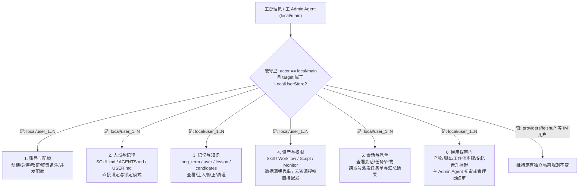

# 主管理员 Agent 统管自建普通用户全量信息与通用审核流设计规范

状态：**2026-10-25 需求与底座接口契约定稿，待底座实现**。

本文档定义 `my-agent` 底座中**主管理员（`local/main`）及其主 Agent 对管理员自建本地普通用户（`local/<user_id>`）的全量信息统管、人设与规则治理、跨账号任务派单及通用提审流（Universal Admin Review Gate）**的完整架构与 Plugin Host v2 接口规范，可直接作为底座增量开发与验收依据。

---

## 1. 核心边界：只管「主 Admin 自建本地普通用户」，IM 接入用户维持原样

在 `my-agent` 底座中，普通用户分为两个完全隔离的账号源（见 `user_space/user_auth.py` 与 `user_space/local_user_store.py`）：

| 维度 | 账号源 1：主 Admin 自建本地普通用户（受管用户） | 账号源 2：IM 接入普通用户（如飞书独立用户） |
| --- | --- | --- |
| **规范 `owner_id`** | `local/<user_id>`（由 `OwnerIdentity.local_user(uid)` 构造） | `providers/<provider>/users/<external_id>`（如 `providers/feishu/users/ou_xxx`） |
| **权威登记源** | `<host_root>/local_users/<user_id>.json`（`LocalUserStore`） | `identity/provider_identity/<provider>.jsonl` |
| **物理目录** | `<host_root>/owners/local/users/<user_id>/` | `<host_root>/owners/providers/<provider>/users/<external_id>/` |
| **统管关系** | **由 `local/main` 亲手创建并托管（`managed_by = "local/main"`）** | 外部渠道独立自然人接入，非 Admin 创建的分身/工号 |
| **人设与规则 (`SOUL`/`AGENTS`/`USER`)** | **开放主 Admin / 主 Admin Agent 全量读写、设定与锁定** | **维持原样不变**（仅限本人当场确认修改，Admin Agent 不可代改） |
| **记忆库 (`memory` / `candidates`)** | **开放主 Admin Agent 跨账号查看、注入、修正与候选驳回** | **维持原样不变**（本人自治） |
| **四大资产 (`workflow`/`monitor`/`script`/`skill`)** | 支持**主 Admin 直接配发/更新/启停**，也支持普通投递 | **维持原样不变**（仅支持[跨用户资产投递](CROSS_OWNER_ASSET_DELIVERY.md)并由本人确认接收） |
| **会话、任务与提审门** | **开放主 Admin Agent 跨账号派单、读取产物、配置通用提审拦截与批复** | **维持原样不变**（本人会话自治，无跨 Owner 派单与强制提审） |

### 1.1 权威判定守卫（`is_admin_managed_local_user`）

所有跨用户统管工具与 Host v2 接口在执行前，必须在底层统一经过一条纯结构化硬校验（不读取任何自然语言说明）：

1. **调用方身份**：当前运行上下文的真实 `actor_owner` 必须精确等于 `OwnerIdentity.local_main()`（`local/main`），且若来自 Agent 工具调用则必须为主代理（`current_subagent_run_id() is None`）；
2. **目标身份**：目标 `target_owner` 必须满足 `target_owner.kind == "local_user"`（即 `local/<user_id>`，排除 `local/main` 与一切 `providers/*`），且在 `LocalUserStore(host_root).get(user_id)` 中存在有效记录；
3. **拒绝越权**：若目标为 `providers/feishu/users/*` 等 IM 接入用户，或调用方本身是普通用户 `local/<user_a>` 试图管理 `local/<user_b>`，一律硬拒绝并返回 `MANAGED_USER_SCOPE_DENIED`（HTTP `403`）。

---

## 2. 主 Admin Agent 统管自建普通用户的 6 大全量信息域

对于通过上述守卫的自建本地普通用户 `local/<user_id>`，主管理员及主 Admin Agent 拥有以下 6 个维度的全量读写与管控权：



### 2.1 域一：账号属性、职责画像与运行配额（Account & Quotas）
- 在 `<host_root>/local_users/<user_id>.json`（`LocalUser`）中扩展可选受管元数据字段（向后兼容旧记录）：
  - `role_title: str`（职责名称，如 `"A平台内容巡检员"`、`"二线客服专员"`、`"数据清洗工号"`）；
  - `role_tags: list[str]`（分组标签，便于主 Admin Agent 按标签批量筛选或群发指令）；
  - `governance_policy: dict`（人设锁定模式与提审策略配置，见 2.2 与 2.6）。
- 支持主 Admin Agent 随时读取和调整该用户的 `quota.json`（并发任务上限、单日运行预算、允许使用的模型列表与最高思考档位）。

### 2.2 域二：人设、行为规则与背景设定（Persona：`SOUL.md` / `AGENTS.md` / `USER.md`）
- **放开受管写门**：在 `PersonaRepository`、`_persona_write_guard.py` 与 `agents_control_service.py` 中，新增受管用户治理分支——当 `actor_owner == "local/main"` 且目标为 `LocalUserStore` 中的 `local/<user_id>` 时，允许主 Admin Agent 通过工具或 Host v2 接口直接读取、全量覆写、按段更新或回滚目标用户的 `SOUL.md`、`AGENTS.md` 和 `USER.md`（强制携带 `expected_revision` CAS 与审计记录）。
- **三种人设管控模式（`persona_governance_mode`）**：
  1. `admin_locked`（管理员锁定）：目标用户的 `SOUL.md` 与 `AGENTS.md` 仅允许 `local/main` 修改；该普通用户本人在会话中要求修改时，系统明确拒绝并提示 `PERSONA_LOCKED_BY_ADMIN`。
  2. `admin_base_plus_user`（管理员底线 + 用户补充，默认推荐）：管理员设定的规则保存在不可被普通用户改动的置顶受管块，普通用户可维护自己的追加偏好段，渲染时合并注入且管理员底线优先级更高。
  3. `user_autonomous`（普通用户自治）：普通用户可自行修改，主 Admin Agent 仍可随时查看或覆盖。

### 2.3 域三：正式记忆与候选记忆全量治理（Memories & Candidates）
- 主 Admin Agent 可按 `target_user_id` 查询、搜索受管用户的正式记忆（`long_term`、`user`、`lesson`、`hot`）与待晋升候选（`candidates.jsonl`）。
- 支持主 Admin Agent 对受管用户执行：
  - **直接注入正式记忆（`inject_memory`）**：把业务基准事实、术语表或公共经验直接写入目标受管用户的正式记忆库（来源标记为 `admin_injected`，带完整版本 CAS）；
  - **修正或删除错误记忆（`update_memory` / `delete_memory`）**：发现下属普通用户的 Agent 记错业务规则或产生幻觉记忆时，直接修正或归档删除；
  - **代审记忆候选（`review_candidate`）**：批准或拒绝受管用户的待晋升记忆候选。

### 2.4 域四：四大一等公民资产与数据源权限统管（Assets, Datasources & Grants）
- 主 Admin Agent 可列出受管用户的全部 `workflow`、`monitor`、`script`、`skill`、数据源（`datasources`）及外部云资源授权（`tool_policy.json` 中的 `resource_grants`）。
- 针对自建受管普通用户，除支持[跨用户资产投递（需确认）](CROSS_OWNER_ASSET_DELIVERY.md)外，额外支持**「管理员直接配发与管控（Direct Provisioning）」**：
  - **直接安装/更新资产包（`provision_bundle`）**：将主 Admin 的工作流（含依赖的固定脚本与 Skill 闭包）直接同步写入受管用户的对应目录，无需等待受管用户手动点“接受”；
  - **直接启停与调度控制（`set_asset_enabled`）**：主 Admin Agent 可直接开启或紧急停用受管用户的某个定时监控（`monitor`）、工作流（`workflow`）或固定脚本（`script`）。

### 2.5 域五：会话、任务、长期目标与跨账号派单（Conversations, Tasks, Goals & Dispatch）
- **全景只读观察**：主 Admin Agent 可读取受管用户的会话列表、最近一次任务执行情况、工具调用链、长期目标（`goals`）及生成的文件产物（`artifacts`）。
- **跨账号任务派单（`dispatch_task_to_user`）**：
  - 主 Admin Agent 可向指定的一个或多个受管普通用户（`local/user_1..N`）直接发起新会话回合或指派后台任务（携带结构化来源 `origin_kind = "admin_dispatch"`、`dispatched_by = "local/main"`、`dispatch_id`）。
  - 目标受管用户的 Agent 按其自身设定的 `SOUL.md` / `AGENTS.md`、自有的资产与数据源独立执行该任务。
  - 执行完成后（或触发提审门挂起时），自动向 `local/main` 的督办账本回写结构化回执（含最终回复摘要、产出 `artifact_ids`、运行状态），供主 Admin Agent 汇总审阅。

### 2.6 域六：通用提审与批复门（Universal Admin Review Gate）
- 不绑定任何特定行业或“运营”概念，抽象为**通用跨用户提审协议**：
  - **可配置提审规则（`review_policy`）**：主 Admin 可为每个受管普通用户配置哪些条件必须进入 `pending_admin_review`：
    1. `require_review_on_scripts: list[str]`（指定脚本或 `"*"` 全部外发/变更类脚本执行前需提审）；
    2. `require_review_on_workflows: list[str]`（指定工作流或包含 `requires_admin_review=True` 节点的步骤执行前需提审）；
    3. `require_review_on_tools: list[str]`（指定高风险/外发工具调用前需提审）；
    4. `explicit_submission_enabled: bool`（允许受管用户的 Agent 主动调用 `submit_for_admin_review` 工具，将写好的报告、方案、代码或任意 `artifact_id` 提交给主 Admin 审核）。
  - **提审单生命周期（`ReviewTicket`）**：
    - `pending_admin_review` $\rightarrow$ 主 Admin Agent（或人类管理员）审阅；
    - **`approved`（批准放行）**：若关联了挂起的工作流步骤或脚本执行，自动恢复并继续执行；若关联产物，标记产物为 `admin_approved`；
    - **`rejected_with_feedback`（驳回重做）**：附带结构化修改意见 `feedback` 自动唤醒目标受管用户的原会话，让其 Agent 按批注修改后重新提审；
    - **`cancelled`（撤销）**：受管用户或管理员主动取消。

---

## 3. 存储结构与权威路径

遵循“一个概念一个权威位置”铁律，不污染 IM 用户目录：

```text
<host_root>/
|-- local_users/
|   `-- <user_id>.json                           # 权威本地普通用户记录（含 role_title、role_tags、governance_policy）
`-- owners/
    |-- local/
    |   |-- main/                                # 主管理员 (local/main)
    |   |   `-- data/
    |   |       `-- managed_users_governance/
    |   |           |-- dispatches.jsonl         # 主 Admin 向受管普通用户派发的任务督办账本
    |   |           |-- review_queue.jsonl       # 受管普通用户上报的通用提审队列（唯一权威审批账）
    |   |           `-- governance_audit.jsonl   # 跨受管用户改人设、改记忆、配发资产与审核批复的不可篡改审计账
    |   `-- users/
    |       `-- <user_id>/                       # 受管本地普通用户 (local/<user_id>)
    |           |-- SOUL.md                      # 受 governance_policy.persona_governance_mode 保护
    |           |-- AGENTS.md                    # 受 governance_policy.persona_governance_mode 保护
    |           |-- USER.md
    |           `-- data/
    |               `-- admin_reviews/
    |                   `-- my_submissions.jsonl # 本用户视角的提审回执投影与被打回修改意见
    `-- providers/
        `-- feishu/
            `-- users/
                `-- <open_id>/                   # IM 接入用户：完全不参与本统管机制，保持原有独立性
```

---

## 4. 主 Admin Agent 新增/扩展工具契约

在 `local/main` 主代理工具集中，扩展 `admin_controls` 或装配专用的管理员统管工具 `admin_managed_users`（仅 `local/main` 主代理可见，子代理与普通用户不可见）：

| 动作 (`action`) | 用途 | 关键参数 |
| --- | --- | --- |
| `get_user_overview` | 获取指定受管普通用户的全量快照（账号状态、人设摘要、记忆统计、四类资产数量、最近一次任务、待审单数） | `user_id` |
| `set_governance_policy` | 设置受管用户的职责名、标签、人设锁定模式（`admin_locked` / `admin_base_plus_user` / `user_autonomous`）与提审拦截规则 | `user_id`, `role_title`, `role_tags`, `persona_governance_mode`, `review_policy` |
| `read_user_persona` / `write_user_persona` | 读取或直接设定受管用户的 `SOUL.md`、`AGENTS.md`、`USER.md` | `user_id`, `target_file` (`soul`/`agents`/`user`), `content`, `expected_revision` |
| `list_user_memories` / `mutate_user_memory` | 查看受管用户的正式/候选记忆，或直接注入、修改、删除记忆 | `user_id`, `operation` (`inject`/`update`/`delete`/`approve_candidate`/`reject_candidate`), `payload` |
| `list_user_assets` / `provision_user_assets` | 查看受管用户的四类资产，或将主 Admin 的资产（含依赖闭包）直接同步配发/启停到受管用户 | `user_id`, `root_asset_ref`, `include_closure`, `enable_immediately` |
| `dispatch_task` | 向一个或多个受管普通用户的 Agent 派发任务指令（新建会话或续接指定会话） | `user_ids`, `title`, `instruction`, `thread_id` (可选), `require_review_before_finish` |
| `inspect_dispatches` | 查看已派发给各受管用户的任务进度、最新回复与产物列表 | `dispatch_id` (可选), `user_id` (可选), `status` |
| `list_review_queue` | 查看受管普通用户提交的待审队列（`pending_admin_review`） | `user_id` (可选), `review_kind` (可选), `status` |
| `decide_review` | 主 Admin Agent（或代管理员）对提审单执行批准放行（`approve`）或附批注驳回重做（`reject_with_feedback`） | `review_id`, `decision` (`approve`/`reject_with_feedback`), `feedback`, `expected_revision` |

同时，在受管本地普通用户（`local/<user_id>`）的 Agent 工具集中提供轻量提审工具 `submit_for_admin_review`：
- 当受管用户的 Agent 完成了某项重要产出（`artifact_id`）或准备执行需要管理员把关的操作时，可主动调用该工具生成 `ReviewTicket` 并挂起等待主 Admin（或主 Admin Agent）批复。

---

## 5. 底座需开放的 Plugin Host v2 接口清单（12 个标准动作）

为了让管理员在 Web 控制台或插件中可视化管理所有自建普通用户的全量信息、批量设定人设、派单督办与审核批复，在 `agent_py_agent/agent/plugin_host/action_specs_v2_ext.py` 中新增以下 **12 个标准动作**（全部强制要求调用方为 `local/main` 且目标属于 `LocalUserStore`）：

| 序号 | 动作名 (`action`) | 模式 | 所需能力 (`capability`) | 功能说明 |
| --- | --- | --- | --- | --- |
| 1 | `users.managed.overview.get` | `read` | `users.manage` | 获取单个或全部自建受管普通用户的全量概览（账号画像、人设修订号、记忆数、四类资产数、最近一次任务情况、待审数量） |
| 2 | `users.managed.policy.set` | `write` | `users.manage` | 更新受管普通用户的 `role_title`、`role_tags`、`persona_governance_mode`（是否锁定人设）及 `review_policy`（提审规则） |
| 3 | `users.managed.persona.get` | `read` | `users.manage` | 读取受管普通用户的 `SOUL.md`、`AGENTS.md`、`USER.md` 全文、版本 `revision` 与锁定状态 |
| 4 | `users.managed.persona.set` | `write` | `users.manage` | 直接写入或更新受管普通用户的 `SOUL.md`、`AGENTS.md`、`USER.md`（带 `expected_revision` CAS 与 `idempotency_key`） |
| 5 | `users.managed.memories.list` | `read` | `users.manage` | 分页查询受管普通用户的正式记忆（`long_term`/`user`/`lesson`/`hot`）与候选记忆（`candidates`） |
| 6 | `users.managed.memories.mutate` | `write` | `users.manage` | 对受管普通用户注入新记忆、修正/删除既有记忆或审批记忆候选 |
| 7 | `users.managed.assets.provision` | `write` | `users.manage` | 将管理员选定的 `workflow`/`monitor`/`script`/`skill`（自动连带依赖闭包）直接配发安装到受管普通用户目录，并可指定初始启停状态 |
| 8 | `users.managed.assets.toggle` | `write` | `users.manage` | 直接开启或关闭受管普通用户名下的指定工作流、定时监控、固定脚本或 Skill |
| 9 | `users.managed.tasks.dispatch` | `write` | `users.manage` | 向一个或多个受管普通用户派发任务指令，返回 `dispatch_id` 与目标会话 `thread_id` |
| 10 | `users.managed.tasks.list` | `read` | `users.manage` | 查询跨受管用户派单的执行进度、最新回复摘要与关联产物（`artifacts`） |
| 11 | `governance.reviews.list` | `read` | `users.manage` | 查询受管普通用户上报的通用提审队列（支持按 `user_id`、`status`、`review_kind` 过滤） |
| 12 | `governance.reviews.decide` | `write` | `users.manage` | 批准（`approve`，自动唤醒续跑被挂起的脚本/工作流）或驳回（`reject_with_feedback`，附修改意见唤醒原受管用户 Agent 重做）指定提审单 |

> **与现有 `act_as_user` 接口的协同**：除了上述 12 个专门用于跨用户统管、人设锁定、直接配发与提审队列的新接口外，管理员插件原有的 `as_user: {"user_id": "<uid>"}` 机制继续保留，可直接复用现有的 40+ 个会话、历史、数据源和任务详情接口查看任一受管用户的细粒度运行数据。

---

## 6. 建议分步实施顺序（供底座开发使用）

1. **Step 1（受管身份守卫与策略模型）**：在 `user_space/local_user_store.py` 扩展 `role_title`、`role_tags`、`governance_policy`，实现统一守卫 `assert_admin_managing_local_user(actor_owner, target_owner)`，确保只允许 `local/main` 统管 `LocalUserStore` 中的自建用户，100% 排除 `providers/*` IM 用户。
2. **Step 2（跨受管用户人设与记忆读写）**：在 `PersonaRepository`、`_persona_write_guard.py` 与 `memory_store` 中打通 `local/main -> local/<user_id>` 的受管读写与 `admin_locked` 写保护。
3. **Step 3（跨受管用户资产直接配发与派单督办）**：复用 `CROSS_OWNER_ASSET_DELIVERY.md` 的依赖闭包打包器，增加针对受管用户的免确认直接配发入口 `provision_bundle` 与跨账号会话派单服务。
4. **Step 4（通用提审队列 `ReviewQueueService` 与断点续跑联动）**：实现 `review_queue.jsonl` 状态机，打通脚本/工作流步骤挂起、主 Admin Agent 调用 `decide_review` 审批放行或打回重做闭环。
5. **Step 5（装配主 Admin Agent 工具与 12 个 Host v2 动作）**：注册工具与 Host v2 动作并补齐隔离单测（重点验证：主 Admin 管自建 `local/<uid>` 全通、主 Admin 试图用该接口改 `providers/feishu/users/<id>` 必拒、普通用户 `local/u1` 试图管 `local/u2` 必拒）。
