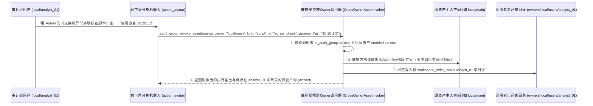
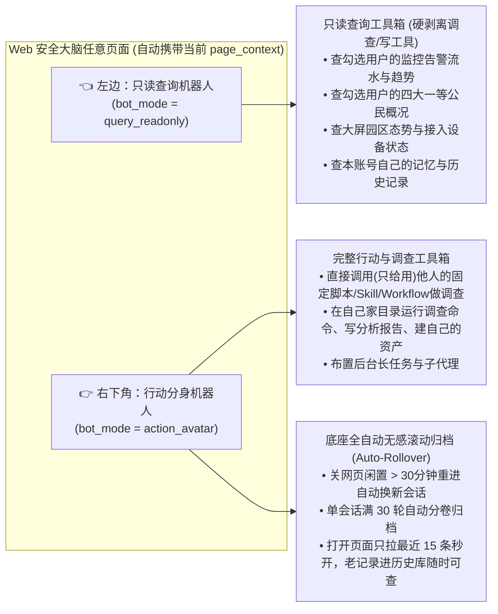

# Web 安全大脑：审计组（`audit_group`）只读汇总、一等公民「只给用不给拿」与页面左右双机器人完整设计规范

状态：**2026-10-25 需求与底座接口契约定稿（整合并一版），待底座实现**。

本文档将以下四项紧密咬合的需求完整合并为**同一份底座与插件接口设计规范**，可直接交给底座 Agent 一次性落地实现：
1. **Admin 自建普通账号纯 Web 约束与「审计组（`audit_group`）」只读视野**（勾选合并看他人一等公民概况、看监控跑出的告警、看大屏/园区/接入设备态势，日常操作权限仍为普通用户）；
2. **审计组对他人四大一等公民「只给用、不给拿（Use-Only / Blackbox Invoke）」机制**（调查时可直接调用别人的固定脚本、Skill、Workflow 和单次复核监控，结果落自己家目录，不复制源码、不看内部细节、不改原件）；
3. **Web 页面「左右双机器人」架构**（左边：本用户只读查询机器人，挂载审计组只读查询工具箱、剥离调查与写工具；右下角：本用户干活分身 Agent，可拿着别人的固定脚本和 Skill 开展调查、布置任务）；
4. **聊天记录「底座全自动无感滚动归档（Auto-Rollover）+ 页面秒开 + 历史随时可查」**（无需用户手动清理，久用不卡浏览器、不影响其他用户）。

---

## 1. 账号边界与「审计组（`audit_group`）」权限模型

### 1.1 核心硬规则
1. **Admin 创建的本地普通账号一律不绑定飞书（纯 Web 账号）**：
   - 所有通过 `admin`（`local/main`）创建的本地普通用户（`local/<user_id>`，登记于 `<host_root>/local_users/<user_id>.json`），在底座层面硬性固定为**仅限 Web 接口访问（`allowed_channels = ["web"]`, `im_binding_allowed = false`）**，飞书及 IM 通道绑定层直接拒绝绑定。
2. **「审计组（`audit_group`）」身份标记**：
   - `admin` 在创建或管理本地普通账号时，通过布尔开关 `in_audit_group: true | false` 将账号加入或移出审计组。
3. **基础写/操作权限 = 100% 普通用户**：
   - 审计组账号只能在**自己独立的家目录（`owners/local/users/<user_id>/`）**里对话、临时处理事务、保存自己的调查产物或自建少量资产；
   - **严禁修改、启停、删除其他任何用户（含 `admin`）的资产，严禁读取或复制其他用户家目录里的私有文件、数据源明文密钥或私人聊天记录**。
4. **进入 `audit_group` 额外获得的「3 项只读视野 + 1 项受控调用权」**：
   - **只读视野 ①（四大一等公民概况合并展示，不给看细节）**：可勾选任意目标账号（含 `admin` 及其他用户），合并查看他们名下的 **监控（`monitor`）、工作流（`workflow`）、固定脚本（`script`）、技能（`skill`）** 的表层概况（名称、类型、功能简介、入参说明、所属人、启用状态、运行次数、最近执行时间与状态码）；**底座硬性裁剪并屏蔽脚本源码、SKILL 正文、工作流内部步骤详细 Prompt 与私有凭据**。
   - **只读视野 ②（监控与一等公民告警流水合并展示）**：可按勾选的账号合并查看监控（及关联一等公民）跑出来的**告警记录与异常摘要**。
   - **只读视野 ③（安全大脑大屏、园区态势与接入设备情况）**：可查看全局大屏态势、园区概览、接入设备在线/告警状态等公共态势数据。
   - **受控调用权 ④（四大一等公民「只给用、不给拿」）**：在调查告警时，审计组成员（及其右下角分身机器人）可直接**调用执行**其他账号已启用的一等公民（固定脚本、Skill、Workflow、监控单次复核），跑出的结果落在自己家目录，但不复制原资产、不暴露内部源码细节。

### 1.2 权限对比总表

| 能力维度 | 普通本地账号 (`in_audit_group = false`) | 审计组账号 (`in_audit_group = true`) | 主管理员 (`local/main`) |
| --- | --- | --- | --- |
| **登录入口** | 仅 Web 接口（无飞书入口） | 仅 Web 接口（无飞书入口） | Web + TUI/CLI + 飞书 |
| **操作自己家目录** | 读写自如（个人会话、临时处理、自建资产） | 读写自如（个人会话、临时处理、自建资产） | 读写自如 |
| **看大屏（园区/接入设备态势）** | 默认仅看个人工作台 | **可看（拥有 `audit_group` 态势视野）** | 可看 |
| **勾选合并看他人监控产生的告警** | 不可看（仅看自己） | **可看（含 `admin` 与其他用户的告警流水）** | 可看 |
| **勾选合并看他人四大一等公民概况** | 不可看（仅看自己） | **可看概况（名称/状态/入参说明，不含源码细节）** | 可看全量详情 |
| **看他人一等公民内部细节（源码/SKILL正文）** | 禁止 | **禁止（底座接口硬性裁剪）** | 允许 |
| **拿着他人的固定脚本/Skill/Workflow 做调查** | 禁止（除非对方主动投递） | **允许「只给用、不给拿」（黑盒调用，结果落自己家目录）** | 允许 |
| **读取他人家目录文件/密钥/私人聊天** | 禁止 | **禁止** | 按管理员规则受控 |
| **修改/启停/删除他人监控或一等公民** | 禁止 | **禁止** | 允许（对受管用户） |

---

## 2. 四大一等公民「只给用、不给拿（Use-Only / Blackbox Invoke）」机制

针对审计组成员在右下角分身机器人或页面上使用其他用户（含 `admin`）的固定脚本、Skill、Workflow、监控开展调查的场景，底座遵循 **「原件不动、细节不漏、受控执行、结果归己」** 四条铁律：



### 2.1 四类一等公民各自的「只给用」方式

1. **固定脚本（`script`）—— 黑盒传参调用**：
   - 审计组能看到脚本的名称、用途描述、入参定义（`parameters_schema`）；
   - 调用时传入参数（如告警 IP、设备 ID、时间窗），底座在受控沙箱中运行该脚本（若脚本绑定了原主人的只读受控数据源句柄，按原脚本声明的只读查询执行并对输出自动做凭据脱敏）；
   - **脚本的工作目录与一切输出文件、生成的 `Artifact` 强制写入当前审计组用户自己的家目录**；审计组用户看不到脚本的 Python/Shell 源码。
2. **技能（`skill`）—— 运行时受控注入（不落盘、不回显原文）**：
   - 当审计组右下角分身机器人需要借用他人的某个调查 `Skill`（如《园区门禁异常研判指南》）时，通过受控调用句柄在模型组装上下文阶段将 `SKILL.md` 规程作为内部系统级指令挂载到本轮推理中；
   - **不允许调用 `read_file` 直接读取他人 `skills/` 目录文件，也不将他人 `SKILL.md` 原文复制到自己家目录**。
3. **工作流（`workflow`）—— 整条工作流受控触发，步骤产物落自己家目录**：
   - 审计组成员可传入工作流所需的输入参数，触发一次该工作流的受控运行；
   - 工作流运行记录（`WorkflowRun`）与各步骤产出的报告全部归属并保存在**当前审计组用户自己的家目录**下。
4. **定时监控（`monitor`）—— 只看告警 + 按需单次复核（`run_once_verify`）**：
   - 监控本体仍在原主人名下按原计划运行（不会复制到 10 个审计组账号下重复跑 10 遍）；
   - 当审计组成员处理完某条告警想验证是否已恢复时，可对该监控发起一次 **`run_once_verify`（单次即时复核）**，复核结果返回给当前审计组用户并记入其自己的调查会话。

---

## 3. Web 页面「左右双机器人」架构与自动无感归档

每个 Web 页面同时提供两个归属当前登录用户（`effective_owner`）的机器人助手，通过线程元数据中的结构化字段 `bot_mode` 在底座运行时严格区分工具集与生命周期：



### 3.1 左边机器人：本用户只读查询参谋（`bot_mode = "query_readonly"`）

1. **底座硬门裁剪（不靠 Prompt 软约束）**：
   - 当会话线程 `bot_mode == "query_readonly"` 时，底座在构建 `ToolRuntimeSnapshot` 时**硬性只保留纯只读查询工具**，**物理剔除一切调查执行类工具与修改类工具**：
     - ❌ **剔除**：`run_command` / `bash`、脚本执行、工作流执行、浏览器录制/操控、`write_file` / `edit_file`、创建/修改资产、派发子代理（`subagents`）。
     - ✅ **保留（普通用户基础只读）**：`self_map`、查本人资产列表、查本人记忆（`memory` 只读）、查本人任务与产物状态。
     - ✅ **自动扩展（当用户 `in_audit_group == true` 时自动挂载「审计组只读工具箱」）**：
       - `audit_group_query_alerts`：查询/统计勾选用户（或全网）的监控告警流水、高危告警汇总、时间趋势；
       - `audit_group_query_assets_summary`：查询勾选用户的监控、Workflow、固定脚本、Skill 概况与最近运行状态（不含源码细节）；
       - `audit_group_query_posture`：查询大屏园区态势、接入设备在线/异常分布。
2. **零记忆污染**：
   - `query_readonly` 会话固定标记 `learning_excluded = true`，高频日常提问不会生成候选记忆垃圾。

### 3.2 右下角机器人：本用户行动分身（`bot_mode = "action_avatar"`）

1. **工具权限**：
   - 拥有当前用户完整的正常 Agent 工具权限（可在自己家目录跑调查工具、读写自己家目录文件、创建自己的监控/脚本、布置后台任务）；
   - 当用户 `in_audit_group == true` 时，额外挂载 **`audit_group_invoke_asset`** 工具，允许分身直接拿着别人已启用的固定脚本、Skill、Workflow（或单次复核监控）去调查告警，并将调查结果落盘到自己家目录。
2. **页面上下文自动感知（`page_context`）**：
   - 前端在任何页面通过左边或右下角机器人发消息时，请求体可附带结构化 `page_context`（当前页面 ID、当前顶部勾选的 `selected_owner_ids`、当前点击聚焦的 `alert_id` 或 `asset_ref`）；机器人无需用户手敲 ID 即可直接针对当前正在看的告警或监控回答与调查。

### 3.3 聊天记录「全自动无感滚动归档（Auto-Rollover）+ 页面秒开 + 历史可查」

为彻底解决**“用户不懂手动清理、用久了文字几十万字导致打开网页巨慢、但同时历史记录又必须能查到”**的问题，底座在会话管理层实现**全自动滚动换新机制**：

1. **为什么不会影响其他用户？**
   - 每个用户的会话文件存放在各自独立的 `<owner_home>` 下，且消息拉取接口有单页字节上限（`PAGE_MAX_BYTES`），单用户记录再多也不会阻塞其他用户。
2. **底座自动换新规则（无需用户点任何清理按钮）**：
   - 当网页调用 `conversations.bots.ensure`（打开/刷新网页）或 `conversations.requests.submit`（发送新消息）时，底座自动检查当前机器人活跃会话（`readonly_bot_thread` 与 `active_avatar_thread`）：
     - **规则 A（关网页闲置自动换新）**：若距离该会话上一轮消息完成已超过 **`idle_rollover_seconds`（默认 `1800` 秒，即关网页离开 30 分钟以上再回来）**，且当前无正在运行的前台回合，底座**自动将该旧会话标记为 `avatar_state = "archived"`（自动取首条任务或总结作为会话标题，如 `[10-25 22:40] 调查东区交换机外联告警`），并自动创建返回一个全新的空白活跃会话**。
     - **规则 B（单次长聊自动分卷）**：若用户连续对话使单会话累计达到 **`max_turns_per_session`（默认 `30` 轮）或消息正文累计超过 `32 KiB`**，在当前回合结束后底座同样自动将其归档分卷，无缝切换到新会话（可自动携带简短的 `rollover_summary` 衔接上下文）。
     - **规则 C（后台任务不断连）**：旧分身会话被自动归档换新时，若其中有之前布置的后台长任务或子代理仍在运行，**后台任务继续执行到底并正常产出 `Artifact`**，绝不会因为界面换新而被误杀。
3. **打开网页永远秒开（默认仅内联最近 15 条消息）**：
   - `conversations.bots.ensure` 返回当前活跃会话时，默认只内联返回最新 `recent_messages_limit = 15` 条消息（约几千字），浏览器 DOM 永远轻量、毫秒级渲染。
4. **历史记录 100% 可查可搜**：
   - 所有被自动归档的老会话完整保存在该用户自己的会话库中；前端点开机器人窗口右上角的 **「🕒 历史记录 / 搜索」**，即可调用 `conversations.bots.history.list`（或现有的 `conversations.turns.search`）按时间、关键词、关联告警查看以往任意一次调查对话和生成的报告。

---

## 4. 存储结构与权威字段扩展

全部复用现有单点权威存储，不引入平行冗余状态表：

1. **本地用户存储（`<host_root>/local_users/<user_id>.json`）**：
   ```json
   {
     "user_id": "analyst_01",
     "display_name": "安全值班员01",
     "status": "enabled",
     "in_audit_group": true,
     "allowed_channels": ["web"],
     "im_binding_allowed": false,
     "revision": 2
   }
   ```
2. **会话线程元数据（`<owner_home>/conversations/threads/<thread_id>.json` 的 `metadata.plugin_host_v2`）**：
   ```json
   {
     "bot_mode": "query_readonly | action_avatar | standard",
     "bot_slot_state": "active | archived",
     "auto_rollover_reason": "idle_timeout | turn_limit | manual",
     "last_page_context": {
       "page_id": "monitors",
       "selected_owner_ids": ["local/main", "local/alice"],
       "focused_alert_id": "alt_20261025_9912a"
     }
   }
   ```

---

## 5. 底座需开放的 Plugin Host v2 接口总表（10 个标准动作）

在 `agent_py_agent/agent/plugin_host/action_specs_v2_ext.py` 与 `capabilities_v2_handlers.py` 中集中新增以下 **10 个标准动作**（前 6 个负责审计组管理、只读汇总与「只给用」受控调用；后 4 个负责页面左右双机器人自动初始化、自动滚动换新与历史检索）：

| 序号 | 动作名 (`action`) | 模式 | 调用方权限要求 | 功能说明 |
| --- | --- | --- | --- | --- |
| **1** | `users.local.audit_group.set` | `write` | 仅 `local/main` 管理员 | 将本地普通用户加入或移出审计组（`in_audit_group: true \| false`，支持创建用户时直接指定） |
| **2** | `audit_group.owners.list` | `read` | `audit_group` 成员或 `admin` | 列出可供勾选合并展示的账号清单（含 `local/main` Admin 与其他用户）及各自四类一等公民数、近 24h 告警数 |
| **3** | `audit_group.assets.summary` | `read` | `audit_group` 成员或 `admin` | 按勾选的 `owner_ids` 合并返回四大一等公民（`monitor`/`workflow`/`script`/`skill`）的**概况列表与入参 Schema**（**硬性剔除源码、SKILL 正文、工作流内部提示词与私有凭据**） |
| **4** | `audit_group.alerts.list` | `read` | `audit_group` 成员或 `admin` | 按勾选的 `owner_ids`、时间窗、级别合并返回各账号一等公民（主要是监控）跑出的**告警记录流水与统计** |
| **5** | `audit_group.posture.overview` | `read` | `audit_group` 成员或 `admin` | 返回安全大脑公共大屏数据（园区态势概览、接入设备在线/异常分布、全局监控覆盖率） |
| **6** | `audit_group.assets.invoke` | `write` | `audit_group` 成员或 `admin` | **一等公民「只给用、不给拿」受控调用接口**：传入目标 `(source_owner_id, kind, asset_id, input_params)`，在沙箱中受控调用他人的固定脚本、Workflow、Skill 或单次复核监控；**执行结果与产物强制落盘到当前调用者自己的家目录**，不返回源码 |
| **7** | `conversations.bots.ensure` | `write` | 当前登录用户 (`conversations.write`) | 打开页面时调用：自动执行闲置/超长检测（超 30 分钟闲置或满 30 轮自动归档旧会话并换新），返回当前用户的 **左边只读机器人活跃会话（`readonly_bot`）** 与 **右下角分身活跃会话（`action_avatar`）** 及各自最近 15 条消息 |
| **8** | `conversations.bots.submit` | `write` | 当前登录用户 (`conversations.write`) | 向左边只读机器人或右下角分身发送消息（可复用或包装 `conversations.requests.submit`），支持传入 `bot_mode`（双重强校验工具裁剪）与 `page_context`（当前页面勾选用户与聚焦告警/资产） |
| **9** | `conversations.bots.rollover` | `write` | 当前登录用户 (`conversations.write`) | 手动或前端触发将当前 `readonly_bot` 或 `action_avatar` 会话立即归档并切换到一个全新空白会话（后台运行中的任务保持继续执行） |
| **10** | `conversations.bots.history.list` | `read` | 当前登录用户 (`conversations.read`) | 分页查询与搜索当前用户已自动归档的历史只读问答会话与历史分身调查会话（含自动生成的任务标题、时间范围、关联告警 ID 与产出 `Artifact` 列表） |

---

## 6. 关键接口契约示例

### 6.1 `conversations.bots.ensure`（打开网页时自动检查换新并秒开返回双机器人）
- **Request Payload**:
  ```json
  {
    "idle_rollover_seconds": 1800,
    "max_turns_per_session": 30,
    "recent_messages_limit": 15,
    "page_context": {
      "page_id": "security_brain_dashboard",
      "selected_owner_ids": ["local/main", "local/alice", "local/bob"]
    }
  }
  ```
- **Response Data**:
  ```json
  {
    "owner_id": "local/analyst_01",
    "in_audit_group": true,
    "readonly_bot": {
      "thread_id": "thread-ro-901a2b",
      "bot_mode": "query_readonly",
      "rolled_over": true,
      "previous_archived_thread_id": "thread-ro-771e0c",
      "allowed_tool_categories": ["self_query", "audit_group_readonly"],
      "recent_messages": []
    },
    "action_avatar": {
      "thread_id": "thread-av-334f1d",
      "bot_mode": "action_avatar",
      "rolled_over": false,
      "turn_count": 4,
      "active_background_tasks": 1,
      "recent_messages": [
        {
          "role": "user",
          "text": "用 Admin 的核心交换机排查脚本查一下 10.20.1.2"
        },
        {
          "role": "assistant",
          "text": "已调用 [Admin]《核心交换机异常外联排查脚本》完成排查，调查报告已生成在您的个人目录：artifact-8821。"
        }
      ]
    },
    "archived_sessions_count": 18
  }
  ```

### 6.2 `audit_group.assets.invoke`（右下角分身或页面直接「只给用」调用他人固定脚本/Skill/Workflow）
- **Request Payload**:
  ```json
  {
    "source_owner_id": "local/main",
    "asset_kind": "script",
    "asset_id": "sc_sw_outbound_check",
    "input_params": {
      "device_ip": "10.20.1.2",
      "window_minutes": 15
    },
    "bind_avatar_thread_id": "thread-av-334f1d"
  }
  ```
- **Response Data**:
  ```json
  {
    "invocation_id": "inv_20261025_5512c",
    "source_asset": {
      "owner_id": "local/main",
      "owner_display_name": "管理员 (Admin)",
      "kind": "script",
      "id": "sc_sw_outbound_check",
      "name": "核心交换机异常外联排查脚本",
      "source_code_exposed": false
    },
    "caller_owner_id": "local/analyst_01",
    "output_workspace_owner": "local/analyst_01",
    "status": "succeeded",
    "result_summary": "设备 10.20.1.2 在过去 15 分钟内存在 1,420 次发往未知 IP 198.51.100.77:4444 的异常连接，疑似失陷信标外联。",
    "generated_artifacts": [
      {
        "artifact_id": "art_analyst01_9921",
        "owner_id": "local/analyst_01",
        "title": "10.20.1.2_异常外联排查结果.json"
      }
    ]
  }
  ```

---

## 7. 底座代码落地模块清单（供底座开发直接对照）

| 模块路径 | 改动职责 |
| --- | --- |
| `agent_py_agent/agent/user_space/local_user_store.py` | `LocalUser` 新增 `in_audit_group: bool = False`，强制固化本地普通用户 `allowed_channels = ("web",)`、`im_binding_allowed = False` |
| `agent_py_agent/agent/audit_group/observation_service.py` | **新增**：审计组跨 Owner 一等公民概况白名单裁剪器（严禁返回源码与凭据）、跨 Owner 监控告警流水聚合器、园区/接入设备态势只读投影 |
| `agent_py_agent/agent/audit_group/cross_owner_invoker.py` | **新增**：四大一等公民「只给用不给拿」受控调用器，内部加载原资产执行，强制将 `workspace_write_root` 与 `artifact_owner` 绑定到当前审计组调用者自己的家目录 |
| `agent_py_agent/agent/tooling/registry.py` | 支持 `bot_mode == "query_readonly"` 时在 `ToolRuntimeSnapshot` 硬性剥离所有 `mutating` 及调查/命令/脚本执行工具，并按 `in_audit_group` 自动挂载审计组只读查询工具箱或 `audit_group_invoke_asset` 工具 |
| `agent_py_agent/agent/plugin_host/dual_bots_service.py` | **新增**：实现 `conversations.bots.ensure` / `submit` / `rollover` / `history.list`，内置 30 分钟闲置与 30 轮对话自动无感归档（Auto-Rollover）及最近 15 条消息轻量切片 |
| `agent_py_agent/agent/plugin_host/action_specs_v2_ext.py` | 注册上述 10 个标准 Host v2 动作及其闭合 Schema |
| `agent_py_agent/tests/test_audit_group_and_dual_bots.py` | **新增**：覆盖本地用户禁飞书绑定、审计组跨用户看概况（断言无源码泄露）与告警、右下角分身「只给用」调用他人脚本且产物落自己家目录、左边机器人硬拦截调查工具、会话闲置/满轮自动无感归档且历史可查的完整单测 |
