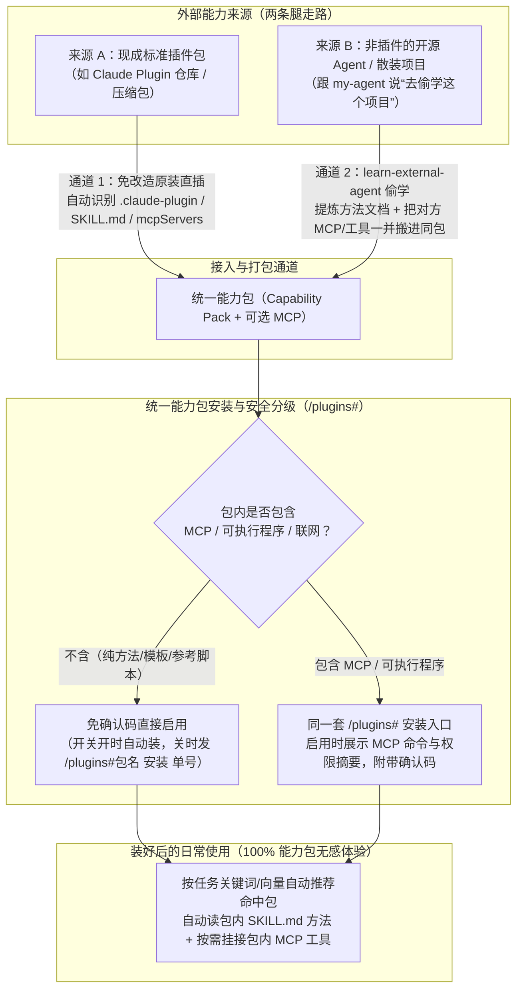

# 能力包内置 MCP 合一与外部插件（Claude Plugin / 开源 Agent）双轨接入设计

> 状态：**2026-11-05 用户确认方向（设计定稿，待排期实施）**。
> 关联背景：承接并演进 [学外部 agent 做成能力包 (`LEARN_TO_PACK.md`)](LEARN_TO_PACK.md)、[能力包使用说明 (`CAPABILITY_PACK_GUIDE.md`)](../guides/CAPABILITY_PACK_GUIDE.md)、[插件与安全开关说明 (`PLUGIN_GUIDE.md`)](../guides/PLUGIN_GUIDE.md) 与 [MCP 连接生命周期 (`MCP_TRANSPORT_LIFECYCLE.md`)](MCP_TRANSPORT_LIFECYCLE.md)。

---

## 一、背景与要解决的核心痛点

### 1.1 外部生态（Claude Code）的做法
在 Claude Code 生态中，扩展分为两层：
- **`Skill` (`SKILL.md`)**：单项任务的步骤说明书（含 `SKILL.md`、参考文档 `references/`、模板 `templates/`、脚本 `scripts/`）。
- **`Plugin` (`.claude-plugin/plugin.json`)**：统一的**打包与安装容器**。一个 Plugin 包内可以同时装入：
  1. 多个 `Skills`（方法说明）；
  2. `Commands` / `Subagents`（命令与子代理定义）；
  3. `Hooks`（工具执行前/后的确定性拦截脚本）；
  4. **`MCP Servers`（`mcp.json` / `mcpServers` 外部或随包工具进程）**。
- 用户看到别人分享的插件仓库时，直接通过 `claude plugin marketplace add <owner/repo>` + `claude plugin install <name>@<repo>` 原样安装，无需手动改造。

### 1.2 我们 `my-agent` 现有的割裂与痛点
在 `my-agent` 现有实现中，底层虽然共用同一张安装表 `PluginInstallStore` 和 `plugin.json`，但在上层人为拆成了两个互斥的概念：
1. **能力包（`plugin_package.v7`，命令 `/plugins#<包名>`）**：
   - 具备**按任务关键词/语义自动推荐**、入口文档（`CAPABILITY.md`）、多 `SKILL.md`、工作流（`workflows/`）、脚本（`scripts/`）及同领域合并能力；
   - **但硬性禁止包含可执行程序或 MCP 服务（`is_content_only = True`）**。
2. **插件（`plugin_package.v6 / v8`，命令 `/plugins@<插件ID>`）**：
   - 具备 **MCP stdio 进程（`MCPStdioClient`）**、工具注册、面板与工具把关（`tool_gate`）；
   - **但没有能力包的“按任务自动推荐、入口手册、同领域合并”能力**，且声明结构与能力包不互通（在 `LEARN_TO_PACK.md` 生产实测中，模型给自己打包插件时曾因能力包字段与插件字段互斥而连续失败）。
3. **拿外部能力时必须“先改造”**：
   - 遇到别人已经写好的标准 Claude Plugin 仓库，不能直接原样安装，必须手工或让 `learn-external-agent` 重新改写成 `my-agent` 专有格式；
   - 遇到带 MCP 工具的外部 Agent，能力包收不下 MCP，被迫把“方法”和“工具”拆成两份分开装、分开管。

---

## 二、核心设计原则：统一外壳（能力包方式）+ 内置可选 MCP + 双轨接入

用户的最终体验完全统一为 **「能力包方式 (`/plugins#`)」**：不再强迫用户或模型在“这是能力包还是插件”之间做二选一，**所有能力包既可以只装静态方法，也可以在同一个包里直接带上 MCP 工具服务**。

---

## 三、双轨接入场景详解

### 场景 1：别人本来就是现成插件（如 Claude Plugin） $\rightarrow$ 「免改造直接装」
当看到社区（如 GitHub / X）分享的现成 Claude Plugin 或 Skill 仓库时，**不再需要人工改造或让 AI 重写一遍**：
1. **自动识别原包结构**：
   - 导入器直接读取原仓库/目录中的 `.claude-plugin/plugin.json`、`skills/*/SKILL.md`、`commands/*.md`、`hooks/` 以及 `mcp.json`（或 `mcpServers` 声明）。
2. **自动生成统一能力包元数据**：
   - 从原包的 `description` 和 `SKILL.md` frontmatter 自动提取 `capability`（`description`、`keywords`、自动生成或映射 `entry_document`）；
   - 将原包的 `mcpServers` 转换为能力包内的结构化 `mcp_servers` 声明；
   - 计算所有成员文件的 `sha256` 并封装为标准能力包。
3. **能力包方式一键安装**：
   - 直接进入 `/plugins#` 能力包列表管理。

### 场景 2：别人不是插件（独立开源 Agent / 散装代码） $\rightarrow$ 「直接偷学，连方法带 MCP 一锅端进同一个包」
当看到一个优秀的垂直领域 Agent（例如写短剧、做安全审计、跑数据分析的开源项目），它不是标准插件但你想把它的本事拿过来时：
1. **偷学不再“丢手脚”**：
   - `learn-external-agent` 不仅把对方的提示词、工作流、模板、检查清单提炼成包里的 `CAPABILITY.md` 和 `SKILL.md`；
   - **如果对方项目里带有 MCP 服务，或者有核心工具脚本需要封装成 MCP 工具，直接一并放进同一个能力包里**（不再像以前那样因为能力包不准带进程而被迫丢弃或拆成另一个插件）。
2. **同领域合并连带 MCP 一起演进**：
   - 当偷学第二个同领域 Agent 并选择“合并进已有能力包”时，新方向的 `SKILL.md` 方法与新增的 MCP 工具一起并入 `v0.2.0`，退回上一版（`/plugins#<包名> 退回`）时连同文档和 MCP 工具一起干净回退。

---

## 四、统一后的安装、确认与使用体验（全部走「能力包方式」）

### 4.1 怎么装（统一 `/plugins#` 入口）

| 来源与包类型 | 安装命令 / 交互方式 | 安全确认要求 |
| :--- | :--- | :--- |
| **偷学来的包（纯方法，无 MCP）** | 开关开：自动装上并提示 开关关：发 `/plugins#<包名> 安装 <单号>` | 无需额外确认码，发单号即启用 |
| **偷学来的包（带搬过来的 MCP）** | 发 `/plugins#<包名> 安装 <单号>`（或带确认码） | 回执用大白话写明：**“本能力包带有 MCP 服务：`[启动命令]`，是否联网：`[是/否]`”**，确认一次即连同 MCP 一起启用 |
| **外部现成 Claude Plugin 直装** | `/plugins install <本地目录/包或仓库>` | 自动入列 `/plugins#`；若含 MCP，启用时展示同样的确认码 |

### 4.2 装好后怎么用（零命令负担）
1. **主代理自动匹配**：
   - 用户不需要背 `/plugins@xxx` 这种插件指令；
   - 平时正常用自然语言派任务，宿主按能力包的关键词/语义向量命中该能力包后：
     - **脑子就位**：模型通过 `skill_search` 读取包内 `CAPABILITY.md` / `SKILL.md` 的方法与模板；
     - **手脚就位**：该能力包自带的 **MCP 工具自动挂载到当前任务的工具表**中供模型直接调用（不相关的日常对话不拉起该包的 MCP 进程，保持本体轻量干净）。
2. **子代理一键连带授权**：
   - 主代理派子代理时，只需在 `allowed_skills` 里像现在一样传一个 `capability:<包ID>`；
   - 子代理（或通过 `capability_request` 申请获批后）自动同时获得该能力包的**文档读取权**和**包内 MCP 工具调用权**，无需分开授权两次。
3. **停用与卸载一键干净回收**：
   - 执行 `/plugins#<包名> 停用` 或 `删除` 时：
     - 立即从能力包推荐目录移除；
     - 同时复用 `MCPStdioClient` 的激活代次撤销机制（`MCP_TRANSPORT_LIFECYCLE.md`），立即停止并清理该包关联的 MCP 进程树，不留后台僵尸进程。

---

## 五、安全边界（不因合并而降级）

1. **按是否含进程动态分级，不搞一刀切**：
   - 不含 `mcp_servers` / `entry` / `verification` 的能力包，继续保持 `is_content_only = True` 的零进程快速路径；
   - 含有 `mcp_servers` 的能力包，严格走宿主 `PluginActivationRef` 代次绑定、SHA-256 完整性核验、管理员确认码与 OS 进程沙箱（`PLUGIN_PROCESS_SANDBOX.md`）。
2. **不信任外部包自报的免审字段**：
   - 导入外部 Claude Plugin 时，忽略原包任何试图绕过审批的非标字段；所有随包 MCP 工具默认按宿主外部 MCP 安全策略裁决，联网与工作区外读写必须显式展示在确认预览中。
3. **向后 100% 兼容**：
   - 存量 `plugin_package.v7` 纯内容能力包与 `v1–v6/v8` 插件的二进制摘要、安装表结构与旧命令完全兼容。

---

## 六、实施模块落点（待排期拆单）

1. **清单与快照扩展（`capability_package_manifest.py` / `plugin_manifest.py` / `package_snapshot.py`）**：
   - 允许能力包声明可选的 `mcp_servers`（支持随包脚本入口或受控标准 MCP 命令声明），并在 `CapabilityPackageSnapshot` 与 `/plugins#<包名> 查看` 中展示包内关联的 MCP 工具列表。
2. **外部 Claude Plugin 免改造转换器（`capability/external_plugin_import.py`）**：
   - 支持解析 `.claude-plugin/plugin.json`、`skills/*/SKILL.md`、`commands/` 与 `mcp.json`，自动合成为规范能力包并走 `PluginInstallStore` 安装。
3. **打包与偷学技能升级（`package_build.py` / `learn-external-agent/SKILL.md`）**：
   - `package_build` 支持在构建能力包时直接声明 `mcp_servers`（不再因含 `capability` 又含 MCP 入口而报错拒绝）；
   - 更新 `learn-external-agent` 技能指导：偷学外部 Agent 时，将方法文档与提取/搬迁的 MCP 服务统一打入同一个能力包。
4. **按需 MCP 激活与子代理连带授权（`package_provider.py` / `tooling/mcp_registration.py`）**：
   - 当能力包启用且被任务选中/授权（含主代理与 `capability:<包ID>` 授权的子代理）时，按激活代次挂载包内 MCP 工具；停用/卸载时同步撤销进程。
