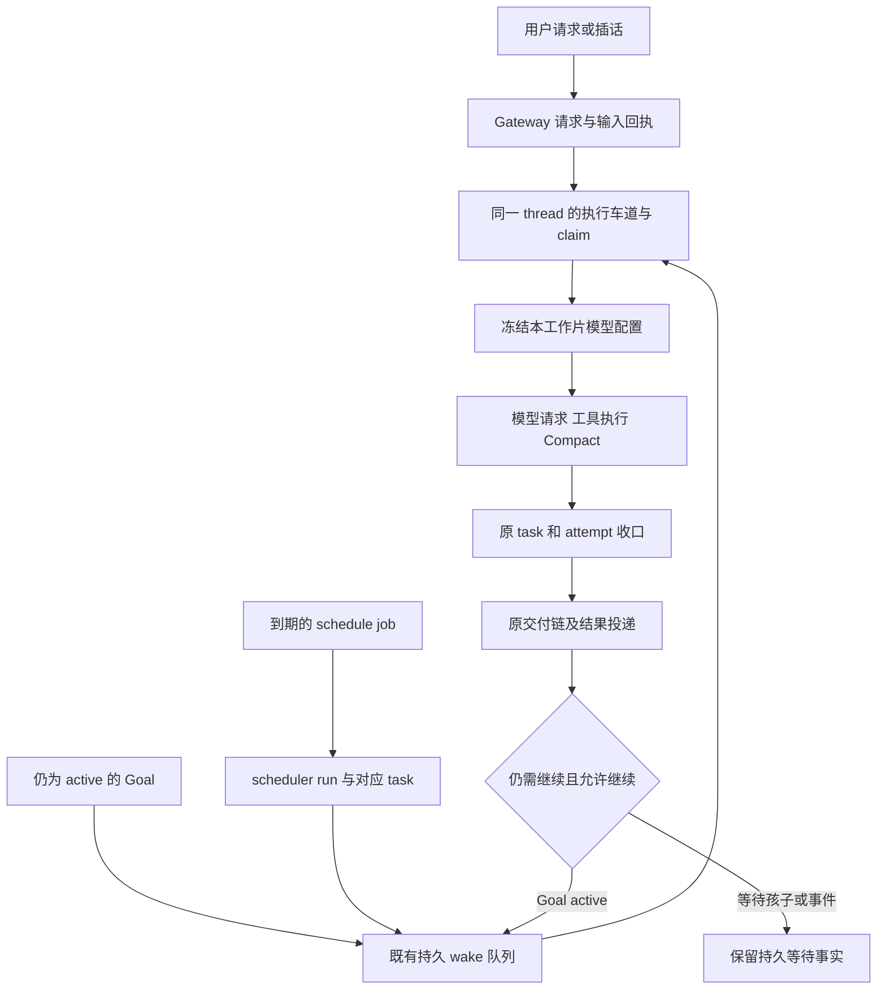

# my-agent 长任务与定时调度审查报告

初审日期：2026-10-09，时区 America/Los_Angeles。状态：用户已授权开始；L 线正在独立分支实施，真实 TUI 验收同步进行。前文缺陷描述是修复前基线，最新实现和证据以文末实施记录及交接为准。

本报告供接手 agent 审查长任务持续执行、Goal 完成、运行中模型切换、定时任务，以及相关的 TUI 插话和停止问题。重点是区分已经证实的运行时缺陷、现行设计带来的体验限制，以及仍需对照实验才能归因的模型行为。

主要结论：**先修正活动执行身份与控制目标，再缩短显式模型切换的安全生效边界，同时建立不含正文的诊断视图。Goal 的实际覆盖率需要独立核验，不能只凭运行时长判断；定时任务已有较完整的持久化与交付基础，宜在原主链扩展执行模式、模型配置和异常策略。**

报告只使用通用任务表述，不包含具体业务对象、用户提示词、工具参数、工具返回正文、产物正文、真实会话标识或凭据。历史现场事实来自既有脱敏诊断记录；本轮重新核对了相关安装版源码、仓库入口与公开资料。

## 阅读顺序与结论清单

建议先读版本基线和问题清单，再按负责的模块进入详细方案。代码行号区分安装版和 checkout，不能混用。

| 编号 | 问题或工作项 | 证据结论 | 建议优先级 | 推荐处理 |
| --- | --- | --- | --- | --- |
| B0 | 部署包与当前 checkout 不同版 | 部署清单已确认源码提交，5 个关键文件与安装版逐字节一致 | 实施前置 | 开工时对齐最新集成基线，保留部署包映射 |
| C1 | 插话和停止目标被旧前台请求、排队请求遮蔽 | 既有现场诊断及最小复现确认；本轮源码仍符合该缺陷条件 | P0 | 统一读取实际活动执行身份，保留精确目标与代次校验 |
| G1 | 大任务可能被模型提前声明完成 | 两个历史 Goal 的结束触发者已确认；业务遗漏程度及根因待验证 | P1 | 增强持久进度与完成证据，做同模型和同框架对照 |
| G2 | 目标范围和时间预算的变更授权主要依靠模型遵守提示 | 源码可见接口边界；没有本次擅自缩小范围的证据 | 审查项 | 评估结构化变更来源，避免增加自然语言判权 |
| M1 | 显式切换模型后长时间仍使用旧模型 | 已确认整工作片冻结；历史后续工作片已实际采用新选择 | P1 | 在响应与已开始工具收尾后的安全点采用新选择 |
| M2 | 选定模型、实际模型与生效时机不够一致 | 菜单已有工作片说明，但文字命令表述和运行视图仍需统一 | P1 | 同时展示选定与实际模型，统一生效口径 |
| O1 | 缺少跨模块的纯元数据诊断视图 | 当前部分 schedule 投影包含正文预览；其他状态分散 | P1 | 从既有事实源投影身份、状态、时间、模型和原因码 |
| S1 | 定时任务仅沿创建会话运行，缺少任务级模型配置 | 已确认当前 schedule 主链和 schema | P2 | 增加独立执行选项和显式模型继承规则 |
| S2 | 补跑、排队期限和失败处置缺少清晰的任务级选择 | 有宽限期、防重叠和恢复，差距在策略表达与展示 | P2 | 在原账本与恢复链上补策略，禁止盲目重放副作用 |
| S3 | 普通周期检查缺少用户可配置的结构化轻量预检 | 当前 schedule schema 没有对应入口 | P2 | 无变化记录检查结果，有变化才调用模型 |

P0 指当前已确认会影响用户控制运行的缺陷；P1 指直接影响可信度或长任务操作的事项；P2 指能力扩展。后续按下文接手顺序推进，每个切片交付代码、验证结果和剩余问题。

## 接手安排与实施依据

本节整合 3a 的部署与协作补充，以及用户确认的接手安排。本会话 agent 接手 L 线，配套 [TUI_STEER_CONTROL_REVIEW_2026-10-09.md](TUI_STEER_CONTROL_REVIEW_2026-10-09.md) 的控制链由 T 线负责。用户已说“开始”，并明确优先在测试机原生 TUI 验收；实现、测试部署与 MiniMax 常规测试已获授权。

### 一、分工、测试机和测试模型

| 事项 | 约定 |
| --- | --- |
| 本报告实施者 | 本会话 agent，下称“实施者 L”；接手时沿用用户选定的开发模型 |
| 配套报告实施者 | 配套 TUI 报告的负责会话，下称“实施者 T” |
| 执行起点 | 用户已明确说“开始”；代码开发、隔离测试部署与真实 LLM 验收正在进行 |
| C1 归属 | **整项归实施者 T**。C1 就是配套报告的全部内容。实施者 L 不改 C1 涉及的控制、输入回执、TUI 状态和 guidance 文件；O1 需要的执行身份字段读取 T 的统一执行绑定，T 未合入前，O1 只做不依赖它的部分 |
| 实施者 L 负责 | G1/G2、M1/M2、O1、S1–S3，以及下文第三部分的第 3 条 |
| 真实环境测试机 | **实施者 L 使用 192.168.1.10**；实施者 T 使用 192.168.1.11。各自独占，不在对方机器上起服务 |
| 真实模型 | **MiniMax-M2.7 可按需要持续使用**，用户在本会话再次明确“随便用”。复用测试机已有官方 MiniMax 档案和私有凭据，常规复现、对照、长任务及修复后复验直接执行，不逐次请求额度确认；先核对有效 provider、端点和实际用量 |
| 其它模型 | 常规验收和同模型框架对照都用 MiniMax-M2.7。真实跨模型比较仅使用届时已获授权的档案；如果确需新增其它收费模型，再单独说明用途和成本。开发会话模型与被测 LLM 分开记账 |
| 测试环境 | L 使用 `192.168.1.10`，T 使用 `192.168.1.11`。各线在自己的隔离测试空间构建、安装、启动和重启测试服务，用独立 HOME、私有端口及明确环境变量；每台测试机一个测试 Gateway，多 TUI 共用。沿用原生配置和运行入口 |
| 数据与观察 | 原有用户任务只读结构化元数据；专门生成的合成测试允许读取完整输入、输出和产物以核对结果。凭据留在私有配置，原有生产 owner 与日常模型不作为测试对象 |
| 自主推进 | 按需要迭代实现与测试。失败先记录实际调用、状态和结果，再定位生产代码或任务组织问题；重复运行要检验具体改动或假设，不用反复请示代替推进。只有缺少访问条件或出现新的范围决策时才补充询问 |
| 交接 | 按 [HANDOFF_TEMPLATE.md](../tasks/HANDOFF_TEMPLATE.md) 直接交给用户；按 AGENTS.md 同步 DESIGN_LEDGER、TESTS、CODEBASE_TREE |

### 二、B0 已有答案；开工时间与代码基线

- **B0 答案**：`runtime-step17yi-8bc21191` 的源码是 `0b938e57ef4c28e4f262ee494353a2930b6cde0d`（3a 的部署分支 `claude/3a-deploy-step17yi2`）。每次部署的权威记录在 `~/.my-agent/releases/<版本>/deployment.json`，其中有 `source_sha`、`wheel_sha256` 和网关 `pid`。
- 本节写作时，3a 正在部署 step17yj = `c52257ef52a05dd24ed99dbba133bf58b2b7d7dd`（07 会话的分支 `claude/07-deploy-step17yj`）。它在 0b938e57e 上增加了 USER_REPLY_UNAVAILABLE 的结构化诊断。
- 生产版本链是本地分支，还没有全部进 origin/main：
  - main `8ade40d6f` 是 step17yg 的祖先；
  - `3626274be` = step17yh；
  - `0b938e57e` = step17yi；
  - `c52257ef5` = step17yj。
- 当前 checkout（`codex/refactor-runtime-composition`，`d7a1a7c98`，2026-09-23）远落后于生产。**不要在它上面开发**，也不要改动这个检出目录本身的其它文件。正文里的“checkout 行号”只能当作历史参考。
- **开工时间**：等待用户明确说“开始”，并按原安排核对 3a 主线交接；主线完成不触发自动开工。开工当天：
  1. 读取最新部署的 `source_sha`，刷新 `origin/main`，用 `git merge-base --is-ancestor` 确认包含关系：main 已包含部署及必要修复时以 main 为基线；部署提交包含 main 时使用主线约定的部署集成提交；两者分叉时先建立包含所需修复的集成基线，按祖先关系和修复集合选择，不按提交时间猜测；
  2. 在自己的 worktree 新建分支；
  3. 所有行号按符号重新定位。
- **3a 主线中会改到同一批文件的分支**。如果开工时它们还没有进 main，先不要改这些文件；等它们合入后再 rebase。
  - AGENTS 第 1 期 B 路（`worker/mc3-agents-b`）：`conversation/runtime.py`、`conversation/background_transcript.py`、`gateway_parts/request_context.py`、`gateway_parts/request_history.py`、`scheduler/service.py`、`agent_core/runtime/loop_support.py`、`memory_push.py`。
  - B1b 多进程（`claude/b1b-int`，以及 `worker/mc1-b1b2`、`worker/mc4-b1b-p4`/`-p5`/`-p6`）：`cli/gateway_process.py`、`gateway_parts/request_worker.py`、`gateway_parts/queue_service.py`、`gateway_parts/multiprocess_*`、`gateway_parts/control_service.py`（P6 停止转达接线）。多进程模式默认关闭，但共享文件会冲突。
  - 07 会话的压缩与缓存线：`agent_core/tool_model_generation.py`、`agent_core/tool_loop/response_decision.py`、`backends/responses.py` 以及压缩相关模块。M1 改请求装配时一定会碰到这里。
- **合并验证**：10-09 一次自动合并后出现函数体缺失和导入失败。合并或 rebase 后先跑 `python3 -m compileall -q agent_py_agent`，再跑受影响模块的 focused tests；推送或合并前执行正文列出的严格 gate。全仓 pytest 按 AGENTS.md 的规模阈值或用户明确要求执行。

### 三、10-09 新增事实，正文没有覆盖

1. **长回合结尾的 USER_REPLY_UNAVAILABLE**：3a 补充的历史统计为 10-09 至少 5 次，sol 4 次、astra 1 次，都是 82–190 分钟、100–190 轮工具的长回合；其中一次正是 C1 现场的 A。相关版本演进如下，具体部署状态以清单为准：
   - step17yh：Responses 完全为空的工具响应改报 MODEL_EMPTY_RESPONSE，并修复重试一次；
   - step17yi：空正文续跑预算按真实工具进展重置（重放不算进展）；只思考被截断时，续跑那一次降一档思考强度；
   - step17yj：结构化诊断（末次调用的工具数、输出条目类型、可交付文本长度、empty_text_repairs 等）。
2. **优先验证的假设 H：合法前后台交接可能被报告为 USER_REPLY_UNAVAILABLE。** 3a 补充的结构化时间线：
   - C1 现场 A 的后台 claim 在 17:32:56 开始，前台 7 秒后以 USER_REPLY_UNAVAILABLE 结束；到 19:42 后台心跳仍在，task 仍 active；
   - 另外两次失败（05:38、11:18）的同名持久 task，都在前台失败后 1–2 分钟才创建，后来都 completed；
   - 多次失败前 200–330 秒都有 context_window_compacted。

   这些记录支持“前台失败与后台继续并存”；A 在记录时仍 active，另外两例记录为后来 completed。根因核验按同一 request/task/attempt 的交接原因、claim 代次和末次调用诊断对齐，区分合法让出、失败后的恢复与真实空回复。fake 重放同时覆盖合法交接，以及真实空回复时仍有后台任务的情况。**相关修复归实施者 T**：已确认的交接显示为继续运行，真实交付失败保留错误事实；后台任务的存在本身不消除前台错误。
3. **G1 停止原因表要加一类**（归实施者 L）：前台以 USER_REPLY_UNAVAILABLE 等错误码结束，但同名持久任务仍 active、在后台续跑。这既不是停止，也不是完成；用户看到“任务处理失败”会误判。O1 的视图要能直接显示这种状态。
4. **部署被挡**：后台执行从 TUI 停不下来时，网关会一直有活动的 attempt 和 claim。部署脚本（`deploy_when_idle.sh`，等 `switch_gateway.py <release> --check` 没有 problems）会被一直挡住：
   - 10-09 step17yi 等了 2 小时 20 分，原因是另一会话挂着的长 pytest；
   - step17yj 从 17:54 起被 C1 现场的 A-bg 挡住。

   现在只能靠自然语言暂停通知让各会话自己收尾，而这些通知本身又会被错投（C1）。候选需求，归实施者 T，优先级 P1：结构化的“维护排空”控制。网关停止接受新回合；活动执行在安全边界停下，并 park 成可恢复状态；不靠自然语言判断。多进程模式下和 B1b P6（独立停止转达与真实排空，合同层已在 `worker/mc4-b1b-p6`）共用同一个 drained 判定，不另起一套。
5. **工具子进程**：agent 用 shell 启动的长测试和批量脚本，在回合结束、Esc 或前台失败之后，仍挂在网关下运行。10-09 只能人工逐个结束这些进程。`/stop` 的验收要包含：该任务启动的进程树被终止，或结构化地列出仍然存活的进程。单进程下由 `background_process_host` 和工具运行时负责；多进程下由 B1b P1 执行者登记和 P6 负责。
6. **派活工具的输入**：A 现场的 B/C/D 不是人手输入，是外部派活工具在 TUI 输入框里打的字。工具当时以为原回合已结束或仍在运行。真实验收要包含“后台运行时程序化地往 TUI 输入文字”这个场景，不能只测人手按键。

### 四、对正文各项的补充意见

- **M1**：
  - 采用新模型时，要按新模型的上下文窗口和压缩触发线重新判断下一次请求；超线时先按新模型的配置压缩再发。压缩阈值是用户定的（DeepSeek、luna 300K；sol 90%，上限 300000），实施中不要改。
  - 切换时清掉只对旧模型有效的单次状态，例如截断降档的推理强度覆盖（step17yi 引入，绑定逻辑调用）、Responses 的续接标识和 WS 会话。
  - 模型切换可能改变可复用前缀与缓存行为。按每次请求的实际模型、配置指纹及 provider usage 记录缓存读写计数；切换事件单独标注，缓存变化的原因未经验证时保持未知。采用新模型并不要求改写工具 schema；已有 schema 不变时保持稳定。参考 [Prompt caching](https://developers.openai.com/api/docs/guides/prompt-caching)。
- **O1**：
  - 复用 step17yj 的诊断字段和 model_usage 账本（purpose_breakdown），不要另起诊断存储。
  - 纯元数据视图至少要回答：这个 task 现在在前台还是后台；谁持有 claim；最后一次结构化进展是什么时候；有没有挡住部署切换的 attempt 或 claim。最后一项正是 10-09 部署被挡时最缺的信息。
- **S1**：
  - 独立执行的定时任务要带结构化的学习来源事实：定时和后台运行“不可学”，见 `capability/agents_learning_contract.py`（AGENTS 第 1 期接口已冻结）。
  - 生产的学习排除名单在 owner 的 `memory_policy.json`（`learning_exclusions`），不要另起一套排除机制。
- **G1 对照实验**：10-09 的长回合还暴露过上下文问题：压缩后丢工具（35→34，已由 07 修复，见线程字段 `loaded_tool_names`）、压缩请求缓存命中两极分化（07 在修）。做 Goal 覆盖率对照时，要一起记录压缩代数、压缩前后的工具数和缓存命中，否则很难把“提前完成”和“上下文丢失”分开。
- **实施顺序**：
  1. 实施者 T 先做 C1（P0）。
  2. 实施者 L 的 M1 等 T 的统一执行绑定合入之后再动 `conversation/runtime.py`；两人都会改这个文件。
  3. L 的 G1/G2、S1–S3 主要在 `goal_*` 和 `scheduler/*`，可以和 T 并行。
  4. O1 先做不依赖执行绑定的部分（模型、Goal、schedule 字段）。

## 版本基线和证据边界

### 安装版与仓库必须分开

本报告使用下列可移植路径约定，不在仓库写入个人目录：

- `REPO`：本项目 checkout 根目录。
- `SRC`：`REPO/agent_py_agent`。
- `RUNPKG`：此前现场 Gateway 所加载的安装包根目录，安装前缀标识为 `runtime-step17yi-8bc21191`，包后缀为 `lib/python3.12/site-packages/agent_py_agent`。
- `REF`：本机既有参考项目根目录，含 `codex-main`、`hermes-agent-main`、`openclaw-main`。不需要重新克隆。

本轮 checkout HEAD 为 `d7a1a7c982533812f51aeede8b476c12864c975c`，提交时间为 2026-09-23。复审已读取部署清单，确认 `runtime-step17yi-8bc21191` 的源码为 `0b938e57ef4c28e4f262ee494353a2930b6cde0d`；模型作用域、线程选模、会话运行时及 scheduler repository/service 共 5 个源码文件与安装版逐字节一致。B0 的版本映射已有答案，开工时继续核对届时最新基线与构建产物。

开始写报告时，工作区已存在 `CODE_SIZE_REPORT.md`、`DESIGN_LEDGER.md`、`LLM_GUIDE.md`、`docs/ROADMAP.md` 的修改及一个未跟踪图片。本轮不覆盖这些既有改动，也不将它们整体认定为本报告的产物。

以下六个安装版文件与当前 checkout 均不同，SHA-256 为本轮读取源码计算的结果：

| RUNPKG 下的相对路径 | 安装版 SHA-256 |
| --- | --- |
| `agent/settings/model_scope.py` | `0c26ac5afc14467f5c1c814190ed5c478b4fc1c041693b0d42a237d2100626fb` |
| `agent/settings/thread_model_selection.py` | `d6e9b92ff68fdb74df78a912bb9182c3a879e4405b69dddd68b4d0fb173cf36d` |
| `agent/conversation/runtime.py` | `aea523ec5c1d8585f7253c2d2f97a38425f4f377dc49fdbb9ef2cdc27ee4087b` |
| `agent/scheduler/repository.py` | `8b3b4938d7165f5016cb923c0259402cca9980326d07f4347383a5cfd30f7ed9` |
| `agent/scheduler/service.py` | `ff5f372b8e617f595a85e964f315800a2c294004e1956ed19dc73f5015b28385` |
| `agent/scheduler/tool.py` | `e15945f5496deb756d67c900540e6d9700565b04e99cc2a05850b5f2b30749dd` |

安装版还包含当前 checkout 缺失的 `conversation/goal_progress_fuse.py`、`scheduler/active_run_closeout.py`，以及旧入口没有的模型依赖切换函数。后续修复不能简单把 checkout 文件复制进运行环境；否则可能同时回退已经上线的修复。

代码表中的“checkout 无”指指定文件或符号在本轮 checkout 中不存在，不代表别处没有相近职责。安装版行号统一相对 RUNPKG，checkout 行号统一相对 SRC；行号只对本报告快照有效，应同时按符号名查找。

### 证据分级

| 类型 | 本报告如何使用 | 能证明什么 |
| --- | --- | --- |
| 安装源码 | 本轮直接读取正在讨论的安装包实现 | 该版本的分支、schema、状态转换和作用域 |
| 历史现场元数据 | 转录既有诊断台账，使用 A/B/C/D 等匿名代号 | 当时的请求、执行、状态和时间关系 |
| 历史最小复现 | 既有安装版临时目录或内存复现记录 | 指定输入条件下的局部错误行为 |
| 官方文档或源码 | 核对公开产品机制，注明版本边界 | 对应产品声明或公开入口实现 |
| 方案推断 | 根据以上事实提出候选修复 | 不等于已经修好或已通过真实验收 |

现场是否仍以相同进程、模型和会话运行，不从历史记录推定。本报告也没有重新读取用户任务正文来判定业务质量。

参考源码快照：OpenClaw `9cf12734e6`、Hermes `0a62610f1` 均为 2026-08-02；Codex `578c1b22` 为 2026-07-30。Goal 与定时任务的新产品说明另由官方在线资料补充。本地快照与在线 main 不应被拼成一个虚构版本。

## 先统一概念与状态

| 概念 | 在本次问题中的含义 | 常见误判 |
| --- | --- | --- |
| Gateway request | 一次传输与服务端处理请求，有自己的排队、处理和终态 | 请求结束就等于持久任务结束 |
| thread | 会话及其模型选择、历史和执行车道的归属 | 同 owner 的所有会话都在同一条串行车道 |
| task 或 run | 持久工作身份，可能跨前后台及多次尝试延续 | 前台 request_id 与 task_id 同名就代表同一种生命周期 |
| attempt | 某次实际执行的代次 | 旧代次的控制回执可以直接作用于新代次 |
| 工作片 | 一次宿主执行作用域内的连续工作，可能含多次模型请求、工具往返与 Compact | 每次 HTTP 请求、每次工具返回或每条进度消息都是新工作片 |
| Goal | 目标、预算及持续推进状态，由宿主决定何时继续，由模型参与完成判断 | Goal active 证明正在运行；Goal complete 证明全部业务条件已验证 |
| schedule job | 跨触发长期存在的计划定义 | 每个计划就是一个永不停止的 Goal |
| scheduler run | 某个计划的一次执行，拥有独立运行记录与任务身份 | 调度触发成功就是任务成功或消息已送达 |
| delivery | 结果向用户会话或通道的投递事实 | 投递失败必须重新做一次工作 |

现有主链可以概括为：



图只解释本次相关主链，不是全部异常分支。暂停、取消、权限、预算、未知副作用和配置不可用都有独立边界，不允许因为目标还在就绕过。

## C1 插话和停止的活动执行身份错位

### 现状与已经确认的问题

既有脱敏诊断记录了一种组合：原前台请求 A 已经终结，但它对应的持久任务仍 active，后台继续持有执行权。随后提交的请求 B 正在等待同一会话车道，却在客户端被作为当前 running 请求。插话和停止因而可能落在旧请求或等待请求上。

关键事实如下。时间和计数是历史观察，不是本轮重新操作现场得到的数据：

| 观察 | 历史结构化事实 | 含义 |
| --- | --- | --- |
| A 的前台结束，后台仍活跃 | 前台 `failed/closed`，错误码 `USER_REPLY_UNAVAILABLE`；同名 task 仍 active，后台 claim 和事件继续更新 | 运输请求与持久工作生命周期已经分开 |
| 插话从 A 被退回队列 | guidance 约 4.6 秒后 rejected，入口变成请求 B | 原任务活跃没有阻止旧前台终态判定 |
| B 尚未获得实际执行位置 | Gateway processing，但只有会话 claim 预绑定；原后台占有执行车道 | processing 不证明模型已经开始执行 |
| C 长时间未被消费 | guidance 从 17:53:51 到 18:18:48 未 submitted，约 1,496.8 秒 | 不能仅用“下一次模型返回就会收到”解释 |
| 期间后台并非没有边界 | 同一显示回合有 63 次 tool_started、58 次 tool_completed、5 次 tool_failed、1 次 assistant_completed | 延迟期间有真实活动，但这不证明每个事件都是可切片边界 |
| 第一次 Esc 停的是 B | B interrupted，原后台继续 | 回执成功对象与用户想控制的工作不同 |
| 后续停止继续失配 | 8 次 Esc 和 1 次 `/stop` rejected，目标为 D；当时 C processing，D pending/conversation_busy | 客户端控制目标再次偏离服务端执行事实 |

历史时间使用 America/Los_Angeles。准确的异步回调交错没有完整保留，因此不能声称已经证明了唯一的乱序原因。

源码已确认两个具体入口问题：

1. `_input_target_lifecycle` 先读同名 Gateway request；只要得到非 unknown，就直接返回，不再读同名持久 task。旧 foreground terminal 可以遮蔽合法后台任务。
2. `_tui_update_running_state` 接入 job 就设置 `is_running=True` 并保存其 request ID。`_tui_submit_active_turn_input` 优先使用这个本地 running 目标，只有本地不 running 才读后台目标。

已有最小复现分别验证了这两个行为：前者在存在旧终态文件时不调用 task loader；后者把仍为 pending 的 job 发布成 running。它们不是完整端到端修复验收。

### 解决方案

活动执行应由现有 owner/thread/task/run/attempt 与 claim 共同定位。建议在原控制解析入口统一返回结构化事实：目标是前台请求、后台工作还是排队请求，是否持有实际执行权，以及证据对应的代次。字段如何命名需服从已有 schema，不新建第二套活动任务注册表。

回执始终保留首次接受的目标身份。若目标本来就是后台 task，不能拿同名旧前台 request 的 terminal 直接拒绝；若目标是等待中的请求，也不能因用户按停止就悄悄改成另一个后台任务。失配时应返回结构化刷新事实，由客户端明确更新目标后重新发起控制。

TUI 应区分“本地已提交”“服务端已接收或排队”“实际执行中”。界面派生状态不具有控制授权，不应覆盖仍在执行的后台身份。停止成功应指向具体对象，不能把取消排队请求显示成停止全部工作。

Esc 与 `/stop` 的既有语义也需保留：Esc 中断当前轮；active Goal 可能随后续跑；`/stop` 或显式暂停则控制目标的持续状态。这与“停止命中了错误对象”是不同问题。

### 代码地点

| 相对包路径与符号 | 安装版行号 | checkout 行号 | 修改或复核重点 |
| --- | --- | --- | --- |
| `agent/gateway_parts/input_delivery_service.py::_input_target_lifecycle` | 873 | 无同名符号 | 按目标种类裁决生命周期，不能让旧请求终态覆盖后台 task |
| `agent/gateway_parts/control_service.py::_exact_gateway_turn_lifecycle_locked` | 1935 | 1634 | 请求生命周期只证明请求自身，检查上层目标解析和回执对账 |
| `agent/gateway_parts/request_binding.py::gateway_conversation_execution_lane` | 408 | 242 | 保留 write-ahead 绑定和唯一车道；等待不等于执行 |
| `cli/chat_parts/tui_worker.py::_tui_update_running_state` | 65 | 65 | queued、processing 和实际执行状态分开 |
| `cli/chat_parts/tui_actions.py::_tui_submit_active_turn_input` | 529 | 511 | 不被本地等待 job 遮住后台执行目标 |
| `agent/conversation/runtime.py::tick_thread` | 3507 | 3065 | 核对前后台共享车道和跨会话隔离 |

参考模式：Codex 以 active_turn 和活动 task 接受 steer；Hermes 将 redirect 与 interrupt 分开；OpenClaw 按 session 活动 handle 投递或 abort。参考入口见文末。不能只复制“更频繁轮询”的表面行为。

## G1 Goal 的持续执行与完成判断

### 当前已经具备的能力

my-agent 的 Goal 保存目标、身份、状态与预算，通过既有 wake 队列在允许时继续。普通单轮 final 不自动等于 Goal 完成；自动续跑也不要求用户每次重新发消息。

安装版 `create_goal` 提示模型仅在明确要求时设置时间或 token 上限，省略表示没有对应上限。每个代理至多一个未结束 Goal，子代理可有自己的目标。Todo 可选，不是进入或退出任务的强制条件。

`update_goal` 接收 complete 或 blocked，也允许修改 objective。入口会验证 thread/task/goal 归属、状态和内容版本，防止旧请求完成新版本目标；但这些身份校验不等于检查了所有业务交付。

实际完成仍主要由执行模型判断。续跑提示要求逐条核对目标并使用证据，模型遵守情况可能受模型能力、上下文、压缩、工具可见性和工作组织影响。

### 历史观察可以证明到哪一步

用户报告：不同规模的工作在大约 1 至 3 小时后结束，扩大目标或预算仍未明显增加覆盖。既有元数据诊断定位到两个候选 Goal，它们通过模型的成功 `update_goal` 进入 complete，而非以时间或 token 预算耗尽结束。

因此，本次已确认的是“模型触发完成，宿主接受后停止目标续跑”。不能据此直接得出“框架有固定三小时上限”“一定是 DeepSeek 能力问题”或“全部内容确实漏做”。后两项需要内容独立验收或可公开的对照任务；本轮遵守不查看原任务内容的边界。

### 不同停止原因必须分别诊断

| 终止或等待原因 | 需要的结构化证据 | 是否等于成功 |
| --- | --- | --- |
| 模型主动 complete | 成功工具事件、Goal ID、revision、状态转换 | 是完成声明，不是外部验收证明 |
| token 或时间预算耗尽 | 预算、累计用量、budget_limited 等状态 | 否 |
| 供应侧额度或错误 | provider 错误分类、usage_limited 或相关原因 | 否 |
| 用户暂停或停止 | 精确控制事件、目标和代次、暂停状态 | 否 |
| 仍在等待子代理或持久事件 | canonical 子任务或事件事实、等待状态 | 否，也不应直接计为空转 |
| 无进展自动暂停 | fuse 计数、原因码和对应 wake 身份 | 否 |
| 丢失执行者或未续跑 | active Goal、claim/attempt、待处理 wake、恢复事实 | 否，需进一步定位宿主链路 |
| 前台失败、后台仍执行 | 原 request 错误、精确 task/attempt、有效后台 claim、最后进展和交接或恢复来源 | 整项仍在推进；前台交付结果与后台执行状态分别保留 |

安装版存在 `goal_progress_fuse.py`。随包 YAML 和 `agent/settings/config.py` 默认 `goal_continuation_idle_limit=3`，0 关闭；本轮没有读取用户覆盖配置，因此不能把默认值当作现场有效值。它统计连续无进展的续跑片，达到阈值走 paused；有工具调用、material progress 或相应结构状态变化会重置。

该机制既不是三小时定时器，也不是覆盖率验证器。反复调用无效工具仍可能满足当前“有活动”的判断，不能由计数重置推出任务取得了实质进展；更不能把这条机制当成历史两个 complete 的原因。

### 与其他产品的 Goal 对照

| 产品 | 谁决定继续 | 谁决定完成 | 审查时需要保留的边界 |
| --- | --- | --- | --- |
| my-agent 安装版 | 宿主持久 Goal、wake 与任务生命周期 | 执行模型调用 update_goal；宿主校验归属与版本 | 提示中的证据审计仍由执行模型完成 |
| Codex 当前公开机制 | 持久目标与宿主自动续跑 | 执行模型调用 update_goal complete | 所核对完成入口没有独立业务裁判；不能据此概括全部内部机制 |
| Claude Code 当前 `/goal` | 每轮结束后独立评估决定是否继续 | 配置中的小模型评估器 | 评估器读对话中已呈现的证据，不独立调用工具读取产物 |
| Hermes 当前 `/goal` | judge 与持续循环 | 辅助模型判断；可配置 completion contract 与 quality gate | 命令通过只证明命令覆盖的条件，judge 也可能被不完整证据误导 |

来源：[Codex Goal 指南](https://developers.openai.com/cookbook/examples/codex/using_goals_in_codex)、[公开完成入口](https://github.com/openai/codex/blob/main/codex-rs/ext/goal/src/tool.rs)、[Claude Code Goal](https://code.claude.com/docs/en/goal)、[Hermes Goal](https://hermes-agent.nousresearch.com/docs/user-guide/features/goals)。Hermes 文档示例及默认机制有回合预算，不能把任何产品的 Goal 理解为不受限永久运行。

### 推荐方案与需要审查的选择

第一步，记录可解释的完成事实。每次 complete 应能关联精确 Goal revision、执行 attempt、触发工具事件，以及现有验证证据引用。先使用已有工具归档和验证账本，确有缺项再扩展原 schema。不要记录一份与 GoalStore 竞争的“完成真相”。

第二步，把大任务进度持久化。复用已有 task_progress、Todo、工具事实、产物引用与恢复机制，为明确列举的工作项保留稳定 ID、处理状态和证据。Compact 后按这些引用恢复未完成项，而不是只相信模型自然语言总结。对开放式探索，没有固定全集时，应显示范围未知或仍可扩展，不伪造覆盖百分比。

第三步，在 closeout 做通用核验。对于用户明确给出的有限清单，可核对数量、ID、重复项、缺失项以及产物存在性；对于主观质量则提供证据要求、warning 和返工目标。不要把“所有 Todo 打勾”变成通用完成硬门，也不要增加任务类别关键词分支。

第四步，是否增加独立模型复核由对照结果决定。可选评估器应引用真实证据而不是只读执行模型最后的自述，记录评估模型、输入范围、结论和预算。新增调用必须显式配置；复核失败应进入有界修复流程，不能无限争论或偷偷重开已停止的工作。

已有 `agent/verification/runtime.py::record_tool_verification` 会消费真实工具结果记录验证，并在后续修改后让旧证据过期。这是可复用的通用入口，但它不证明任意报告的语义正确，也不应直接被宣传为完整覆盖验收器。

### G2 目标修改与预算授权的候选审查

my-agent 的 update_goal 允许 objective 变更；所核对 Codex update 入口只变更状态。接口不同本身不是缺陷。当前没有证据证明模型曾把本次目标改小。

建议审查目标修改是否需要记录原 revision、新 revision、结构化变更来源及所依据的用户或父任务事件引用。若需要限制模型填写时间预算，也应在控制事件与工具合同中表达授权，不能扫描普通用户句子判断是否出现“小时”“继续”等词。

合法需求变更必须继续可用；不能为了防止提前完成而禁止所有 objective 更新、覆盖用户纠正，或让旧模型看到的目标版本完成新的目标。

### 代码地点

| 相对包路径与符号 | 安装版行号 | checkout 行号 | 职责 |
| --- | --- | --- | --- |
| `agent/conversation/goal_tools.py::CreateGoalTool` | 139 | 139 | 创建 schema、可选预算、唯一未结束目标 |
| `agent/conversation/goal_tools.py::UpdateGoalTool` | 247 | 247 | 模型完成与目标修改入口；execute 在 297 |
| `agent/conversation/store_goals.py::GoalStore.update` | 314 | 307 | canonical 状态、revision 和预算判断 |
| `agent/conversation/store_goals.py::GoalStore.account_usage` | 492 | 475 | 用量累计与预算相关处理 |
| `agent/conversation/goal_runtime.py::raise_goal_continuation_wake` | 12 | 10 | 唯一 Goal 去重 wake 发布 |
| `agent/conversation/background_goal.py::continue_goal_after_report` | 94 | 87 | 报告后继续及等待子任务边界 |
| `agent/conversation/goal_prompting.py::continuation_prompt` | 74 | 73 | 完成与阻塞的软提示，不是硬验收器 |
| `agent/conversation/goal_progress_fuse.py::record_goal_continuation_fuse` | 32 | 无 | 无进展计数及暂停 |
| `agent/conversation/goal_progress_fuse.py::slice_has_progress` | 191 | 无 | 工具计数与结构化进展的当前口径 |

相关合同：[THREAD_GOAL_LIFECYCLE.md](THREAD_GOAL_LIFECYCLE.md)。既有验收只证明其具体场景，不足以关闭本报告的新问题。

## M1 运行中模型切换的生效边界

### 已确认的实际语义

显式选择先写入 canonical thread 的模型引用与选择版本。前台、后台进入 `selected_model_scope` 时解析一次模型配置，整个工作片沿用该配置。普通工具返回、进度回复和片内 Compact 不必退出该作用域。

所以，“已保存新模型”与“下一次请求已使用新模型”之间可能相隔很久。当前实现没有根据等待 15 分钟自动切换的计时器，也不会因为选择改变就立即要求旧工作片让出。已经创建的子代理保持其独立模型状态。

### 历史时间线

| 事件 | 时间或事实 | 可以得出的结论 |
| --- | --- | --- |
| 旧工作片开始 | 北京时间 2026-10-10 08:49:32 | 是工作片开始，不是用户点击切换的时间 |
| 用户报告等待 | 切换后至少 15 分钟仍感觉使用旧模型 | 用户观察；点击时刻未精确取证 |
| 旧工作片结束 | 北京时间 09:27:37，runtime_status 为 ok | 整片持续约 38 分 05 秒，不能写成切换延迟 38 分钟 |
| 新工作片开始 | 北京时间 09:29:22 | 后续运行开始重新采用会话模型选择 |
| 模型调用上下文 | 旧片为官方连接的 `deepseek-v4-flash`；新片出现 OpenCode 连接的 `deepseek-v4.1-flash` | 后续片已采用新请求配置，不能说保存始终无效 |
| 新片的后续活动 | 当时已有三次工具成功事件，整片用量尚未结算 | 不能因缺少整片结算行判定没有调用新模型 |

上述模型名用于识别请求配置，不构成对转接服务内部真实后端模型的独立认证。北京时间为 UTC+08:00；例如 09:27:37 对应 UTC 01:27:37、America/Los_Angeles 前一日 18:27:37。

### 展示问题与执行问题应一起处理

安装版模型菜单已经明确提示“下个工作片生效，当前执行不被中断”，不能把它写成完全没有提示。另一方面，Gateway 文字命令仍出现“下一条消息生效”，而下一条消息可能仍在等待旧工作片。

更核心的体验问题是切换粒度过粗。单纯换一句提示不能满足运行中纠偏需求。建议在界面上分开显示当前实际请求模型、已保存选择、选择版本、待采用状态和采用时间；用正在执行的请求事实更新实际模型，不能仅凭菜单保存成功更新它。

### 推荐安全采用点

建议目标语义：**当前响应接收结束，已开始工具执行及其结果记账完成后，在下一次模型请求装配前采用最新的显式模型选择。** 若当前正在一个很长的流式请求或工具调用中，仍需等待对应安全边界；不能承诺固定几秒生效。

推荐顺序：

1. 显式选择原子推进 thread 的选择版本；同值显式选择也遵守现有版本合同。
2. 当前模型请求只使用已经捕获的模型、协议和配置，不中途换后端。
3. 处理本次响应包含的工具调用，保存其真实结果；不重放已经执行的工具。
4. 在已有请求装配或让出边界比较已采用版本与最新选择版本。
5. 准备并验证整组新模型依赖，再按现有作用域机制采用；配置无效时返回明确状态，不默默换到第三个模型。
6. 下一请求记录实际模型与选择版本；子代理和其他会话保持各自的归属。

需要一起检查 backend、工具协议、系统提示、上下文容量、推理参数、token 估算、缓存、用量归属和能力快照。仅赋值 `agent.config.model_name` 不能算完成切换，还可能污染并发会话。

安装版已有 `prepare_model_dependencies`、`model_dependencies_scope`、`activate_model_dependencies` 等入口，应先审查其适用边界。优先复用既有依赖与请求循环，不在 TUI 另建替代 runner，也不为切换模型重复创建 MCP 连接。

### 代码地点

| 相对包路径与符号 | 安装版行号 | checkout 行号 | 职责 |
| --- | --- | --- | --- |
| `agent/settings/thread_model_selection.py::thread_model_profile_id` | 106 | 55 | 原子保存会话选择和版本 |
| `agent/settings/thread_model_selection.py::thread_model_config` | 145 | 83 | 解析会话模型配置 |
| `agent/settings/model_scope.py::selected_model_scope` | 193 | 81 | 最外层工作片模型冻结 |
| `agent/settings/model_scope.py::prepare_model_dependencies` | 96 | 无 | 准备整组依赖 |
| `agent/settings/model_scope.py::model_dependencies_scope` | 123 | 无 | 绑定依赖作用域 |
| `agent/settings/model_scope.py::activate_model_dependencies` | 179 | 无 | 既有生命周期内采用依赖 |
| `agent/gateway_parts/request_execution.py` | 340 的 with 语句 | 按符号重定位 | 前台模型作用域 |
| `agent/conversation/runtime.py::_invoke_background_main_agent` | 1137，with 在 1146 | 877 | 后台模型作用域 |
| `cli/chat_parts/tui_model_menu.py::_publish_selection` | 118 | 106 | 已选模型的展示投影 |
| `cli/chat_parts/tui_model_menu.py::_select_model` | 173，说明在 198 | 189 | 菜单选择与当前生效提示 |
| `agent/gateway_parts/model_profile_service.py` | 110 | 按文案重定位 | 文字命令的生效提示 |

现有 `test_thread_model_selection.py::test_work_slice_snapshot_and_default_nested_scope_are_stable` 在 checkout 第 98 行明确测试工作片冻结。若改变生效边界，应先改合同，再调整这类测试；不能只让旧测试继续通过就声称热切换完成。

## S1 到 S3 定时任务的现状与优化

### 已有能力应保留

当前定时任务由 Gateway 后台调度接入原会话执行链。关闭 TUI 与关闭 Gateway 是不同动作；持久保存计划不代表宿主停止期间仍能按时执行。

| 能力 | 安装版现状 | 审查结论 |
| --- | --- | --- |
| 时间表达 | 单次 at、固定间隔 every、五段 cron、IANA 时区 | 不需要重新造 cron 解析器 |
| 固定间隔 | 使用锚点计算下一次时间 | 不应为了补跑改成每次结束后随意漂移 |
| 持久存储 | owner 范围内 job/run 账本与 history | 已有唯一权威，不新建另一套计划库 |
| 到期发现 | 有 SQLite due index 等投影 | 索引是唤醒优化，不替代原 job 权威 |
| 并发修改 | expected_version 与原子更新 | 保留 CAS，不让旧 UI 覆盖新配置 |
| 同任务重叠 | 同 job 已有 active run 时不再预留另一 run | 已有防重叠；不等于不同会话不能并发 |
| 执行领取 | claim、心跳、epoch、进程身份 | 租约过期本身不证明执行者死亡 |
| 子任务等待 | run 与对应 durable task 关联，有 waiting 和对账 | 本轮返回不应提前结算仍有后续工作的任务 |
| 结果投递 | 记录 delivery_status/reason，支持冻结回复重投 | 不能把每次投递重试都变成重跑模型 |
| 历史与状态 | 可查看历史、当前 run、错误和时间 | 部分结果带正文预览，不满足纯元数据诊断 |
| 模型选择 | 执行时沿创建会话模型作用域 | 当前没有 job 级固定模型与推理参数 |
| 运行位置 | 创建会话的 thread | 当前没有公开的独立执行目标选项 |

### 错过触发的现行语义

随包默认宽限期为：单次任务 300 秒，cron 3600 秒；every 采用间隔的一半并限制在 60 至 7200 秒。用户可以在 job 上明确设置 `misfire_grace_seconds`，这些默认值不代表其实际计划配置。

`reserve_due_runs` 检查到期时间与当前时间：在宽限期内预留执行，超过则记录 skipped 并推进计划；单次过期任务进入 paused，周期任务计算下一个未来时间。它不会把所有漏掉的周期逐一补齐。

同一 job 已有 active run 时跳过本次预留，下一轮再判断。这个行为需要与补跑策略一起解释，不能把持续等待、合并漏掉的时段和真正执行失败混成一个错误。

宽限期检查在“到期预留”处。它不能直接被宣传为实际开始执行的时限保证：任务预留后仍可能等原会话车道。后续若增加开始期限，必须在原准入链核对并记录，不能只调整 cron 的下一次时间。

### 崩溃和失败的现行边界

| 状态与证据 | 当前可见处理 | 后续优化必须守住的边界 |
| --- | --- | --- |
| claimed，租约到期且旧进程死亡得到证明 | 可以恢复 queued 并由新 epoch 领取 | 继续使用原身份和 CAS |
| running，租约到期且旧进程死亡得到证明 | 进入 unknown，避免自动重做已可能发生的动作 | 未建立幂等或副作用证据前不能统一重跑 |
| 进程仍活着或身份无法可靠判断 | 不轻易接管 | 不能用“很久没输出”代替死亡证明 |
| 工作已产生结果，只有投递失败 | 原冻结回复可重投 | 保持 run 和结果身份，不重复执行任务 |
| 本轮返回但原 task 仍有后续工作 | park_waiting，等待原任务收口 | 不把助手一条回复记成整个任务 done |
| task active 但没有可确认的后续工作 | 安装版有 active_run_closeout 进一步裁决 | 当前 checkout 缺该文件，不能覆盖回旧实现 |

失败重试策略应按失败阶段区分。需要重试的模型请求、可以恢复的未开始执行、必须保留 unknown 的副作用、仅需重投的结果，是四类不同动作。

### 与外部产品比较

| 产品 | 执行上下文 | 模型与资源 | 值得参考的方向 | 不能由此推定 |
| --- | --- | --- | --- | --- |
| my-agent | 原会话与原执行车道 | 跟随会话模型，Skill 可固定到计划 | 原身份、等待、恢复与交付主链已经统一 | 所有延迟都由模型导致 |
| OpenClaw | 支持主会话、独立及其他会话执行目标 | job 级模型等配置，独立执行可回送创建会话 | 条件触发、执行与必要投递分开、失败策略更显式 | 任意命令副作用都能恰好一次 |
| Hermes | 通常每次建立新 agent session | job 模型优先于 cron 默认和全局默认，可附 Skill | 结构化脚本预检、无模型任务形态 | 新会话天然等于隔离了文件与工具权限 |
| Codex | 原聊天跟进与独立计划均有入口 | 独立本地项目可用目录或 worktree，有模型和推理选项 | 结果收件箱与可继续查看的运行记录 | 未公开的漏触发、重试、重叠保证 |
| Claude Code | `/loop`、桌面持久任务和云 Routines 分层 | 云端按配置环境和连接运行 | 时间与事件触发、每次运行可回看 | 绿色状态证明业务目标已经完成 |

来源：[OpenClaw 运行机制](https://docs.openclaw.ai/automation/cron-jobs/how-it-works)、[执行与模型](https://docs.openclaw.ai/automation/cron-jobs/payloads)、[调度与条件触发](https://docs.openclaw.ai/automation/cron-jobs/schedules)、[投递与失败](https://docs.openclaw.ai/automation/cron-jobs/delivery)、[Hermes Cron](https://hermes-agent.nousresearch.com/docs/user-guide/features/cron/)、[Codex Scheduled tasks](https://developers.openai.com/codex/app/automations)、[Claude Code 会话调度](https://code.claude.com/docs/en/scheduled-tasks)、[Routines](https://code.claude.com/docs/en/routines)。

OpenClaw 和 Hermes 的本地 Gateway、需要本地文件的 Codex 桌面任务，都依赖相应宿主运行。云 Routines 的可用性来自托管执行环境，不是模型通过提示词获得了离线运行能力。

### S1 执行位置与模型配置

建议保留两种明确模式：原会话跟进用于持续上下文，独立执行用于需要稳定任务上下文的周期工作。独立执行仍使用已有 owner/thread/task 与 runner，只增加精确的来源会话、执行会话和回送关系，不建立另一套执行生命周期。

独立会话不是文件系统隔离。工作目录、工具权限、Skill 或包版本、可用连接应继续遵守现有合同；不应自动复制全部聊天内容、全部凭据或放宽能力授权。原会话被删除或重置时，结果投递应明确失败或按既有合同归档，不猜测新的接收会话。

模型至少区分“固定到明确引用”与“在执行边界继承会话选择”。优先级、解析时机和错误处理要写入合同：固定模型不可用时显式失败或等待配置，不能悄悄换回默认模型；继承模型时记录本次实际解析的引用、选择版本与时间。已经开始的本次 run 是否允许热切换，应与 M1 使用同一机制，不能另造规则。

### S2 补跑与失败策略

可评估三种时间策略：跳过过期时段、合并补一次、有界补跑。是否提供全部选项取决于产品需求，不能仅为功能对齐增加复杂度。每种策略都需说明原时间锚点、最大积压、同 job 重叠、用户暂停后的恢复和手动 run_now 的关系。

推荐先实现可解释的时间与原因展示，再扩展补跑选择。失败退避、连续失败提醒和恢复提醒复用原调度与交付事实，按 job/run/incident 去重。不要以“只有失败才通知”为理由丢掉历史，也不要在每个 tick 重复推送相同错误。

对结果未知的工作，优先展示 unknown 和可核查的操作引用。安全自动恢复必须由真实幂等、未开始证据或目标工具的查询能力支持，不能把重启当成重新执行的授权。

### S3 结构化轻量预检

Hermes 可用结构化 `wakeAgent: false` 跳过本次模型；OpenClaw 的条件脚本可决定是否触发实际工作。适合借鉴的是“检查事实与执行动作分开”，而不是照搬脚本 stdout 文案或自然语言关键词。

候选主链：计划到期后，执行明确配置的通用检查；检查返回变化事实、checkpoint 和证据引用；无变化时保存检查结果并结束，有变化才派发原 agent 工作。检查失败应记为失败或不可判断，不能等同于无变化。

检查与后续动作之间的 checkpoint 提交必须考虑失败恢复：提前提交可能吞掉未完成工作，重复提交可能造成重复动作。应复用原操作和 run 身份，明确“检查成功”和“动作成功”的提交边界。

默认将预检限制为所需的读取范围，沿原工具权限执行；需要写入的预检必须显式声明和评估。新增后台执行、网络调用和持久状态必须配置可见。正常用户回复仍由模型基于结构化事实生成，不直接把脚本输出接到普通回复通道。

### 代码地点

| 相对包路径与符号 | 安装版行号 | checkout 行号 | 职责 |
| --- | --- | --- | --- |
| `agent/scheduler/tool.py::build_schedule_tool_model_spec` | 35 | 35 | 对外 action、计划类型、宽限期与 Skill schema |
| `agent/scheduler/schedule.py::build_schedule` | 76 | 72 | 时间计划规范化 |
| `agent/scheduler/schedule.py::compute_next_run` | 163 | 159 | 下次时间计算 |
| `agent/scheduler/schedule.py::default_misfire_grace_seconds` | 194 | 190 | 随包默认宽限期 |
| `agent/scheduler/repository.py::reserve_due_runs` | 298 | 287 | 到期预留、宽限期、防重叠 |
| `agent/scheduler/repository.py::claim_run` | 407 | 394 | claim 领取和 epoch |
| `agent/scheduler/repository.py::_resolve_expired_claim` | 1370 | 无 | 死亡证明和 queued/unknown 分流 |
| `agent/scheduler/repository.py::_reserved_run` | 1526 | 1422 | 一次执行的持久字段 |
| `agent/scheduler/repository.py::_advance_after_misfire` | 1600 | 1495 | 过期后计划推进 |
| `agent/scheduler/service.py::enqueue_ready_runs` | 155 | 135 | 原 wake 入队及 run/task 绑定 |
| `agent/scheduler/service.py::park_waiting` | 348 | 248 | 有后续工作的持久等待 |
| `agent/scheduler/service.py::reconcile_waiting_run` | 372 | 272 | 与原 task 终态对账 |
| `agent/scheduler/active_run_closeout.py::close_active_run` | 117 | 无 | 安装版活动任务收口 |
| `agent/scheduler/active_run_closeout.py::settle_stale_waiting` | 145 | 无 | 安装版等待状态治理 |
| `agent/conversation/runtime.py::_execute_wake_signal` | 3974 | 3500 | 优先恢复冻结交付，再考虑工作 |
| `agent/conversation/runtime.py::_finish_scheduler_wake_claim` | 4171 | 3648 | 结合 task 与 delivery 事实收口 |
| `agent/scheduler/tool.py::_job_projection` | 455 | 455 | 当前会附 prompt 或 prompt_preview |
| `agent/scheduler/tool.py::_run_projection` | 485 | 485 | 当前会附 response_preview 和原错误说明 |

## O1 纯元数据诊断与统一状态展示

### 建议展示的事实

诊断不应要求打开任务全文，也不应依赖模型根据当前聊天猜测运行状态。建议在已有状态接口增加白名单投影，CLI、TUI 和后续审查都读取同一份投影。

下表是候选字段含义，不是已上线的新 schema。已有字段优先复用，新增字段必须有明确生产者和权威来源。

| 分组 | 应可查看 | 生产者或事实源 |
| --- | --- | --- |
| 身份 | owner 范围内的 thread/task/run/attempt、目标种类和代次 | 原会话、运行账、执行 claim |
| 排队 | 请求已接受、等待车道、等待能力、等待供应资源及进入时间 | 原请求队列与准入事实 |
| 执行 | 实际开始、最后结构化活动、运行状态、结束原因 | 实际 runner 与 attempt 记录 |
| 模型 | 选定引用、已采用引用、选择版本、采用时间 | canonical thread 与请求执行上下文 |
| Goal | 状态、revision、预算、用量、暂停或完成来源 | GoalStore 与成功控制或工具事件 |
| schedule | job/run、计划时间、预留时间、实际开始、下次计划 | scheduler 原账本 |
| 完成证据 | 核验结果或未核验、证据引用、对应内容版本 | 原验证与产物事实，不从 done 推导 |
| 投递 | 待投递、已送达、失败或未知及安全原因码 | 原 delivery 记录 |

当前 `_job_projection` 有 prompt 预览，`_run_projection` 有回复预览和 error_message。直接调用 list/get/history 后声称“只看元数据”是不准确的。新的纯元数据选项必须在返回前做白名单投影，并明确排除名字、目标正文、prompt、summary、response、命令、URL、原始错误正文及密钥字段。

error_code 可以用于诊断；error_message 可能包含路径、输入或供应方返回内容，应保留在受控详细视图，不能随元数据摘要自动公开。模型档案中的连接地址和凭据同样不应随模型身份展示泄漏。

### 三种成功应分别表达

执行正常结束、用户目标经核验、结果成功送达，是三个事实。没有独立验收时应显示未核验或证据不足，不能在缺字段时默认验收成功；投递失败也不抹掉已经完成的工作。

这层投影不拥有新的状态机。它只解释 canonical 状态，不改运行行为，不用 UI 显示标签或模型自然语言触发控制。

## 模型与框架归因的验证方案

### 可以直接归为框架的部分

C1 的生命周期判断、M1 的工作片冻结、定时任务的执行目标与模型字段、O1 的预览泄漏边界，都由宿主代码和 schema 决定。更换模型不会自动改变这些规则。

G1 的完成质量是模型与宿主共同影响的结果。更强模型可能更少提前 complete，但宿主提供什么上下文、如何压缩、是否保留进度、工具结果是否可见，也会影响同一个模型。

### 推荐对照矩阵

| 对照 | 固定项 | 变化项 | 目的 |
| --- | --- | --- | --- |
| A | 同版 my-agent、任务、工具、权限、预算 | 模型或供应路由 | 测模型及接入差异 |
| B | 同一模型端点、可比请求参数、任务与工具能力 | my-agent 与可接同端点的其他框架 | 测宿主差异 |
| C | 同模型、同框架、同任务 | 持久进度或验证候选开关 | 测具体改进是否有效 |
| D | 同版框架与模型 | 少量与大量同类工作项 | 测规模增加后的覆盖率和停止行为 |

Codex 的原生模型与另一个模型直接对比只能说明产品组合差异，不构成模型固定的因果隔离。工具协议、上下文长度、系统指令和权限无法完全对齐时，应逐项记下偏差。

建议使用不含业务敏感信息的有限批次任务，例如整理公开样例记录、修复一组本地样例文件、按明确清单生成结构化结果。外部验收器掌握预期集合、稳定 ID 和真实文件结果，执行模型不得改写这份验收基准。

真实验收时开发者只给一次普通中文需求，然后观察被测对象自己工作；不能帮它补文件、补结果或把旁路产物算作通过。测试准备和离线 fake 可以事先构造，运行中人工救场须单列，不能计为自主完成。

### 必须记录的指标

- 预期工作项数、实际覆盖数、缺失和重复项、正确率，以及未知范围。
- 模型宣布完成时尚未满足的明确条件数量。
- Goal 状态变化的发起者、对应 revision 和停止原因。
- Compact 次数与前后尚未完成项是否保留；摘要写了某项不等于该项已完成。
- 工具调用次数与可验证成果分开，避免把忙碌当进展。
- 模型请求的实际配置、协议、上下文及输出预算，包含失败与重试。
- token、费用、运行时间、人工干预、投递结果；小时数不能替代覆盖率。

不要预先规定“必须跑满三小时才算正常”。有些任务可以提前完成，另一些需要更长时间，验收应以可证明的结果和显式预算为准。

现有 [TESTS.md](../../TESTS.md) 已有模型与框架对照记录，可以复用其方法；旧模型、旧端点、不同题目及不同版本的结果不能充当本次问题的直接证据。

## 实施顺序与模块边界

### 开始后的推进方式

用户说“开始”后，L 按以下切片推进，主动完成定位、实现、验证和修正。每片完成时汇报实际行为、测试证据和下一片；发现新问题纳入同一通用模块处理。测试机与 MiniMax-M2.7 的现有授权覆盖常规测试迭代。

### 阶段零 对齐集成代码并建立测试基线

按部署清单与 Git 祖先关系选择包含必要修复的代码，在独立 worktree 开发。读取相关模块合同、实现与已有回归，按本报告参考索引复核要采用的通用模式。保存源码提交、依赖、wheel 摘要和安装清单之间的对应关系。

在 `192.168.1.10` 的隔离空间部署测试包，保留一个测试 Gateway，多 TUI 共用。复用已有官方 MiniMax-M2.7 档案，验证一次实际模型请求和一次工具往返；用有效配置与请求用量核对模型来源。此阶段产出可复用的测试入口、基线结果和失败样例。

### 阶段一 补诊断事实并接入控制修复

L 先完成 O1 中可独立实现的模型选择、实际请求模型、Goal 完成来源、schedule 阶段及最后进展投影，复用现有账本。T 负责 C1 的执行绑定、输入结算、停止和前后台交接。T 的绑定合入后，L 接入 task/attempt/claim 与交接来源，再复验组合场景。

代码入口以 `settings/thread_model_selection.py`、`settings/model_scope.py`、`conversation/goal_*`、`scheduler/*` 及既有 model_usage 投影为主。纯元数据接口在投影入口筛选字段，测试同时覆盖字段缺失、失败、后台续跑和迟到回执。诊断必须能回答“为什么仍用旧模型”“为什么 Goal 结束”“是工作失败还是投递失败”。

### 阶段二 缩短显式模型切换的生效边界

M1、M2 作为一片完成。沿原模型依赖生命周期，在当前响应与已开始工具结果收尾后、下一次 provider 请求前采用最新有效选择版本；同时切换 backend、配置、prompt 依赖、工具视图、上下文预算与用量归属。按新档案重新评估压缩，清理旧协议专属的续接状态。

记录 `selected_at`、实际采用时刻及两者之间的执行阶段；验收直接检查下一次合法请求是否采用新版本。采样、工具执行或必要压缩尚未完成时，界面显示实际等待阶段。若已经经过合法采用点仍使用旧版本，就定位漏接路径，不等整片结束后再宣称生效。

真实验收使用两个指向官方 MiniMax-M2.7、具有不同有效请求配置的测试档案，检查选择版本与实际请求字段；此项验证档案采用链。跨后端、上下文差异和模型身份切换使用可控 fake/replay 验证，真正的跨模型实测按已授权模型补充。

### 阶段三 修复 Goal 的进度保持与完成收口

先在同一 MiniMax-M2.7 和同类样例上比较小批次、大批次以及运行中扩大范围，复现覆盖遗漏或过早 complete。开发前固定外部验收清单，执行模型正常使用公开输入；验收器独立核对稳定 ID、结果和重复项。

G1 先补完成事件与 Goal revision、attempt、验证引用的关联，再修复已证实的持久进度或 Compact 恢复缺口。沿原 task_progress、Todo、工具归档和验证账本恢复未完成项。发现明确遗漏时，把缺失证据交回现有 closeout/返工链；开放式质量仍由模型结合证据判断。

G2 核对扩大或修改目标后的 revision、变更来源与预算继承，覆盖旧 complete 迟到和正在运行时变更范围。模型选择、Goal 和预算的有效配置均以运行时读回为准。可选独立评估器只有在对照证明收益后才接入，新增成本由配置控制。

### 阶段四 沿原调度链完成 S1 到 S3

S1 先加入原会话跟进与独立执行选项、任务固定模型与继承规则，并接入已有学习来源事实。S2 随后补齐错过周期、队列等待期限、失败处置及运行和投递状态展示。S3 最后增加结构化预检，明确无变化、有变化、检查失败三类结果。

固定模型的 schedule run 保持自己的模型来源，不被原会话选模覆盖；继承会话模型的运行沿 M1 的安全采用规则。定义时、触发时及实际执行时的引用分别可追溯，避免新增第二套模型切换机制。

保持现有 schedule job、run、wake、task 与冻结交付的关联。实现和测试覆盖 claim 恢复、未知执行结果、重复唤醒与投递失败重试；预检检查点要与已确认动作关联。每一步单独验证后进入下一步，便于归因。

### 阶段五 做真实长任务组合验收并交付

在已通过定向回归的测试包上运行下表。出现失败时保留原结果，先定位调用链和源码，再修改通用实现、补定向回归、复验失败组合；每轮记录相对上一版改变了什么。框架状态、内容覆盖和交付结果分别评价。

| 用例 | 执行方式 | 验收重点 |
| --- | --- | --- |
| L01 模型采用 | 在采样、工具执行和 Compact 三个阶段分别切换 MiniMax 测试档案；另测快速连续选择 | 下一合法请求采用最新版本，实际配置和用量一致，已执行工具不重做 |
| L02 范围扩大 | 同类输入分别使用 10、100、300 个工作项，再测显式扩大原目标 | 逐项核对覆盖与正确率、Goal revision、缺失项；样例数字仅存在测试数据层 |
| L03 多小时运行 | 安排一组有持续有效工作的 3 小时以上任务，跨至少两次自然 Compact；提前完成则扩大下一次测试规模 | 进度保留、自动续跑、模型采用、客户端重连；不以等待或空转凑时长 |
| L04 控制整合 | T 的 C1 合入后复验后台执行、前台等待、连续插话与停止 | 输入消费和停止命中真实执行；前台错误与后台继续分别呈现 |
| L05 定时组合 | 原会话繁忙、独立执行、固定模型、预检三类结果、Gateway 重启和投递失败 | 原身份恢复、无重复动作、只重投冻结结果；结合可控时钟覆盖错过周期 |

真实用例从原生 TUI 提交一次普通中文初始需求。选模、插话、修改 Goal、停止和重连是预先列出的受测操作，单独记账；测试者在旁观察和核验合成产物，由被测 agent 自己完成工作。MiniMax-M2.7 可按诊断需要多轮使用，记录实际调用和结果即可。

最终交付包含源码提交与 wheel 对应、每个切片改动、定向测试结果、真实用例记录、覆盖率与停止原因、剩余问题和安装/回滚步骤。按照原交接模板交给用户；开发验证和发布验证各自列明状态。

### 并行与依赖

T 负责控制链及 `conversation/runtime.py` 的输入和前后台交接函数。开工复核时 T 的候选尚未提交，且没有修改 `runtime.py`。用户补充“你看着来做，先把东西确认完再”后，L 在自己的工作树接入模型作用域、定时执行开始/预检、来源交付三处窄入口；没有改 T 工作树、guidance 或输入/停止实现。T 候选已有交接证据，组合验收仍须在明确集成版本上重跑。

本基线缺失的 AGENTS 学习来源及公共 drain 接口继续列为依赖，不重造第二份合同。共享文件合并按函数核对，不能把某一分支单独通过当成组合通过。

参考复核、独立测试设计和 UI 字段消费审查适合并行；共享执行入口按单一负责人合并。协作遵守 [WORKSTREAMS.md](../WORKSTREAMS.md)，交接使用 [HANDOFF_TEMPLATE.md](../tasks/HANDOFF_TEMPLATE.md)。

## 验收矩阵

先按项目规定走合同单测、fake tool、fake LLM、replay，再用少量独立真实会话验收。表中为待执行计划，不代表本轮已经通过。

| 编号 | 场景 | 必须观察到的结果 |
| --- | --- | --- |
| C01 | 旧 foreground terminal 与同名后台 active task 并存 | 插话按首次绑定的真实目标处理，不被旧 request 终态直接否决 |
| C02 | 前台请求 processing 但尚未取得会话车道 | UI 显示等待；后台实际执行目标仍可辨认 |
| C03 | 两条插话的 HTTP 回执返回顺序颠倒 | 不因到达顺序把控制目标改到后来的等待请求 |
| C04 | 精确取消一个排队请求 | 仅该请求取消，不报告后台执行已停止 |
| C05 | 精确停止后台当前 attempt | 命中同 owner/thread/task/attempt，原执行真正退出 |
| C06 | 旧 attempt 迟到的停止回执 | 不作用于新 attempt，不跨会话 |
| C07 | Esc 与 `/stop` 分别作用于 active Goal | 前者依既有合同可续跑，后者明确暂停；不混同效果 |
| C08 | Compact 与前后台切换期间投递插话 | 一次接受、可追踪消费，不丢失、不重复、不靠碰巧 Compact 才生效 |
| C09 | 有精确交接事实的合法前台让出 | 显示后台继续，原交付身份保留；最终结果沿原链路送达 |
| C10 | 真实空回复且同时存在活动后台任务 | 保留前台交付错误，后台状态单独显示；不把 active 当成交接或成功证明 |
| M01 | 模型响应流尚未结束时切换 | 当前请求保留旧配置，显示待采用，不截断或混用协议 |
| M02 | 响应产生工具调用后切换 | 已开始工具及其结果完成记账；下一个可安全请求使用新选择 |
| M03 | 多次快速选择不同模型 | 采用最新有效显式版本，旧回执不覆盖新选择 |
| M04 | 选择模型不可用或被撤销 | 显式配置错误，不静默采用第三模型 |
| M05 | 主代理与已有子代理并行 | 主代理显式选择不改写既有子代理及其他会话模型 |
| M06 | 新旧模型上下文容量和工具协议不同 | 请求按新配置合法装配，历史结果不重放，用量归属正确 |
| M07 | 切换后经过多个可执行请求边界 | 下一合法请求采用最新选择；按阶段记录实际等待时长，不靠整片结束才采用 |
| M08 | 切换后 provider 分别报告缓存命中、未命中或不提供计数 | 原样记录真实计数或未知，不以切换事件覆盖 usage 或自动认定缓存退化原因 |
| G01 | 模型过早调用 complete | 记录准确完成来源；候选核验能指出明确缺失项 |
| G02 | 用户修改 Goal 后旧模型返回 complete | 旧 revision 不得完成新版本目标 |
| G03 | Compact 前有未完成清单 | Compact 后 ID、状态和证据可恢复，不只保留总数 |
| G04 | active Goal 等待真实孩子 | 不误计空转、不重复派工、不提前完成整项任务 |
| G05 | 连续无工具也无结构进展 | 按有效配置计数并给出正确暂停原因，0 配置确实关闭 |
| G06 | 重复无效工具调用 | 不把活动计数当业务覆盖率，外部验收仍判未完成 |
| G07 | 时间、token、供应额度分别耗尽 | 原因分别可见，不混报 complete |
| G08 | 前台失败且原 Goal/task 在后台继续 | 执行、前台交付和 Goal 状态分开，不重复创建同一工作 |
| G09 | 小批次、扩大批次及运行中扩大目标 | 比较实际覆盖率；新 revision 保留新增未完成项与已有有效成果 |
| S01 | Gateway 关闭后错过多个周期 | 按配置跳过或补跑，有可追溯记录，不假称按时执行 |
| S02 | 原会话持续繁忙 | 区分已到期、已预留、等待车道、实际开始 |
| S03 | 同 job 上次运行未结束 | 符合重叠策略，不产生第二个无授权执行者 |
| S04 | 预留后、开始前进程死亡 | 使用原身份恢复，epoch 和 CAS 正确 |
| S05 | 已开始后进程死亡 | 保留 unknown 或有证据的恢复，不盲目重复副作用 |
| S06 | 工作完成但投递失败 | 只重投冻结结果，模型与工具动作不重做 |
| S07 | 独立运行时创建会话被重置 | 不投到猜测的接收者，记录明确交付状态 |
| S08 | 任务固定模型与继承模型分别触发 | 解析规则和实际模型回执一致 |
| S09 | 预检无变化、有变化、失败三种结果 | 分别静默结束、调用模型、记录错误；失败不算无变化 |
| S10 | 预检成功后动作失败并重启 | checkpoint 不吞任务，也不重复已确认动作 |
| S11 | 独立定时任务或后台触发学习候选 | 沿已有来源合同标记不可学，复用 owner 学习策略，不新建排除名单 |
| S12 | 夏令时、手动触发、暂停恢复和执行前排队超期 | 时区、下一周期和排队策略与实际运行记录一致 |
| O01 | 纯元数据状态查询 | 输出中无提示词、回复、名字、原始错误、连接地址或凭据 |
| O02 | 执行完成、核验未知、投递失败组合 | 三个事实分别显示，不合并成笼统成功 |
| O03 | 元数据缺失、旧记录或迟到回执 | 缺失字段显示未知，原代次事实不覆盖新执行，不回读正文猜测 |

实际时间与时区需要额外覆盖夏令时边界、用户暂停恢复与手动执行对下一自然周期的影响。它们属于计划计算与生命周期验证，不能由一次正常触发外推。

### 现有测试入口

以下是当前 checkout 已有文件，供找到可复用测试结构。安装版新增模块的对应测试应从同版源码找回；本报告没有修改或运行这些测试。

| 模块 | 当前已有测试 |
| --- | --- |
| Goal 工具与归属 | `agent_py_agent/tests/test_conversation_goal_tools.py`、`test_agent_goals.py` |
| Goal 恢复 | `agent_py_agent/tests/test_goal_lifecycle_recovery.py` |
| 模型选择与作用域 | `agent_py_agent/tests/test_thread_model_selection.py` |
| TUI 请求状态 | `agent_py_agent/tests/test_tui_worker_paths.py` |
| 控制回执幂等 | `agent_py_agent/tests/test_gateway_control_operation.py` |
| 时间计算与计划 | `agent_py_agent/tests/test_scheduler_schedule.py`、`test_scheduler_repository.py` |
| wake 与持久任务 | `agent_py_agent/tests/test_scheduler_service.py`、`test_scheduler_runtime.py`、`test_scheduler_wake_tick.py` |
| 领取和恢复 | `agent_py_agent/tests/test_scheduler_unknown_recovery.py`、`test_scheduler_heartbeat_resilience.py` |
| 工具 schema 与状态 | `agent_py_agent/tests/test_scheduler_tool.py` |
| 扫描与资源 | `agent_py_agent/tests/test_scheduler_due_index.py`、`test_scheduler_scan_costs.py`、`test_offline_scheduler_resource_contract.py` |

已有测试通过不等于新组合通过。例如，原模型测试要求整工作片稳定，新需求改变采用点后必须明确哪些断言保留、哪些需要调整。恢复测试也应覆盖生产调用路径，而不是只让 helper 返回期望字典。

### 实施后的验证和发布要求

本地开发先跑本次改动直接相关的 focused tests；修复作用域、身份或幂等时，增加覆盖这些合同的 fake 与 replay。真实任务失败时先保留真实证据并诊断生产原因，不为单个样例增加特殊路径。

准备推送、开 PR 或合并前，依仓库现行规则执行：

```bash
python3 -m pytest <与本次改动直接相关的测试文件> -q --tb=short
ruff check agent_py_agent scripts
python3 scripts/check_doc_sync.py
python3 scripts/check_code_size.py --mode strict --baseline CODE_SIZE_BASELINE.json
git diff --check
python3 scripts/check_clean_package.py .
```

第一行是待替换的模板，不能原样当作有效测试命令。只有生产与测试改动累计达到仓库规定的大规模阈值，或用户明确要求，才追加全仓 pytest。线上 CI 不可用不能替代本地严格 gate。

新增运行配置须同步默认 YAML、实际 dataclass 所在模块及相关测试；安装版 dataclass 位于 `agent/settings/config.py`，不能机械修改一个不存在的 `agent/config.py`。子代理能力与授权配置继续放 capability 配置体系。

更改函数、类或模块时同步更新项目要求的双层注释、调用方和合同文档。纯 bug fix 不必为每个修复另加开关；新增模型调用、预检、后台状态或显著改变用户偏好的行为必须显式配置。

## 实施复核与接手提示

以下清单用于实施定位和每片收尾，也可交给独立审查者复核：

1. 核对 B0：以已确认的部署映射为起点，核对最新集成提交和构建产物，补齐新增部署差异。
2. 核对 C1：前台请求和后台任务同名时，生命周期裁决究竟依据什么；TUI 等待 job 是否仍能遮住真实控制目标。
3. 核对 M1：现有模型依赖生命周期是否允许在安全请求边界采用新选择，哪些协议或缓存状态必须一起切换。
4. 核对 G1：把已确认的完成触发者与未验证的业务遗漏分开；不要将“模型说完成”直接当作模型单方根因。
5. 审查 G2：是否需要结构化范围变更与预算授权来源，如何保留正常需求编辑。
6. 核对 S1 到 S3：逐项确认既有能力，避免重造持久化、claim、waiting 或 delivery。
7. 审查 O1：字段是否来自唯一权威，纯元数据模式是否真正在返回前排除正文。
8. 对每个候选方案指出共享主链冲突、跨会话影响、恢复影响和缺失测试。
9. 给出“可实施、需修改、证据不足”的逐项结论，附代码位置与理由。

用户明确说“开始”后，L 的接手说明：

> 按本报告接手 L 线：对齐包含必要修复的集成基线，在独立 worktree 完成 O1、M1/M2、G1/G2、S1–S3。C1 由 T 线负责，复用其执行绑定，按函数边界集成共享 runtime。使用 192.168.1.10 和已授权的官方 MiniMax-M2.7 开展合同单测、fake、replay 和真实多小时 TUI 验收；常规测试迭代直接推进。原用户会话只读元数据，合成测试完整核验输入输出。失败后保存证据、定位通用原因、修复并复验；每片汇报结果和下一步，最终按交接模板提交代码与验收证据。

## 参考入口与证据导航

### 项目内资料

- [DESIGN_LEDGER.md](../../DESIGN_LEDGER.md)：此前插话与停止诊断、Goal 对照、模型切换时间线和定时任务候选的原始脱敏记录。
- [THREAD_GOAL_LIFECYCLE.md](THREAD_GOAL_LIFECYCLE.md)：Goal 身份、单一续跑入口、暂停恢复与编辑版本规则。
- [TUI_MODEL_PROFILES.md](TUI_MODEL_PROFILES.md)：模型选择、档案与现有交互合同。
- [SUBAGENT_PARALLEL_EXECUTION.md](SUBAGENT_PARALLEL_EXECUTION.md)：子代理独立执行、等待和生命周期边界。
- [TESTS.md](../../TESTS.md)：测试策略、真实环境证据与历史模型框架对照。
- [ROADMAP.md](../ROADMAP.md)：后续工作状态。本报告为详细审查入口，不另建竞争的任务状态表。

### 本地参考源码

| 参考项目与版本 | 路径或符号 | 用途 |
| --- | --- | --- |
| Codex `578c1b22` | `codex-rs/core/src/session/mod.rs::steer_input` | active_turn 与 expected turn 的输入归属 |
| Codex 同快照 | `codex-rs/core/src/session/input_queue.rs`、`session/turn.rs`、`tasks/mod.rs` | pending input、后续模型循环、活动任务取消 |
| Hermes `0a62610f1` | `run_agent.py::redirect` 与 `interrupt` | 纠偏与中断分开，保留已执行结果 |
| Hermes 同快照 | `cron/scheduler.py` 的预检及 run_job，预检说明约第 2410 行 | 结构化唤醒条件和无模型运行形态 |
| OpenClaw `9cf12734e6` | `src/agents/embedded-agent-runner/runs.ts` | session 活动 handle、投递与 abort |
| OpenClaw 同快照 | `src/cron/types-shared.ts` | schedule、sessionTarget、payload、delivery 的职责分离 |

查阅顺序先用 `openclaw_contract_code_files.xlsx`、`hermes_contract_code_files.xlsx` 缩小入口，再读实现。索引中的分类和概括只用于导航，不直接作为运行保证。

### 官方在线资料的使用边界

前文链接支持各自产品的机制描述。在线 main 和文档会更新，实施前应重新确认对应版本；本报告没有更新本地参考仓库。未公开的产品细节不补猜，未执行的产品不标成实测。

Anthropic 的[长任务工程经验](https://www.anthropic.com/engineering/effective-harnesses-for-long-running-agents)可用于理解结构化清单、增量工作与验证的作用；不能把研究中的工程实践直接写成某产品默认保证。

## 文档交付与建议下一步

报告已补齐接手分工、测试资源授权、分阶段实现、42 项合同验收与 5 组真实组合用例；同步修正前后台交接归因、缓存观察、Git 基线选择和测试范围。B0 的部署源码映射已核实，原 42 处安装版符号与行号核对记录保留为历史版本依据。

用户已授权实施；代码、测试和文档同步推进。文档检查、离线回归、真实任务和发布验收分别记录，代码已实现不等于整张验收矩阵已关闭。

建议下一步：完成 L 候选的真实调度组合与长任务观察，再按明确 T 候选集成控制链。T 控制与公共 drain/学习来源接口可由原负责线并行；共享 runtime 合并须核对实际调用边界、执行身份和冻结交付。


## L 线实施记录（2026-10-10）

- 基线：`c52257ef52a05dd24ed99dbba133bf58b2b7d7dd`，已确认继承部署源 `0b938e57ef4c28e4f262ee494353a2930b6cde0d`；独立分支 `codex/long-task-runtime-l`。
- O1：`get_goal(metadata_only=true)`、`schedule` 查询和 `gateway_status(metadata_only=true)` 从原账本白名单投影。当前/历史/歧义/嵌套/失败回执排除目标、名字、提示词、回复、地址及原始异常；元数据模式不允许写动作。
- M1/M2：下一次请求装配前采用最新显式选择；当前响应、已开始工具、同一已提交请求重试保持原依赖。配置、backend、prompt、工具视图、上下文容量与用量来源一起切换。删除/撤销引用明确报错；目录竞态重新校验。菜单区分保存、绑定、待采用与实际请求。
- 模型历史：清理已知 provider 私有推理块，保留未知媒体及工具结果；不兼容的 provider Compact 从同一原历史与 archive 恢复。原始来源缺失时报错，不编造摘要、不重做工具；旧一次性推理覆盖只在实际采用时清除。
- G1/G2：Goal 原 JSON 同事务记录 source、前后 revision、run/attempt/tool ID、验证引用及进度。完整 300 项计数不受 UI 截断影响，open IDs 有界并标明截断。模型 complete 仍是声明，verification 保持 not_evaluated，不增加质量硬门。
- S1–S3：原会话/独立上下文、继承/固定档案、misfire、队列期限、未来周期退避/暂停及结构化预检已进入原调度执行链。合同与代码入口见 [定时执行合同](SCHEDULER_EXECUTION_POLICIES.md)。
- 执行开始：原 `started_at` 在 scheduler claim 后提前写入，现移到真正取得后台车道后；等待期间仍可按队列期限结束。预检同样在原后台领取与中断范围内，取消令牌传入工具执行器。
- 检查点：changed 调模型、no_change 静默跳过、failed 留错误；只在动作和交付 done 的原事务提交 checkpoint。重启/冻结重投不重新观察或重跑模型；独立来源绑定变化不猜新接收者。
- 学习边界：本基线 Skill 自学习已按结构化 source 排除 `background_main_agent`；新版 AGENTS 来源合同未集成，S11 完整组合不宣称完成。
- 测试部署：核对旧测试 Gateway 的前后台元数据及失效领取者后停止旧测试服务。隔离 home、venv 与合成 workspace 使用一个 Gateway；原日常启动器和生产会话内容未读取或修改。

### 已取得的真实原生 TUI 证据

首个候选 wheel SHA256：`9dab4777b1274dbac79ca35798673e8e1547938c9b976f5ced9e295a4f1bb978`。该包包含早期 M1/G1/M2，不含后来 S1–S3 与完整进度快照；不同版本证据不互相替代。

| 合成任务 | 外部核验 | 框架事实 | 结论 |
| --- | --- | --- | --- |
| 10 条记录核对 | 覆盖 10/10，错误 2 条 | 模型调用 complete，来源可追溯 | 内容验收失败；覆盖全不等于正确 |
| 100 条相同规则记录 | 100/100 正确，无漏项/重复 | 正常完成 | 此样本通过 |
| 300 条相同规则记录 | 300/300 正确，无漏项/重复 | 工作中切档案约 4.28 秒后采用，后续请求账为新 revision | 此样本与采用链通过 |
| MiniQL 查询引擎，600 条公共检查 | 仍运行，最终正确率待外部核验 | 一次原生 TUI 初始需求；主代理自然 Compact 至少 5 次，两个 child 继续 | 不计为已完成或三小时通过 |

MiniQL 在实际 Compact 阶段切档案：选择与采用相差约 27.12 秒；主请求账采用新 revision，已有两个 child 保持原选择。64K/200K 是两个明确测试档案的有效窗口，自动 Compact 阈值未修改。没有向被测 agent 补源码、产物或修复提示。

模型均为官方 MiniMax-M2.7。真实使用不同温度/窗口档案，目前证明宿主采用及请求账关联；不把相同模型名的两档当成跨模型实测。fake HTTP 另验证实际 wire 参数、较小窗口及 Messages → Chat 原生工具协议转换。

测试机与开发机时钟不同步，采用延迟只在同一测试机 Unix 时钟内相减。调用账 started/finished 是 monotonic，选择/adopted 是 Unix，新投影标注时钟，禁止混减。

最终 focused 数量、严格 gate、后续 wheel 指纹、调度真实用例及长任务结论在交接补齐；未执行项目保持待验收。

### T 候选源码集成

T 的核心控制候选已具备交接条件，但 HEAD 仍为共同基线。L 只读导出其已暂存的 `agent_py_agent` 差异，核对可无冲突应用后集成到 L 工作树；快照 SHA256 为 `54b42fb212ba0dd1a151c650ef3cb4ec59296aaa6cf68c7acda841c8f314631a`。没有修改 T 工作树或测试服务。原 [T 交接](../tasks/TUI_STEER_CONTROL_HANDOFF.md) 随候选保留，不能把其中未完成的 T22/T23/IM 等组合标成完成。

集成处补接预检的原后台身份发布回调：实际只读 attempt 同样发布到原 claim，用户停止可以按精确 claim/attempt 命中；没有给预检建立新的控制状态。L 单独 723 项通过；组合候选按 L 与 T 相关文件并集重新验收。
