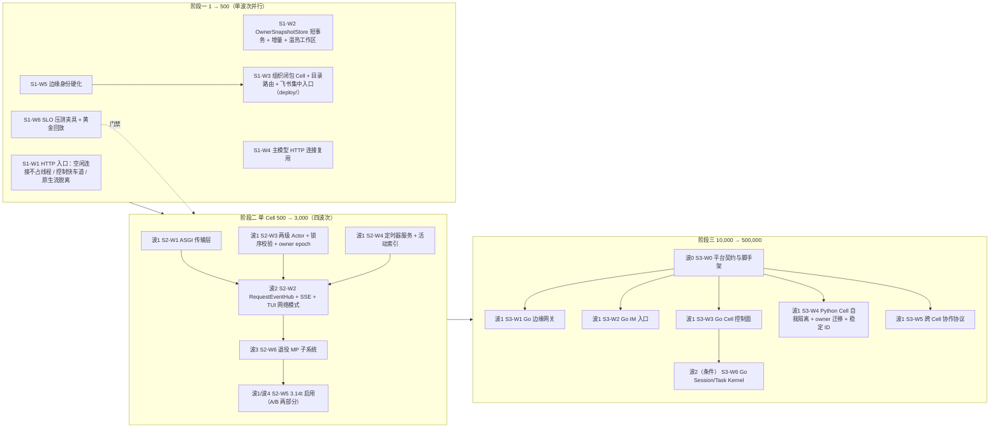

# my-agent 1 → 500 → 500,000 用户三阶段扩展总方案（Opus × GPT-6 Pro 统一版）

- **文档状态**：长期架构蓝图，已定稿，待分阶段派发（2026-11-05）。本文件只给方案，不派发代码。启动某一阶段时，把该阶段整章交回生成派发包（`workstreams.json`、`plan-w*.md` 等五件套）。
- **锚定提交**：`my-agent-dsh@215b9fbc2`（工作区内 `.py` 文件与 HEAD 一致）。
  - 文中代码行号均指该提交。路径写法：`agent/…`、`cli/…`、`tests/…`、`config/…` 位于 `agent_py_agent/` 下；`scripts/…`、`deploy/…`、`platform/…`、`docs/…`、`.github/…`、`pyproject.toml` 位于仓库根。
  - `DESIGN_LEDGER.md` 行号指当前工作区。工作区比 HEAD 多 10 行顶部台账，HEAD 行号 = 文中行号 − 10。
- **证据来源**：
  1. Opus 评审 `/private/tmp/cellular_scaling_opus_review_20261105.md`：含实测，脚本见附录 B；
  2. GPT-6 Pro 评审 `/private/tmp/nextgen_scaling_gpt6pro_review_20261105.md`；
  3. 仓库源码、`TESTS.md`、`DESIGN_LEDGER.md`。
- **证据标注**：
  - `[实测]`：Opus 在隔离 HOME 下测得；
  - `[GPT实验]`：GPT-6 Pro 的受控实验；
  - `[仓库]`：仓库已有的测量记录；
  - `[代码]`：源码事实，附 `文件:行号`；
  - `[估算]`：推算值，必须用阶段门禁压测校准；
  - `[待核实]`：未证实，不作为决策依据。
- **相关设计**：
  - [管理员统管受管用户](ADMIN_MANAGED_USERS_GOVERNANCE.md)；
  - [跨 owner 资产投递](CROSS_OWNER_ASSET_DELIVERY.md)；
  - [审计组跨 owner 观察](AUDIT_GROUP_CROSS_OWNER_OBSERVATION.md)。

---

## 0. 结论

1. **技术路线**：
   - 单 Cell 的主路径是 Track A：在 Python 内深度优化。
   - Track B 只在平台层引入 Go，用于边缘网关、IM 集中入口和 Cell 控制面。
   - Go Session/Task Kernel 是有触发条件的可选项，不做全量重写。
   - 两份评审都同意"语言换不掉结构问题"。不采纳 GPT-6 Pro 的长期设想"Go 核心逐项接管模型、工具与压缩"，理由见 §2.4。
2. **先修四个与语言无关的结构问题**（重写成 Go 或 Rust 也同样存在）：
   1. **HTTP 入口**：16 条不发任何字节的空闲连接，就能让整个网关返回 503，耗时 4.70 s `[实测]`。2 s 排队超时要等 worker 取到请求后才检查，不是端到端上界 `[GPT实验]`。
   2. **原生长流**：`/client/business/stream` 在整个生命周期内占着一个 HTTP worker `[代码]`。
   3. **规模路径快照**：`OwnerSnapshotStore` 在整轮执行期间持有 PostgreSQL 会话级 advisory lock，并且每轮全量恢复、全量提交 owner 文件 `[代码][GPT实验]`。
   4. **主模型连接**：主模型 HTTP 调用每次都新建连接，经代理的 TLS 建连约 0.9 s `[代码][仓库]`。
3. **三阶段**：
   - **阶段一（1 → 500）**：
     - 6 个工作流 `S1-W1`…`S1-W6`，文件互不重叠，一个波次并行；
     - 产出 10～16 个按组织闭包划分的 `count=0` Cell，加上集中目录与飞书入口。
   - **阶段二（单 Cell 500 → 3,000）**：
     - 6 个工作流 `S2-W1`…`S2-W6`，分四个波次（第 4 波只做 3.14t 默认切换与收尾修复）；
     - 内容：ASGI 传输层、进程内事件中心、两级 Actor 与锁序校验、事件驱动定时器、Python 3.14t，以及退役多进程（MP）子系统（`multiprocess_*` 共 134 个文件、27,597 行；`count=0` 仍在使用的部分改名保留，实际删除量以 import 图为准）。
   - **阶段三（10,000 → 500,000）**：
     - 7 个工作流 `S3-W0`…`S3-W6`；
     - 形态：Go 平台层 + Python Cell，故障转移以 Cell/owner 为粒度并用 epoch 隔离；
     - 删除台账中"请求级 `XAUTOCLAIM` 跨节点接管"的设计。
4. **3,000～10,000 用户不需要阶段三**：多个阶段二 Cell 加上阶段一的静态目录即可。阶段三解决的是 1 万以上用户时放置、故障转移、迁移和休眠的自动化。

---

## 1. 实测基线与代码事实

### 1.1 Gateway 进程本身（`[实测]`）

测量条件：macOS arm64；HOME、`MY_AGENT_HOME`、cwd 全部指向临时目录；使用备用端口 18431。

| 指标 | CPython 3.12.13 | CPython 3.14.3t | 工程含义 |
|---|---|---|---|
| `import agent_py_agent.agent.core` | 0.61～0.73 s，1,506 个模块，约 108 MiB | 0.72 s，1,427 个模块，**GIL 保持关闭** | 进程基线 ≥ 100 MiB，"一人一进程"不经济 |
| import Gateway 入口和飞书适配器 | 约 0.58 s，约 101 MiB | **GIL 保持关闭**（lark-oapi 1.7.5、pycryptodome、pillow 12.3、charset-normalizer 3.5.2） | 3.14t 依赖链可行；Linux 的 wheel `[待核实]` |
| `count=0` 冷启动到 `/status` 返回 200 | 0.98～1.20 s | 1.06～1.09 s | 空 home 下测得，真实 home 只会更慢 |
| 就绪 RSS | 约 138 MiB | 约 202 MiB（+46%） | 两者都是 13 个线程 |
| 稳态空闲 CPU | 0.90～0.93% 核 | 0.93～0.97% 核 | 来源：0.2 s pending 轮询、1 s 后台与调度 tick、5 s 心跳；与解释器无关 |
| 空闲时 `/status` 单次耗时 | 0.4～0.6 ms | 约 0.5 ms | |
| SIGTERM 到退出 | 约 0.65 s（`drain_complete=true`） | 约 0.71 s | |

### 1.2 HTTP 入口悬崖

| 场景 | 结果 | 来源 |
|---|---|---|
| 开 N 条只建连、不发字节的 socket，0.3 s 后测一次 `/status` | N=0 或 15：200，1 ms<br>**N=16：503 `GATEWAY_HTTP_BUSY`，耗时 4.70 s**<br>N=140：立即 503<br>全部关闭后：200，1 ms | `[实测]` |
| 先让 16 个 handler 阻塞，再发第 17 个轻量请求 | 等待约 2.252 s 仍无回复；放开前 16 个 handler 后才收到 503 | `[GPT实验]` |
| 机制 | 每个连接先占 128 个在途槽之一，再交给 16 个固定 worker（`bounded_http_server.py:41-46,88-133`）。worker 读请求时 socket 超时 5 s；2 s 排队超时在 worker 取到请求后才检查（`:137-145`）。结果是：只要 16 个 worker 都被空闲连接、慢请求或长流占住，所有用户的请求连同探针都要等到有 worker 释放 | `[代码]` |

### 1.3 解释器与语言微基准（`[实测]`）

负载是 0.77 MB 的 LLM 请求体：300 条中英混合消息加 40 个工具 schema。

| 指标 | 3.12（有 GIL） | 3.14t，`-X gil=1` | 3.14t，无 GIL | Go 1.26.1 |
|---|---|---|---|---|
| JSON 解码 + 编码，单线程 | 2.06 ms | 1.75 ms | 2.13 ms | 3.29 ms |
| 同上，4 线程 / 12 线程加速比 | 1.10× / 1.08× | 1.01× / 1.00× | **3.63× / 6.97×** | 3.07× / 6.18× |
| 纯 Python 逻辑（遍历消息、估 token、重建 dict），单线程 | 8.03 ms | 7.25 ms | 8.23 ms | **1.30 ms（约 6×）** |
| 同上，4 线程 / 12 线程加速比 | 1.07× / 0.96× | 1.01× / 1.00× | 3.62× / 4.82× | 3.60× / 7.25× |
| 解析后对象内存 / JSON 体积 | 1.51× | 1.54× | 1.54× | 1.57× |
| 一个阻塞中的 OS 线程 | 37 KiB，创建 77 µs | — | **436 KiB**，创建 50 µs | — |
| 一个 asyncio task / goroutine | 0.93 KiB | — | 0.89 KiB | goroutine 2.71 KiB，创建 0.6 µs |
| 最小 HTTP 服务进程 | 138 MiB（Gateway） | — | 202 MiB | `net/http` 12 MiB |

**读法**：
- Go 只在纯逻辑上快约 6 倍。大块 JSON 是 CPython 的 C 代码在处理，Go 的反射式 `encoding/json` 反而更慢。
- 上下文占用的内存两种语言基本一样，真正的差距在进程基线和线程模型。
- 3.14t 下"一请求一线程"更贵了。因此阶段二要先有异步传输层（`S2-W1`），再全面启用 3.14t（`S2-W5`）。

### 1.4 仓库已有的规模与时延证据（`[仓库]`）

| 来源 | 场景 | 数据 |
|---|---|---|
| `TESTS.md:20130-20135` | 1 CPU / 2 GiB，真实模型，100 个独立用户，处理槽峰值 50 | 队列 204.3 s 清空；`/status` P95 3,268 ms、最大 4,897 ms；Gateway RSS 313.8 MiB；cgroup 峰值 1,047.1 MiB |
| `TESTS.md:20177-20185` | 100 个本地 owner + 假模型 | Gateway RSS 约 194 MiB；空闲 CPU 约 2.04%；`/status` P95 4.20 ms |
| `DESIGN_LEDGER.md:9591-9595` | 现网单 Gateway | 107 个线程；`sample` 中 906/998 次 `pthread_cond_wait` 位于 `take_gil`；141.3% CPU；每秒 7,658 次闲置唤醒 |
| `DESIGN_LEDGER.md:9573` | 忙碌的 TUI | 每个占 20%～25% CPU，每秒 27～38 次闲置唤醒 |
| `DESIGN_LEDGER.md:5948-5962`（J1） | 经本机代理访问决策后端 | 新连接仅 TLS 就约 0.9 s，同连接第二次请求约 0.3 s<br>A/B 各 40 次：P50 1,390 → 395 ms，平均 1,507 → 621 ms |
| `DESIGN_LEDGER.md:7494-7496` | 140 次各段计时齐全的调用 | 建连（经代理的 TLS）约占网络耗时的 50%；11 次超时中 8 次卡在 `tls_handshake` |
| `docs/design/GATEWAY_ROLE_INCIDENT_ACCEPTANCE_2026-10-20.md:22`（I08） | MP 协调者被终止后由 systemd 重新拉起 | 新协调者就绪耗时 40.49 s |

**推断量**（`[估算]`，两次测量的环境不同，只用作量级参考）：
- 共享进程中每多一个空闲用户，边际内存约为 (194 − 138) / 100 ≈ **0.6 MiB**；
- 每个小型活跃请求约为 (314 − 138) / 50 ≈ **3.5 MiB**。

**规模口径**：
- 生产 Python（不含 tests/vendor）694,104 物理行，去掉空行和 `#` 注释行后 538,823 行。
- 测试 847,657 行，共 2,552 个 `test_*.py`；`SKILL.md` 30 个。
- 旧版路线图写的"31.6 万行"用本口径无法复现，本版不再沿用。

### 1.5 关键代码事实（本方案所有工作流的出发点）

| # | 事实 | 锚点 |
|---|---|---|
| F1 | HTTP 是同步 `HTTPServer` 加 16 个固定 worker、128 个在途槽、128 backlog，socket 超时 5 s，2 s 排队超时在出队后才检查 | `agent/gateway_parts/bounded_http_server.py:40-46,53-83,88-133,137-157` |
| F2 | 每个响应都强制 `Connection: close` | `agent/gateway_parts/http_service.py:141-154`（`:147`） |
| F3 | 原生 NDJSON 长流在 handler 内同步循环写出，在整个生命周期内占用 HTTP worker | `agent/gateway_parts/business_api.py:895-944`（循环在 `:926-930`） |
| F4 | 插件 SSE 已经把 socket 交给独立流池（`detach`），**不占** 16 个 worker；上限为全局 16、每个安装 2、每会话事件队列 8 | `agent/plugin_host/http_transport.py:26-30,202-288`（`:242`） |
| F5 | `BusinessEventStream` 是拉式观察器：有 `event_signal` 就在它上面等待，否则在 heartbeat/60 到 heartbeat 之间指数退避睡眠 | `agent/gateway_parts/business_event_stream.py:26-168`（`:147-148`） |
| F6 | `request_id` 计数器依赖 GIL 保证原子性；注释写明 id 重复会导致 `GATEWAY_REQUEST_LOAD_ERROR` | `agent/gateway_parts/http_service.py:112-120` |
| F7 | 规模路径每轮执行：会话级 `pg_advisory_lock` 持续整轮 → 删目录并全量下载、逐个散列 → 全树 `rglob` 并重新散列 → 逐文件 `HEAD` → 先 DELETE 全部清单行再 INSERT 全部 | `agent/owner_object_store.py:101-117,119-134,136-159,161-175,189-224,231-241` |
| F8 | 规模 worker 每轮新建 SimpleAgent，并且执行前后两次 `rmtree` 执行根目录 | `agent/scale_downstream.py:126-143,238-246,248-255`（`:143`、`:253`） |
| F9 | 主模型 HTTP 调用构造 `GatewayRequest` 时不带连接池，每次 `build_opener` 新建连接 | `agent/backends/http.py:421-447`；`agent/backends/gateway_helpers.py:887-932`（`:905`、`:918`、`:924`） |
| F10 | 长连接池只接受"零重试、禁止重定向、有绝对期限"的严格请求，目前只有决策调用使用，且默认关闭 | `agent/backends/gateway_request_limits.py:44-47`；`agent/backends/keepalive_transport.py:1-9,27-29,101`；`agent/backends/typesafe_decision.py:94-111`；`config/agent_config.yaml:1199` |
| F11 | Responses WebSocket **已经有**会话级连接池：idle 300 s、最多 32 条；会回放 `x-codex-turn-state`；陈旧连接最多换新连接重试一次 | `agent/backends/responses_ws_pool.py:20-238`；`agent/backends/responses_websocket.py:73,105,109,161,215`；`config/agent_config.yaml:853,855` |
| F12 | 可信凭据 + 缺少身份头 → `("admin","chat")`；终端通道或 `user_id == "admin"` → ADMIN | `agent/auth/middleware.py:107-111,123-135`（`:132`）；`agent/auth/models.py:53-75` |
| F13 | Full Access 默认把其它 owner 的目录**只读**挂进沙箱 | `config/agent_config.yaml:569-572` |
| F14 | 管理员 IM 身份绑定只在 base owner 为 `local/main` 时可用 | `config/agent_config.yaml:636-640` |
| F15 | 飞书长连接在每个进程内按 `(app_id, config_generation)` 共享；webhook 模式绑定 `0.0.0.0:<feishu_callback_port>` | `agent/adapter/feishu.py:655-718,892-901` |
| F16 | 轮询节奏：请求派发 0.2 s；scheduler-due **1 s**；owner 维护 60 s，每页最多 4 个 owner；唤醒发现整轮扫完后休眠 120 s；过期 lease 恢复为处理超时的 1/3；锁 sidecar 清理 3600 s；心跳 5 s | `cli/gateway_loops.py:96,100,1976-2048,2073-2157,2498-2499,2513-2539,292`；`agent/gateway_parts/lease_service.py:32` |
| F17 | 请求同步等待采用 20/50/100/200 ms 退避轮询 | `agent/gateway_parts/request_worker.py:570-588` |
| F18 | 通道回复投递线程约每秒轮询一次；HTTP 回环轮询进度和回执 | `agent/adapter/delivery.py:1301-1565`（`:1529-1545`）；`agent/adapter/manager.py:860-1062` |
| F19 | TUI 经 HTTP 提交，但通过**轮询本地 chunk 文件**观察进度 | `cli/chat_parts/gateway_client.py:87-135,185-247,293-316`；`cli/chat_parts/tui_worker_paths.py:20-45` |
| F20 | 每个请求已经有执行围栏 `(execution_attempt_id, lease_epoch)`；收口时核验 | `agent/gateway_parts/queue_service.py:65-79,290-374,473-477`；`agent/gateway_parts/request_worker.py:1697-1770` |
| F21 | 锁：CG（owner 工作区子代理创建锁，`coordination.py:21-44`）、T（每请求转换 flock，`gateway_parts/io.py:498-521`），以及 MP 模式下的 M/L。持有 M/L 时只允许 try 获取 CG（`runtime_gate_registry.py:21-38`）。约定 CG 在最外层（`DESIGN_LEDGER.md:9604`） | 同列 |
| F22 | 真正跨 owner 共享的只有：base 队列目录、`turn_transitions/`、`global_index/scheduler_due.sqlite3`；`runtime.db` 与 `local.db` 都属于单个 owner | `agent/runtime_db/schema.py:35-42`；`agent/user_space/runtime_paths.py:112-127`；`cli/gateway_loops.py:2092` |
| F23 | `runtime.db` 已经有 `wake_queue`（含 lease）、`outbox_entries`/`inbox_entries`（at-least-once 投递 + `effect_key` 去重）、`metadata` 表，以及 `workspace_epoch` 字段 | `agent/runtime_db/schema.py:45-50,284-349,87,127,202,231` |
| F24 | 后台进程记录的目录由 owner 绝对路径的 sha256 决定；workspace scope id 由根目录绝对路径的 sha1 决定，路径一变状态就失联 | `agent/tooling/process_session_store.py:156-163`；`agent/user_space/runtime_paths.py:193-198` |
| F25 | MP 子系统：`agent/gateway_parts/multiprocess_*.py` 共 134 个文件、27,597 行，另有 20 个以 `multiprocess` 命名的测试文件 | `ls agent_py_agent/agent/gateway_parts/multiprocess_*` |

---

## 2. Opus × GPT-6 Pro 交叉评审与合成

### 2.1 两份报告独立得出的一致结论

| # | 结论 | Opus 证据 | GPT-6 Pro 证据 | 本方案落点 |
|---|---|---|---|---|
| C1 | 换语言不解决结构问题 | 入口悬崖与解释器无关（§1.2） | 16 worker、整轮 owner 锁、全量快照翻译过去依旧存在 | 阶段一先修结构 |
| C2 | 否定"Go 单进程扛 5 万流 + 5 万连接且 < 200 MB" | 上下文约为 JSON 体积的 1.5 倍，两种语言一致 | 10 万 goroutine × 2 KiB 已经是 204.8 MB | 容量按活跃上下文计（§3.4） |
| C3 | 否定"Actor 从 PG/S3 重载 < 2 ms" | 相对 LLM 首 token 0.5～3 s，几十 ms 的重载用户感知不到 | S3 首字节约 100–200 ms | 热状态在本地盘，冷状态异步 |
| C4 | Rust `Drop` 不能保证租约安全和进程退出 | 需要进程树退出证明 + fencing | 析构函数不保证执行；Tokio `kill_on_drop` 也要等待回收 | 全局不变量 G2/G7 |
| C5 | 飞书必须集中接入 | 单应用 ≤ 50 条长连接、事件随机投给其中一条，多个 Cell 直连无法亲和 | 官方说明每个应用最多 50 条长连接，事件只由其中一个客户端接收 | `S1-W3`、`S3-W2` |
| C6 | 控制指令需要保留容量；慢客户端需要有界缓冲和游标重放 | 16 worker 的悬崖 | 停止、插话、进度要有独立预算 | `S1-W1`、`S2-W1` |
| C7 | 3.14t 不解决传输问题 | 实测 3.14t 下悬崖依旧 | 不改变 16 worker、整轮锁和快照算法 | `S2-W5` 排在 `S2-W1` 之后 |
| C8 | 不做朴素的一人一进程；放置不对节点数取模 | 一致性哈希在 K 变化时约 1/K 的 key 迁移到空 home | owner → 虚拟分片 → cell | `S1-W3` 目录、`S3-W3` 放置 |
| C9 | 故障接管不能只改路由 | epoch + 自我隔离 + 外部副作用守门 | 新执行前要有旧执行体退出证明或未启动证明 | G2、G3、`S3-W4` |
| C10 | SLO 口径 | 受理 100 ms、`/stop` 100 ms、流转发 50 ms | 相同，另加"空闲成本随活跃对象变化" | §7（第 7 条采纳自 GPT） |
| C11 | 业界案例纠偏 | Figma 是 TS 宿主 + 每文档 Rust 子进程；Discord 迁移的是 Read States 服务，从 Go 换成 Rust | 同 | 附录 C |

### 2.2 GPT-6 Pro 的有效增量（采纳）

| # | 要点 | 为什么成立 | 落点 |
|---|---|---|---|
| GP1 | `OwnerSnapshotStore` 的事务粒度：会话级 advisory lock 持续整轮，PgBouncer 事务池无法透明兼容；用计数实验证明全量搬运（3 个文件、6,144 字节、两轮不改：每轮 3 次下载、3 次 HEAD、读 12,288 字节算摘要、替换 3 行清单、0 次 PUT） | 源码与实验一致（F7）。增加连接池解决不了事务边界问题 | `S1-W2`；增量传输库再复用为 `S3-W4` 的 owner 迁移和备份通道 |
| GP2 | 状态粒度：owner 是归属与预算边界，会话和任务是执行状态边界 | 修正了 Opus 原 A3 "每 owner 一个单写者" 的粒度：owner 级串行会把同一 owner 的多会话、后台任务和停止指令串在一起 | `S2-W3` 两级 Actor（OwnerBudget + Conversation/TaskRun） |
| GP3 | 重新执行前必须先有旧执行体的退出证明或未启动证明；效果未知时保留可核实状态 | 与现有 `outcome_uncertain` 收口（`request_worker.py:1776`）一致，并扩展到跨节点 | 全局不变量 G2；`S3-W4` 外部副作用守门 |
| GP4 | 文件增量必须覆盖任意 shell、PTY、用户脚本的直接写入，只包装 `write_file()` 不够 | 工具进程会绕过任何 Python 写入包装 | `S1-W2` 改为从文件系统状态检测变更（stat 索引 + 时钟颗粒规则） |
| GP5 | 2 s 排队超时不是端到端上界（2.252 s 实验） | 出队后才检查（`bounded_http_server.py:143`） | `S1-W1` 在出队前回收过期请求 |
| GP6 | 黄金行为回放与纵向切片里程碑：一个 owner、两个会话，生成中依次 steer → stop → new → 下一轮，同时有子代理和真实工具进程，中途重启 | 是阶段二、阶段三的等价判据 | `S1-W6` 建夹具，阶段二用作门禁，`S3-W6` 作等价判据 |
| GP7 | PG 事务 outbox；PostgreSQL 默认异步复制下已确认提交的丢失边界 | 控制面状态需要可靠发布 | `S3-W3` 目录变更走 PG outbox；同步复制作为可选项列入 SLO 取舍 |
| GP8 | 负载按四个口径分开：注册 owner、在线连接、在途主回合、活跃子代理/后台/工具进程 | 避免"支持多少用户"这种含混口径 | §3.4 容量表 |
| GP9 | 内部多进程不会让入口预算随 worker 数相乘：HTTP 监听仍在协调者上，owner 池按 worker 分摊 | 印证退役 MP 的必要性 | `S2-W6` |
| GP10 | 业界补充：Coder 官方验证架构为 1 万用户、6,000 个 workspace、600 个并发 build，coderd 10 副本 × 4 vCPU / 12 GB；JupyterHub 在数百并发用户下 hub 的单用户开销可忽略；Cloudflare Durable Objects 的休眠受在途 I/O 限制 | 校准阶段三的组件规模预期 | 附录 C |
| GP11 | 把部分 owner 状态从独立文件改成共享 PG 行，属于隔离方式变化，需要单独确认 | 与 Opus "owner 状态不进中心 OLTP" 一致 | 全局不变量 G8 |

### 2.3 Opus 证据更强、或 GPT-6 Pro 遗漏的要点

| # | 要点 | 证据 | GPT-6 Pro 的缺口 | 落点 |
|---|---|---|---|---|
| O1 | **无字节空闲连接**即可触发悬崖（16 条，4.70 s） | §1.2 `[实测]` | 只实验了"16 个慢 handler"。空闲连接意味着 L7 代理的上游 keep-alive 池、客户端预连接、半开连接都会触发悬崖，因此必须做到"无字节连接不占 worker"，而不只是加大线程数 | `S1-W1` |
| O2 | 3.14t 实测：GIL 保持关闭；JSON 4 线程 3.63×；RSS +46%；每线程 436 KiB | §1.1、§1.3 | 只写了"收益需实测"，没有给出线程成本上升这一约束 | `S2-W1` 先于 `S2-W5` |
| O3 | **主模型连接复用**：新连接经代理 TLS 约 0.9 s，复用约 0.3 s；A/B 均值 1,507 → 621 ms；1 个用户就能受益 | F9、F10、§1.4 | 未提及 | `S1-W4` |
| O4 | **退役 MP 子系统**：134 个文件、27,597 行 | F25 | 指出预算不随 worker 相乘，但没有给出处置 | `S2-W6` |
| O5 | **请求级 `XAUTOCLAIM` 跨节点接管不安全**（`DESIGN_LEDGER.md:9608-9621`，见 `:9617`） | ① owner 状态在原节点本地盘上，被接管的请求要么拿到空 owner，要么每个请求跨节点搬状态（退化为 Tier 5）；② 网络分区下两个节点会对同一 owner 各执行一遍外部副作用（shell、文件写、IM 回复），这类副作用无法用存储层 fencing 回滚；③ 单节点内已有正确的崩溃恢复语义 | 讨论了 fencing，但没有审台账里已拍板的这条方案 | 不变量 G7；`S3-W3`/`S3-W4` 只做 Cell/owner 级故障转移 |
| O6 | 身份与权限陷阱：可信凭据 + 缺少身份头 = admin；nginx 对空值不发送该头；`X-Channel: cli` 或 `user_id=admin` 也会推断为 ADMIN；默认 `read_only` 让同 Cell 邻居可读 | F12、F13 | 未覆盖 | `S1-W5`、`S1-W3` Cell 模板 |
| O7 | 路径哈希状态：进程会话目录在 owner 目录之外，workspace scope id 取绝对路径的 sha1，迁移必须改用稳定 ID 或固定挂载路径 | F24 | 未覆盖 | `S3-W4` |
| O8 | 每个 Cell 只有一个 `local/main`：管理员 IM 绑定只对它可用，多组织 Cell 会冲突 | F14 | 未覆盖 | `S1-W3` Cell 模板规则 |
| O9 | 休眠判据必须是合取式（全部为真并持续 T_idle），且自身的空闲上报不算活动 | Opus 评审 §5.5.2 | 只提了"活动集合" | `S2-W4` 活动索引，`S3-W3` 生命周期 |
| O10 | 存储角色：owner 业务状态留在 owner SQLite + 本地盘；PG 只放目录、放置、租约、epoch、outbox、幂等键 | Tier 5 每条消息 checkout 无法保留子代理、受管进程、定时器、watch 等长期后台能力（F7、F8） | 建议"PG 分片存小型任务状态"，但同时承认这会改变隔离方式（GP11） | 不变量 G8；`S3-W3` 表结构 |

### 2.4 不采纳的提议

| 提议 | 来源 | 不采纳的理由 |
|---|---|---|
| 长期用"Go 核心底座"逐项迁移 provider、prompt、compact、调度、PTY（其阶段 3～4） | GPT-6 Pro 方案四 | 迁移面正是 GPT-6 Pro 自己列出的最密集语义（SessionTaskStore、ClaimStore、Workflow 效果边界、PTY 退出证明、配额、compact、调用账本）。收益只是常数项：纯逻辑约 6×，JSON 上 CPython 反而更快。只保留"状态核心"的条件性抽取（`S3-W6`），工具、模型、compact 留在 Python |
| "已决定走 Go，就不要先重写一遍 asyncio 再重写一遍 Go" | GPT-6 Pro §五 | 本方案的 asyncio 只做传输层（`S2-W1`），不改业务逻辑。即使有了 Go 边缘，边缘到 Cell 之间仍需要 keep-alive 和长流，ASGI 仍然是 Cell 的边界，不是重复投资 |
| 1～500 用户阶段用"单机模块化 Go 核心进程" | GPT-6 Pro §三 | GPT-6 Pro 自己也写"500 用户本身不是必须换语言的技术分界线"。阶段一的 Python 修正即可达标 |
| 台账两阶段决议中的 `RequestQueue`（Redis Streams `XREADGROUP` + `XAUTOCLAIM` 跨节点接管） | `DESIGN_LEDGER.md:9617` | 见 O5。`DistributedLease` + fencing、Lease Affinity、PubSub（仅短暂扇出）、`{owner_id}` hash tag 保留；`HotCache` 只缓存只读派生数据 |
| 台账决议中"3.14t 带来零磁盘目录轮询" | `DESIGN_LEDGER.md:9611` | 轮询来自代码结构（F16～F19），与 GIL 无关，由 `S2-W2`/`S2-W4` 消除 |
| 旧版路线图中的"CPU 提速 10～50 倍" | 旧版本文件 | 实测纯逻辑约 6×，JSON 约 0.6×（Go 更慢） |

### 2.5 自我更正（Opus 原评审 → 本版）

1. **插件 SSE 不占 16 个 HTTP worker**：已经 detach 到独立流池（F4），占 worker 的只有原生 NDJSON 流（F3）。
2. **Responses WebSocket 已经有会话级连接池**，并回放 `x-codex-turn-state`（F11）。`DESIGN_LEDGER.md:9541` 写的"每次调用都新建 WebSocket"描述的是修复前的状态。A6 只剩 HTTP 主路径这一个缺口（`S1-W4`）。
3. **TUI 提交走 HTTP**（`request_http_client.post_gateway_ask`），只有**观察**走本地 chunk 文件（F19）。
4. **调度轮询节奏**：旧版写的"60 s 周期扫表"不准确，实际节奏见 F16。
5. **A3 的 Actor 粒度改为两级**，见 GP2。

### 2.6 合成后的组件决策

| 组件 | 实现 | 所在阶段 | 理由 |
|---|---|---|---|
| Cell 内核：会话、任务、工具、模型、compact、记忆、沙箱 | Python（3.12 → 3.14t） | 全程 | 语义密集，收益只在常数项 |
| Cell 传输层 | 阶段一：同步服务器 + 选择器 + 流池；阶段二：ASGI（uvicorn h11，纯 Python） | 一、二 | 先修悬崖，再去掉线程成本 |
| 进程内通知 | `RequestEventHub`（只做提示，文件和 SQLite 仍是权威） | 二 | 消除轮询，不改变权威数据源 |
| 目录与路由 | 阶段一：小型 Go 服务 + SQLite 静态目录；阶段三：Go 控制面 + PG | 一、三 | 放置单位是组织闭包，用显式目录 |
| 飞书入口 | 阶段一：集中接收并转发为签名 webhook；阶段三：Go 多应用入口服务 | 一、三 | 50 条连接上限，事件只投给一条 |
| 边缘网关 | 阶段一：nginx/Envoy 或同一 Go 服务；阶段三：Go 边缘 | 一、三 | 大量连接 + 流转发 |
| 租约、epoch、故障转移、迁移 | Go 控制面 + Python Cell 自我隔离 | 三 | 粒度是 Cell/owner，不做请求级接管 |
| Session/Task Kernel | Go，可选；按触发条件启动 | 三（W6） | 由黄金回放证明等价 |
| Rust | 只用于 profiling 证实的窄热点 | 不排期 | |

---

## 3. 总览：三阶段、依赖、全局不变量与工程规则

### 3.1 阶段与波次



**波次规则**：
- 同一波次内的工作流，文件所有权互不重叠。
- 后一波次的工作流可以在**已合入**的前一波次文件里修改约定的接合点，接合点逐条列在各阶段的"接口合同"表中。
- 跨波次的修改只能顺序进行，不能并发。

### 3.2 全局不变量（每个工作流都必须保持，门禁逐条核对）

| 编号 | 不变量 | 现有锚点 |
|---|---|---|
| G1 终态单调 | `cancelled`/`done`/`failed` 不回退。所有收口都核验执行围栏 `(execution_attempt_id, lease_epoch)` | `queue_service.py:65-79`；`request_worker.py:1697-1770` |
| G2 先有退出证明再重新执行 | 只有拿到旧执行体（含 PTY/受管进程的整棵进程树）的退出证明或未启动证明，才能再次执行同一请求或同一工具；结果不明时记为 `outcome_uncertain`，不盲目重试 | `request_worker.py:1776`（`_record_execution_outcome_uncertain`） |
| G3 单写者 | 任一时刻，每个 owner 的持久状态只有一个写入进程：阶段一、二由 `coordinator.lock` 的 flock 保证；阶段三由 Cell 租约 + epoch 保证 | `standalone_lifecycle.py:62-95` |
| G4 锁序 | 层级顺序为 CG → T →（仅 MP：M → L）→ 存储路径锁。阻塞获取必须按层级递增；逆序只能 try 获取 | `coordination.py:21-44`；`gateway_parts/io.py:498-521`；`runtime_gate_registry.py:28-38`；`DESIGN_LEDGER.md:9604` |
| G5 通知不是权威 | 进程内事件、边缘缓存、目录缓存都只是提示；权威是文件、SQLite、PG。丢失一条通知，最坏只造成延迟，不造成数据错误 | — |
| G6 外部副作用 | 外部副作用按 at-least-once 投递，用 `effect_key` 去重，不宣称 exactly-once | `runtime_db/schema.py:308-349` |
| G7 故障转移粒度 | 故障转移以 Cell/owner 为单位并伴随 epoch，不做请求级跨节点接管 | §2.3 O5 |
| G8 隔离边界 | owner home、凭据、沙箱可见范围、配额、清理边界保持不变。把 owner 状态移入共享 PG 行需要单独评审 | §2.2 GP11 |

### 3.3 跨阶段工程规则

1. **测试隔离**：凡是启动 Gateway 的测试或压测，HOME、`MY_AGENT_HOME`、cwd 都必须指向临时目录，避免写入在线的 `~/.my-agent`；端口随机分配。
2. **共享投影文件只由阶段集成方修改**。以下文件属于全局投影，各工作流只在交付说明里列出"需新增的键或常量"，由集成方在一次集成提交中统一修改并重新生成：
   - `config/agent_config.yaml`、`agent/settings/config.py` 与参数注册表；
   - `config/constants_catalog.json` 与 `tests/fixtures/constants_catalog_pending_fixes.json`。
3. **新常量**：放在读取它的模块内，遵守 `tests/test_constants_catalog.py` 的规则（单位后缀加上方中文说明）；目录由集成方用 `scripts/build_constants_catalog.py` 重新生成。项目在持续减少配置项（`cli/gateway_loops.py:94-95`），所以回退开关默认做成模块常量；确有运维需要时，由集成方升级为配置键。
4. **共享台账**（`DESIGN_LEDGER.md`、`CODEBASE_TREE.md`、`TESTS.md`）在主分支集成收尾时更新（`AGENTS.md:158`），分片分支不改。
5. **新旧路径并存**：每个工作流都带开关，旧路径保留到阶段退出门禁通过之后，再隔一个发布周期删除。
6. **跨平台**：CI 有 windows-latest 任务，新的传输代码只使用跨平台 API（`selectors`、`socket.MSG_PEEK`）；涉及 `dir_fd` 的代码沿用现有的可移植写法。
7. **浅克隆**：CI 用 depth 1 checkout。黄金回放语料和基准基线必须作为文件提交，不能从 git 历史读取。

### 3.4 容量口径与各阶段目标（`[估算]`，由各阶段门禁校准）

负载必须按四个口径分别报告（采纳 GPT-6 Pro 的 GP8）：
- 注册 owner 数（个人加群组）；
- 在线连接数；
- 在途主回合数；
- 活跃子代理、后台任务与工具进程数。

下表的默认画像沿用 Opus 评审 §7.10：日活 20%，同时在途 2%。

| 阶段 | 每个 Cell 承载（注册用户） | 500 用户需要 | 50 万用户需要 | 主要约束 |
|---|---|---|---|---|
| 现状（零改代码） | 30～50 | 13 个 Cell | — | 16 个 HTTP worker；owner 池 64；后台 worker 8 |
| 阶段一完成 | 起步按 30～50 部署；`S1-W6` 实测后可上调到 80～150 | 10～16 个 Cell（含 N+1 冗余） | — | 轮询与扫盘仍在；GIL |
| 阶段二完成 | **1,000～3,000** | 1 个 + 1 个热备 | 170～500 个 Cell | 核数、内存、可接受的故障影响面 |
| 阶段三 | 同阶段二（Cell 内仍是阶段二的 Python） | — | 170～500 个 Cell + 边缘 + 控制面 | 放置、故障转移、迁移的自动化 |

**规模公式**：
- 先计算 `Cell 数 ≥ 目标在途执行数 ÷ 单 Cell 在 SLO 下实测的在途执行容量`；
- 再按连接、状态提交、文件吞吐、工具执行四项分别校核，最后加上故障余量 N+1。

单个 Cell 的规模上限，最终由业务能接受的故障影响面决定，而不只是容量。

---

## 4. 阶段一（Stage 1）：1 → 500 用户

### 4.0 阶段目标、拓扑与退出标准

- **目标**：不推翻同步执行内核，在 10～16 个按组织闭包划分的常驻 `count=0` Cell 上稳定服务 500 用户。每个 Cell 内要满足 SLO 1～3（§7），单个 Cell 故障不影响其它 Cell。
- **拓扑**：
  - 客户端经边缘（`S1-W3`）完成认证，查目录 org → cell，注入身份后转发到 Cell；
  - 飞书事件进入集中入口（`S1-W3`），去重后转发为签名 webhook，送到所属 Cell；
  - 每个 Cell 有独立的 home、卷和凭据。
- **退出标准**（全部满足）：
  1. 在 `S1-W6` 的 `cell50` 场景下（50 名用户，按 1.5 倍预期峰值）：受理附加延迟 P99 ≤ 100 ms，`/stop` 受理 P99 ≤ 100 ms，流转发附加延迟 P99 ≤ 50 ms。
  2. 在 64 条空闲连接、32 条原生流、16 个慢请求同时存在时：控制路由 P99 ≤ 50 ms，0 次 503。
  3. 快照计数门禁通过（`S1-W2`）。
  4. 飞书路由正确率 100%，重复事件只入库一次（`S1-W3`）。
  5. 身份硬化测试全部通过（`S1-W5`）。
  6. 黄金回放语料 v1 至少 10 个场景，连续 3 次回放的规范化轨迹完全一致（`S1-W6`）。

### 4.1 `S1-W1` HTTP 入口：空闲连接不占线程、控制快车道、原生长流脱离线程池

**① 问题与目标指标**

**问题**：
- 16 条无字节连接即可让全网关 503，耗时 4.70 s（§1.2）；
- 排队超时在出队后才检查，没有端到端上界；
- 原生流在整个生命周期内占用 worker（F3）；
- 控制指令和普通请求共用 16 个 worker。

**目标**（全部由新测试固定）：
- 64 条空闲连接存在时，`/status` 200，P99 ≤ 50 ms；
- 16 个普通 handler 阻塞时，控制路由由控制车道服务，P99 ≤ 50 ms；
- 普通车道饱和时，第 17 个普通请求在 `request_queue_timeout + 0.1 s` 内收到 503，不必等到 worker 释放；
- 32 条原生流在线时 `/status` P99 ≤ 50 ms，worker 占用为 0；
- 空闲连接在 5 s 后关闭，在途槽归还。

**② 修改与新增位置**

| 文件 | 符号与行号 | 改动 |
|---|---|---|
| `agent/gateway_parts/bounded_http_server.py` | `GatewayBoundedHTTPServer` `:40-208`；常量 `:41-46`；`__init__` `:53-83`；`process_request` `:88-133`；`_process_request_worker` `:137-157`；`_request_finished` `:163-170`；`_reject_overloaded_request` `:175-199`；`server_close` `:205-208` | ① 新增 `_ReadinessSelector`：单个守护线程 + `selectors.DefaultSelector` + 自管道唤醒。`process_request` 取得在途槽后只登记 socket，不再直接提交。<br>② socket 可读后用 `recv(HTTP_PEEK_BYTES, MSG_PEEK)` 读出请求行，经 `match_gateway_http_route` 分到控制车道或普通车道；请求行不完整时归普通车道。<br>③ 在 `:69` 旁新增控制车道执行器（`HTTP_CONTROL_LANE_WORKER_COUNT=4`），与普通执行器在同一个 `original_http_birth` 出生门内创建。<br>④ 出队前回收：排队条目带状态（`QUEUED`/`RUNNING`/`EXPIRED`），由选择器每拍（`HTTP_READINESS_TICK_SECONDS=0.05`）把超过 `request_queue_timeout` 的条目 CAS 为 `EXPIRED` 并以非阻塞方式回 503；worker 在 `:143` 处改为 CAS `QUEUED→RUNNING`，失败即返回。<br>⑤ 超过 `request_socket_timeout` 仍未收到字节的连接直接关闭，在途槽恰好释放一次。<br>⑥ `server_close` 先停止选择器，再关闭两个执行器。 |
| `agent/gateway_parts/http_service.py` | `_REQUEST_ID_COUNTER`/`_generate_request_id` `:112-120`；`GatewayHTTPServer.start` `:414-460`；`stop` `:531-557` | ① 计数器改由 `threading.Lock` 保护，格式不变（为 3.14t 做准备，消除 F6 对 GIL 的依赖）。<br>② `start` 中 `:432-433` 对两个车道执行器都调用 `group.bind_executor`；选择器线程按 `:442-450` 监听线程的方式 `retain_thread("control", "http/readiness", …)`。<br>③ 在 `:441` 的 `plugin_host.start` 旁启动 `BusinessStreamPool`，并挂到 `self.business_streams`。<br>④ `stop` 中在 `:539` 旁增加 `business_streams.close()`。<br>⑤ `_send_payload` `:141-154`（`Connection: close`）**本阶段不改**。 |
| `agent/gateway_parts/business_api.py` | `native_business_context` `:729-848`（owner 在 `:743-744` 解析）；`handle_client_business_stream` `:895-944` | ① `native_business_context` 额外返回本次请求的 owner 键（`home.owner_id` 与 provider/kind）。<br>② 取得首帧（`:915-918`）并通过 `context.check`（`:919`）之后，先调用 `pool.reserve(owner_key)`：超出上限时，在发响应头之前回 429 `RATE_LIMITED`。<br>③ 发完响应头（`:920-925`）后调用 `pool.hand_off(ticket, handler, iterator, first, check, event_schema)`，把 `:926-930` 的循环移入池线程。<br>④ `finally`（`:940-944`）用 `handed_off` 标志判断，只在未移交时关闭迭代器。 |
| 新增 `agent/gateway_parts/business_stream_pool.py` | `BusinessStreamPool`、`StreamTicket`、`_NativeStreamSession` | 参照 `plugin_host/http_transport.py:202-288` 的 `StreamPool`：<br>- `start(runtime)` 在原出生门内创建执行器（`max_workers=NATIVE_STREAM_MAX_COUNT`）；<br>- `hand_off` 执行 `socket.socket(fileno=handler.connection.detach())` 并设置 `NATIVE_STREAM_SOCKET_TIMEOUT_SECONDS`；<br>- 每条流 1 个线程，负责迭代、`context.check`、校验和写出；<br>- 写超时或断连即结束，`iterator.close()` 恰好一次；<br>- `close()` 先关准入和 socket，再执行 `shutdown(wait=False, cancel_futures=True)`。 |
| 新增测试 | `tests/test_s1w1_http_lanes.py`、`tests/test_s1w1_native_stream_pool.py` | 见 ④ |

**③ 数据结构、不变量与开关**

- **数据结构**：
  - `_PendingHTTPRequest(sock, client_address, accepted_at, lane, state)`，状态迁移只有 `QUEUED→RUNNING` 和 `QUEUED→EXPIRED` 两种，在车道锁内 CAS；
  - `_ReadinessSelector`：`{fd: (sock, addr, header_deadline)}` 加一个注册队列；
  - `StreamTicket(owner_key)`；`BusinessStreamPool` 维护全局计数和每 owner 计数。
- **不变量**：
  - W1-I1：每个被接受的 socket 只有三种结局之一：被 worker 处理、回 503、停机时关闭。在途槽在每次成功提交后恰好释放一次（沿用 `_request_finished` 的合同）；登记后、提交前就被关闭的连接，由选择器释放在途槽。
  - W1-I2：控制车道只执行 `HTTP_CONTROL_ROUTE_TEMPLATES` 中的路由。分类只看路由表，不做任何鉴权判断，鉴权仍在 handler 的 `_dispatch_route` 中（`http_service.py:182-211`）。
  - W1-I3：没有字节到达的连接只占一个选择器登记和一个在途槽，不占 worker。
  - W1-I4：移交后的原生流不占 HTTP worker，也不占在途槽（移交时由 handler 正常返回并释放）；流池名额在会话线程退出时恰好释放一次。
  - W1-I5：fd 总量有上界：128（HTTP 在途 + 空闲）+ `NATIVE_STREAM_MAX_COUNT`（256）+ 插件流 16。
- **控制车道路由**（模块常量 `HTTP_CONTROL_ROUTE_TEMPLATES`）：
  - `GET /status`、`GET /metrics`；
  - `POST /control`、`/client/agent-stop`、`/client/agent-guidance`、`/client/agent-permission`、`/stop`（`http_routes.py:18-62`）。
  - `/progress/*`、`/result/*`、`/client/notices` 等轮询读路由仍走普通车道，防止轮询挤占控制容量。
- **新常量**（按目录规则命名）：
  - `HTTP_CONTROL_LANE_WORKER_COUNT = 4`
  - `HTTP_PEEK_BYTES = 8192`
  - `HTTP_READINESS_TICK_SECONDS = 0.05`
  - `NATIVE_STREAM_MAX_COUNT = 256`
  - `NATIVE_STREAM_PER_OWNER_MAX_COUNT = 8`
  - `NATIVE_STREAM_SOCKET_TIMEOUT_SECONDS = 5.0`
- **回退开关**：
  - `HTTP_CONTROL_LANE_WORKER_COUNT = 0`：全部走普通车道；
  - `HTTP_READINESS_SELECTOR_ENABLED = False`：回到"接受即提交"；
  - `NATIVE_STREAM_POOL_ENABLED = False`：回到 handler 内循环。

**④ 验证门禁与基准**

- **新测试**：
  - `test_s1w1_http_lanes.py`：
    1. 64 条空闲连接时 `/status` P99 ≤ 50 ms；
    2. 16 个普通 handler 阻塞时，`/status` 与 `/client/agent-stop` 走控制车道，P99 ≤ 50 ms；
    3. 普通车道饱和时，第 17 个普通请求在 `2.0 + 0.1 s` 内收到 503；
    4. 空闲连接 5 s 后关闭，在途计数归零；
    5. 请求行不完整时归普通车道；
    6. 停机时选择器中的 socket 全部关闭。
  - `test_s1w1_native_stream_pool.py`：
    1. 32 条流 + 16 个并发 `/status`，全部 200，P99 ≤ 50 ms；
    2. 同一 owner 的第 9 条流在发头前收到 429；
    3. 客户端断开后，名额在 socket 超时内释放；
    4. 停机时关闭全部流；
    5. `iterator.close()` 恰好调用一次。
- **既有回归套件**：
  - `tests/test_gateway_bounded_http_server.py`、`test_gateway_http.py`、`test_gateway_http_prepare_boundary.py`、`test_gateway_http_runtime_errors.py`；
  - `test_gateway_status_runtime_errors.py`、`test_runtime_request_id_contract.py`；
  - `test_mega_business_stream_resume.py`、`test_mega_business_api_actions.py`；
  - `test_plugin_host_requests_and_streams_v2.py`、`test_gateway_multiprocess_http_transport.py`（出生门合同）。
- **SLO 门禁**：`S1-W6` 的 `cliff` 与 `streams_control` 场景由"预期失败"转为通过。
- 在 Windows CI 上运行 `test_s1w1_http_lanes.py`。

**⑤ 工作流边界**

- **独占**：`bounded_http_server.py`、`http_service.py`、`business_api.py`、新文件 `business_stream_pool.py` 和两份新测试。
- **只读依赖**：
  - `http_routes.py`：只调用 `match_gateway_http_route`，不改路由表；
  - `plugin_host/http_transport.py`：参照其模式，不修改；
  - `business_event_stream.py`：不改，迭代器在池线程中消费；
  - `multiprocess_http_transport.py`：沿用出生门合同。
- **禁止触碰**：`agent/auth/*`（属于 `S1-W5`）、`agent_config.yaml`。
- **依赖**：无，属于波次 1。

### 4.2 `S1-W2` OwnerSnapshotStore：短事务、增量文件与温热工作区

**① 问题与目标指标**

- **问题**：见 F7、F8 与 GP1 的计数实验。
  - 整轮持有会话级 advisory lock，与 PgBouncer 事务池不兼容；
  - 每轮全量下载、全量散列、逐文件 HEAD，并先删后插全部清单行；
  - 每轮执行前后两次 `rmtree`。
- **目标**：以一个有 500 个文件、50 MiB 的 owner 连续跑两轮不改文件的回合为基准。
  - **同一 worker**：第 2 轮下载 0 次、HEAD 0 次、PUT 0 次、写入清单 0 行、读取摘要 0 字节；
  - **改动 1 个文件**：1 次条件 PUT，upsert 1 行清单，0 次 HEAD；
  - **换一个 worker**：只下载摘要不同的行；
  - **任何情况**：LLM 调用期间持有的 PG 连接数为 0，在 PgBouncer transaction 模式下行为正确。

**② 修改与新增位置**

| 文件 | 符号与行号 | 改动 |
|---|---|---|
| `agent/owner_object_store.py` | `OwnerSnapshotStore` `:44-241`：`checkout` `:101-117`、`restore` `:119-134`、`commit` `:136-159`、`_owner_lock` `:161-175`、`_read_manifest` `:177-187`、`_replace_manifest` `:189-224`、`_upload` `:231-241`、`_stable_file_digest` `:303-309` | ① 用行级租约替换 `_owner_lock`，新增 `_acquire_owner_lease`、`_renew_owner_lease`、`_release_owner_lease`，每次都是独立短事务。<br>② `checkout` 拆成：T1 取得租约并读到 `head.version` → `sync_workspace(local_index, manifest)` → 执行回合（不持有 PG 连接）→ T2 `commit_delta`。<br>③ `restore` 改为只下载与本地索引摘要不同的行，并删除清单中已不存在的本地文件；本地版本无效时退回到全量恢复。<br>④ `commit` 改为 stat 索引扫描，只对 stat 发生变化的文件重新散列，用 `put_object(IfNoneMatch="*")` 条件上传（412 视为已存在）。<br>⑤ `_replace_manifest` 改为 `_apply_manifest_delta`：只 DELETE 被删除的路径，只对变化行做 `INSERT … ON CONFLICT DO UPDATE`，同时做 `version` CAS。<br>⑥ `_upload` 中 HEAD 加上传的旧路径保留为后备（对象存储不支持条件写时使用）。 |
| 新增 `agent/owner_snapshot_index.py` | `OwnerStatIndex`、`StatEntry` | 每个 owner 一份本地索引，记录 `relative_path → (size, mtime_ns, ino, mode, sha256)` 和索引写入时刻 `written_at_ns`；落盘在 owner_home **之外**的温热缓存目录 `.<owner_ref>.snapshot-index.json` |
| `agent/runtime_schema.py` | `_create_owner_file_manifest` `:76-85`；`_secure_owner_file_manifest` `:88-105`；`runtime_migrations` `:140-175`；`_require_scale_physical_schema` `:237-259` | 新增迁移：创建 `owner_snapshot_head` 表并加 RLS（谓词与 `owner_file_manifest` 相同）；物理 schema 校验同步更新 |
| `agent/scale_downstream.py` | `ScaleAgentPool` `:107-255`：`__init__` `:110-119`、`_run_locked` `:126-143`、`_execute_and_commit` `:147-160`、`_execution_root` `:248-255` | ① 温热 owner 目录改为常驻 LRU，容量沿用 `SCALE_AGENT_CACHE_SIZE`（`:113`），只有回合内的临时 workspace/tmp 在每轮清理；取消 `:143`、`:253` 对温热目录的 `rmtree`。<br>② `_execute_and_commit` 改为调用新 API。<br>③ `_build_agent`（`:238-246`）本阶段不改，Agent 复用列为后续项。 |
| 新增测试 | `tests/test_s1w2_owner_snapshot_delta.py` | 带计数的假 S3 与假 PG；如有条件，接入 `tests/_postgres_test_schema.py` |

**③ 数据结构、不变量与开关**

```sql
CREATE TABLE IF NOT EXISTS owner_snapshot_head (
  tenant TEXT NOT NULL, owner_kind TEXT NOT NULL, owner_id TEXT NOT NULL,
  version BIGINT NOT NULL DEFAULT 0,
  lease_epoch BIGINT NOT NULL DEFAULT 0,
  lease_holder TEXT NOT NULL DEFAULT '',
  lease_expires_at BIGINT NOT NULL DEFAULT 0,      -- 毫秒
  updated_at BIGINT NOT NULL,
  PRIMARY KEY (tenant, owner_kind, owner_id));

-- T1 取租约（短事务）：无返回行 = 其它 worker 持有 → 消息延后重投，不阻塞等待
INSERT INTO owner_snapshot_head AS h (tenant, owner_kind, owner_id, version, lease_epoch, lease_holder, lease_expires_at, updated_at)
VALUES (:t, :k, :o, 0, 1, :holder, :now + :ttl, :now)
ON CONFLICT (tenant, owner_kind, owner_id) DO UPDATE
  SET lease_epoch = h.lease_epoch + 1, lease_holder = :holder, lease_expires_at = :now + :ttl, updated_at = :now
  WHERE h.lease_expires_at < :now OR h.lease_holder = :holder
RETURNING version, lease_epoch;

-- 续约（每 ttl/3 一次，独立短事务）：0 行 = 失去租约 → 本轮放弃提交
UPDATE owner_snapshot_head SET lease_expires_at = :now + :ttl
 WHERE tenant=:t AND owner_kind=:k AND owner_id=:o AND lease_holder=:holder AND lease_epoch=:epoch;

-- T2 提交（短事务）：先删改清单行，再推进版本；版本行 0 行更新 = 围栏失败 → 回滚
UPDATE owner_snapshot_head SET version = version + 1, lease_expires_at = 0, updated_at = :now
 WHERE tenant=:t AND owner_kind=:k AND owner_id=:o AND lease_holder=:holder AND lease_epoch=:epoch AND version=:base_version;
```

- **不变量**：
  - W2-I1 单写者：每个 owner 最多一个未过期租约。只有 `(lease_holder, lease_epoch, base_version)` 全部匹配才能提交；过期的持有者晚到提交时被拒，返回 `OWNER_SNAPSHOT_STALE_LEASE`，消息交由队列按既有语义重试。
  - W2-I2 先对象后清单：沿用 `:44` 的类合同，按内容寻址上传完成后才提交清单增量。中途崩溃只会留下孤儿对象，不会出现清单指向不存在的对象。
  - W2-I3 版本单调：每次成功提交 `version` 恰好加 1；只有获取租约时 `local_version == head.version`，温热缓存才视为有效。
  - W2-I4 PG 连接不跨 LLM：从 T1 返回到 T2 开始之间，不签出任何数据库连接；续约用独立短事务。
  - W2-I5 增量完整：变更检测基于文件系统状态，不基于写入包装，因此能覆盖 shell、PTY、脚本等任意写入。`mtime_ns ≥ written_at_ns − 2 s` 的文件一律重新散列（时钟颗粒规则）。
  - W2-I6 外部效果：失去租约的旧 worker 可能已经发出过飞书回复。这与队列重投的既有 at-least-once 语义一致（G6），在文档和测试里明确。
- **迁移与回退**（与 `ScaleRuntimeConfig.from_env` 同口径，使用环境变量）：
  - `MY_AGENT_SCALE_SNAPSHOT_MODE=full|delta`：首个发布默认 `full`，门禁通过后改为 `delta`。
  - `MY_AGENT_SCALE_SNAPSHOT_ADVISORY_LOCK=1|0`：滚动升级期间保持 `1`，新代码同时持有行租约和原会话锁，保证新旧 Pod 互斥；全部 Pod 升级完成后改为 `0`。
  - `MY_AGENT_SCALE_OBJECT_CONDITIONAL_PUT=1|0`：对象存储不支持条件写时设为 `0`，走 HEAD 后备路径。
  - 回退到旧版本时，旧代码会忽略 `owner_snapshot_head`；它的全量清单替换语义仍然成立。

**④ 验证门禁与基准**

- **新测试** `test_s1w2_owner_snapshot_delta.py`：
  1. 500 个文件、两轮不改：第 2 轮计数全为 0；
  2. 改 1 个、加 1 个、删 1 个：分别计数；
  3. 回合内经 `subprocess` 直接写文件，能被检测到（GP4）；
  4. 时钟颗粒规则：同一 mtime 刻度内修改的文件被重新散列；
  5. 两个 worker 竞争：一个拿到租约，另一个得到延后重投；
  6. 持有者过期后晚到提交被拒；
  7. LLM 阶段打开的 PG 连接数为 0（假 backend 统计）；
  8. `ADVISORY_LOCK=1` 时与旧代码互斥。
- **既有回归套件**：`tests/test_owner_object_store.py`、`test_scale_downstream.py`、`test_runtime_schema.py`、`test_scale_runtime.py`、`test_scale_f*.py`。
- **SLO 门禁**：`S1-W6` 的 `snapshot_counts` 场景。

**⑤ 工作流边界**

- **独占**：`owner_object_store.py`、`scale_downstream.py`、`runtime_schema.py`、新文件 `owner_snapshot_index.py` 和新测试。
- **只读依赖**：`StorageBackend`、`tenant_session`、`ScaleRuntimeConfig`。
- **禁止触碰**：Gateway 主路径文件。
- **依赖**：无，属于波次 1。
- **后续复用**：`S3-W4` 的 owner 迁移会复用 `OwnerStatIndex` 和增量上传逻辑。

### 4.3 `S1-W3` 组织闭包 Cell、目录路由与飞书集中入口（部署组件，不改 Python）

**① 问题与目标指标**

- **问题**：
  - 分片单位必须是组织闭包：管理员 + 受管用户 + 群组 + 审计组成员 + 跨 owner 资产对端；
  - 普通一致性哈希在 K 变化时约有 1/K 的 owner 落到空 home；
  - 飞书单应用 ≤ 50 条长连接，事件只投给其中一条（F15）；
  - webhook 模式绑定 `0.0.0.0`；
  - 管理员 IM 绑定只对 `local/main` 有效（F14）；
  - 默认 `read_only` 会让同一 Cell 的邻居可读（F13）。
- **目标**：
  - 500 用户分布到 16 个 Cell 时，飞书事件 100% 送达所属 Cell；平台重复投递（同一 `event_id`）只产生一条 Cell 入口记录；
  - 目录中不存在的 owner 明确拒绝，进入接入流程，**不落默认 Cell**；
  - 新增 Cell 时已有 owner 迁移数为 0；
  - 边缘附加延迟 P99 ≤ 5 ms；
  - 边缘剥离客户端伪造的身份头。

**② 新增与修改位置**

| 位置 | 内容 |
|---|---|
| 新增 `deploy/cell-router/`（Go 模块） | 程序入口：`cmd/cell-router/main.go`。<br>内部包：<br>- `internal/directory`：SQLite 目录、加载与校验；<br>- `internal/edge`：认证、查目录、注入身份头的反向代理，与 nginx `auth_request` 兼容的 `/authz` 接口；<br>- `internal/feishu`：长连接持有、webhook 接收、`event_id` 去重、重新签名并转发。<br>另有 `README.md`、运行手册与 `testdata/`。 |
| 新增 `deploy/k8s/cell-statefulset.yaml`、`deploy/k8s/cell-router.yaml`、`deploy/k8s/cell-networkpolicy.yaml` | 每个 Cell 一个 StatefulSet + PVC。NetworkPolicy 只允许 router/边缘访问 Cell 的 `gateway_port` 与 `feishu_callback_port` |
| 新增 `deploy/cell-template/agent_config.cell.yaml` | 只使用仓库中**已存在**的键（行号见下） |
| `deploy/README.md` | 增加 Cell 部署章节 |

**Cell 模板覆盖**（`config/agent_config.yaml` 中已存在的键）：

| 键 | 行号 | 取值 |
|---|---|---|
| `auth_enabled` | `:447` | `true`（非回环绑定的硬性前置条件） |
| `gateway_worker_process_count` | `:521` | `0` |
| `gateway_per_user_owner_scoping` | `:635` | `true` |
| `gateway_bind_host` | `:645` | Pod IP |
| `gateway_auth_token` | `:649` | 每个 Cell 独立的部署凭据，由 Secret 注入 |
| `feishu_connection_mode` | `:726` | 应用独占一个 Cell 时用 `"long_connection"`；应用跨 Cell 共享时用 `"webhook"` |
| `feishu_callback_port` | `:721` | 只在集群内可达 |
| `sandbox_full_access_other_owner_homes` | `:572` | 多组织 Cell 用 `"isolate"`；单组织 Cell 可用 `"read_only"` |
| `admin_channel_identity_enabled` | `:640` | 多组织 Cell 用 `false` |
| `gateway_user_inflight_limit` / `gateway_global_inflight_limit` | `:547` / `:550` | 按 Cell 规模填写 |
| `owner_agent_pool_max_agents` | `:585` | 不小于 Cell 内峰值活跃 owner 数 |
| `background_owner_workers` | `:579` | 按 Cell 规模填写 |

**③ 数据结构、不变量与开关**

```sql
-- 目录（阶段一：SQLite 单文件，随 router 发布；阶段三迁入 PG，见 S3-W3）
CREATE TABLE cells (cell_id TEXT PRIMARY KEY, base_url TEXT NOT NULL, token_secret_ref TEXT NOT NULL,
                    capacity_users INTEGER NOT NULL, state TEXT NOT NULL CHECK (state IN ('serving','draining','frozen')));
CREATE TABLE orgs  (org_id TEXT PRIMARY KEY, cell_id TEXT NOT NULL REFERENCES cells, state TEXT NOT NULL DEFAULT 'active');
CREATE TABLE owners (provider TEXT, owner_kind TEXT, owner_id TEXT, org_id TEXT NOT NULL REFERENCES orgs,
                     PRIMARY KEY (provider, owner_kind, owner_id));
CREATE TABLE feishu_apps (app_id TEXT PRIMARY KEY, routing TEXT NOT NULL CHECK (routing IN ('single_cell','by_owner')),
                          cell_id TEXT NULL REFERENCES cells);
CREATE TABLE feishu_event_seen (event_id TEXT PRIMARY KEY, seen_at INTEGER NOT NULL);  -- TTL 清理
```

- **不变量**：
  - W3-I1：分配单位是组织闭包，一个 owner 只属于一个 org；群组 owner 跟随群主所在的 org。
  - W3-I2：未知 owner 一律返回 403 并进入接入队列，不设默认 Cell。
  - W3-I2a：新增 Cell 只接收新 org；已有 org 的迁移按运行手册手工执行：冻结 → 排空 → 拷贝 home 与卷 → 切换目录 → 解冻。阶段三自动化。
  - W3-I3：边缘只信任自己认证得到的身份。必须剥离入站的 `X-User-Id`、`X-Channel`、`X-Gateway-Token`、`X-Agent-Push-Token`，再按目录注入。注入的 `user_id` 必须带命名空间（例如 `feishu:ou_…`、`web:<uuid>`），不得出现 `admin`；`channel` 不得是终端通道 `chat`/`cli`/`terminal`。
  - W3-I4 飞书：
    - `routing=single_cell` 的应用只由该 Cell 持有长连接，router 不参与；
    - `routing=by_owner` 的应用由 router 持有 1～2 条长连接或接收 webhook。每个事件依次：验签 → 按 `event_id` 去重（窗口 ≥ 飞书最长重投窗口，`[待核实]`，暂取 24 h）→ 快速确认 → 按 `tenant_key` + 发送者 `open_id`/`chat_id` 查 owner → 查 Cell → 用应用的 verification token 与 encrypt key 重新签名，以当前时间戳转发到 Cell 的 webhook；
    - 卡片回调同样处理；
    - Cell 侧的 `FeishuReplayGuard` 窗口为 300 s（`feishu_replay_guard.py`），router 重试时必须用新时间戳重新签名。
  - W3-I5：Cell 不可达时，router 按退避重试，超过 N 分钟转入失败投递队列（DLQ），可查询并可重放。
- **开关**：目录中把应用设为 `routing=single_cell` 即回到 Cell 直连。router 不在 Cell 的数据路径上保存任何权威业务状态。

**④ 验证门禁与基准**

- `deploy/cell-router` 的 `go test ./... -race`：
  1. 用合成事件语料覆盖 16 个 Cell：路由正确率 100%；
  2. 同一 `event_id` 投递两次，只转发一次；
  3. 未知 owner 不转发，并留有记录；
  4. 伪造身份头被剥离；
  5. 新增第 17 个 Cell 时，已有 org 移动数为 0。
- **端到端**：用 `S1-W6` 的 `cell50` 场景并行启动 2 个 Cell，飞书事件经 router 进入，确认 Cell 侧 `GatewayIngressStore`（`adapter/ingress.py:255-747`）的记录数等于事件数。
- **基准**：边缘附加延迟 P99 ≤ 5 ms（1k rps）；router 进程 RSS ≤ 100 MiB。

**⑤ 工作流边界**

- **独占**：`deploy/cell-router/**`、`deploy/k8s/cell-*.yaml`、`deploy/cell-template/**`、`deploy/README.md`。
- **只读依赖**：`config/agent_config.yaml` 的键语义；飞书适配器的 webhook 合同（`adapter/feishu.py:892-1025`）。
- **禁止触碰**：任何 `.py` 文件。
- **依赖**：可以与其它工作流并行开发；上线顺序在 `S1-W5` 合入之后，因为 Cell 侧需要防御纵深。

### 4.4 `S1-W4` 主模型 HTTP 连接复用

**① 问题与目标指标**

- **问题**：主模型调用不带连接池，每次都新建 TCP + 代理 CONNECT + TLS（F9）。长连接池只接受严格请求（F10）。经代理时 TLS 约 0.9 s，复用约 0.3 s（§1.4）。
- **目标**：
  - 对同一 provider 路由的 10 次调用回合中，至少 9 次复用连接（传输快照里 `connection_reused=true`），复用调用的建连与 TLS 阶段计为 0 ms；
  - 回合墙钟时间减少约 (N − 1) × 实测建连耗时（经代理时预计每次 0.5～0.9 s，`[估算]`，以 J1 为依据）；
  - 传输层不产生任何未记账的物理发送：每一次物理发送都出现在尝试账本中；
  - 陈旧连接失败率作为指标可见。

**② 修改与新增位置**

| 文件 | 符号与行号 | 改动 |
|---|---|---|
| `agent/backends/keepalive_transport.py` | 常量 `:27-29`；`KeepAlivePool` `:49-97`；`DECISION_CONNECTION_POOL` `:101`；`pooled_urlopen` `:153-175`；`release_pooled_response` `:181-189`；`_prepare_reused` `:215-228` | ① 新增 `MAIN_CONNECTION_POOL = KeepAlivePool(max_idle_per_key=MAIN_KEEPALIVE_IDLE_PER_ROUTE_COUNT)` 和 `allows_retrying_requests=True` 标记。<br>② `pooled_urlopen` 增加陈旧连接重试：只在**复用**连接、且在读到状态行之前出现 `RemoteDisconnected`/`ConnectionResetError`/`BrokenPipeError` 时，关闭该连接，发出 `status=progress, reason=stale_connection` 的尝试事件，再在新连接上重发**一次**（同 `responses_websocket.py:105` 的两次尝试模式）。<br>③ `release_pooled_response` 的归还条件不变。 |
| `agent/backends/gateway_request_limits.py` | `validate_request_limits` `:27-47`（池检查 `:44-47`） | 带池请求的严格性检查改为"池未声明 `allows_retrying_requests` 时才要求严格"。决策池保持严格 |
| `agent/backends/gateway_helpers.py` | `_gateway_urlopen_unlimited` `:887-932`（`:905`、`:918`、`:924`） | 池化响应遇到 3xx 且 `request.allow_redirects` 为真时，关闭该连接，本次尝试改走原 `opener.open` 路径（3xx 表示服务端没有处理推理请求，不另外计为一次推理尝试） |
| `agent/backends/http.py` | `_gateway_request` `:421-447`（`GatewayRequest(...)` 在 `:436`） | `MAIN_CONNECTION_REUSE_ENABLED` 为真时传 `connection_pool=MAIN_CONNECTION_POOL` |
| 新增测试 | `tests/test_s1w4_main_connection_reuse.py` | 本地 TLS 测试服务器统计 accept 与握手次数；代理隧道场景用本地 CONNECT 代理 |

**③ 数据结构、不变量与开关**

- 池的身份仍是 `(scheme, host, port, proxy_host, proxy_port)`（`:38-44`），凭据不参与。
- **不变量**：
  - W4-I1：一条连接同一时刻只归一个请求（checkout → checkin）。
  - W4-I2：只有正文已读完、未中止、服务端没要求关闭的连接才能放回池（沿用 `release_pooled_response`）。
  - W4-I3：陈旧连接重试每次尝试最多一次，只在收到任何响应字节之前发生；两次物理发送都要记账。
  - W4-I4：代理带凭据，或明文 HTTP 经代理时，不复用连接（沿用 `keepalive_route` `:132-150`）。
  - W4-I5：用户停止或到期时关闭连接，绝不放回池。
  - W4-I6：Responses WS 池（F11）不改。
- **新常量**：
  - `MAIN_KEEPALIVE_IDLE_PER_ROUTE_COUNT = 32`：同一路由的并发回合多于 4 个，所以不沿用决策池的 4；
  - 空闲上限沿用 `KEEPALIVE_MAX_IDLE_SECONDS = 60.0`，代理链约在 103 s 断开（`:24-27` 注释）。
- **开关**：`MAIN_CONNECTION_REUSE_ENABLED = True`；设为 False 时完全回到原 urllib 路径，字节与行为不变。

**④ 验证门禁与基准**

- **新测试**：
  1. 同一路由 10 次调用只握手 1 次；
  2. 服务端在空闲期间关闭连接后，陈旧连接重试成功，账本里有两次发送；
  3. 读到部分响应字节后断开时不重试，按原错误分类处理；
  4. 3xx 走 opener 路径；
  5. 用户中断时连接被关闭、不放回；
  6. 代理带凭据时不复用；
  7. 决策池仍拒绝非严格请求。
- **既有回归套件**：`tests/test_keepalive_transport.py`、`test_gateway_helpers.py`、`test_responses_websocket.py`、`test_model_oauth_transport.py`。
- **SLO 门禁**：`S1-W6` 的 `connection_reuse` 场景。经本地 TLS + 人工 100 ms 握手延迟时，10 次调用的回合节省 ≥ 0.8 s。在实际代理环境上的测量作为上线验收。

**⑤ 工作流边界**

- **独占**：`keepalive_transport.py`、`gateway_request_limits.py`、`gateway_helpers.py`、`backends/http.py` 和新测试。
- **只读依赖**：`responses_websocket.py`、`responses_ws_pool.py`。
- **禁止触碰**：决策调用的配置键 `decision_connection_reuse_enabled`（`:1199`）。
- **依赖**：无，属于波次 1。

### 4.5 `S1-W5` 边缘身份硬化（多 Cell 的前置条件）

**① 问题与目标指标**

- **问题**：经边缘转发的请求带着部署凭据。此时只要缺少身份头、身份头为空（nginx 对空值不发送该头）、`X-Channel` 是终端通道，或者 `user_id == "admin"`，都会被推断为 ADMIN（F12）。
- **目标**：
  - 部署凭据请求在以下情况一律被拒，返回 403，`error_code=GATEWAY_EDGE_IDENTITY_REQUIRED` 或 `GATEWAY_EDGE_IDENTITY_FORBIDDEN`：缺少身份头、身份头为空、终端通道、`admin` 身份；
  - 本机 G1 凭据（宿主终端）的语义完全不变；
  - 现有鉴权测试全部通过。

**② 修改位置**

| 文件 | 符号与行号 | 改动 |
|---|---|---|
| `agent/auth/middleware.py` | `has_gateway_credential` `:80-85`；`_peer_trusted` `:107-111`；`extract_identity` `:123-135`；`check_trusted` `:170-172`；`require_trusted_source` `:218-240` | ① 新增 `_matched_credential_kind(headers) -> "local" \| "deployment" \| None`，用常量时间比较，区分匹配的是 `_local_client_credential` 还是 `auth_token`。<br>② 当 kind 为 `deployment` 时：`X-User-Id` 与 `X-Channel` 必须是唯一且非空的值；`channel` 不在 `_TERMINAL_CHANNELS` 中；`user_id != admin_user_id`。否则 `check_trusted` 返回 False。<br>③ `require_trusted_source` 在 403 响应体中附带对应的 `error_code`。 |
| 新增测试 | `tests/test_s1w5_edge_identity.py` | |

**③ 不变量与开关**

- W5-I1：宿主终端路径（本机 G1 凭据 + 无身份头 → `("admin","chat")`，`:132`）不变。
- W5-I2：部署凭据请求永远不会被推断为 ADMIN；运维管理通过 Cell 宿主上的本机凭据或阶段三的管理平面完成。
- W5-I3：`agent/auth/models.py:53-75` 的 `infer_role` 不改。
- 本工作流不引入开关：这是安全修复，属于 fail-closed。若需要过渡期，集成方可以按 §3.3 第 2 条临时加一个兼容键，但默认值必须是收紧后的行为。

**④ 验证门禁**

- **新测试**：分别覆盖部署凭据下的四种拒绝情形（缺头、空头、`X-Channel: cli`、`X-User-Id: admin`）、两种合法通过情形（`feishu:ou_x`/`feishu`、`web:u1`/`web`），以及 G1 凭据 + 无身份头仍为 admin。
- **既有回归套件**：`tests/test_gateway_auth_hardening.py`、`test_gateway_auth_configuration.py`、`test_auth_class.py`、`test_local_user_auth_and_password_api.py`、`test_gateway_http.py`。

**⑤ 工作流边界**

- **独占**：`agent/auth/middleware.py` 和新测试。
- **只读依赖**：`agent/auth/models.py`。
- **依赖**：无，属于波次 1。`S1-W3` 在生产上线前依赖本工作流合入。

### 4.6 `S1-W6` SLO 压测夹具与黄金回放

**① 问题与目标指标**

- **问题**：没有可重复的负载夹具来验证 §7 的 SLO，也没有网关级的行为等价判据（GP6）。仓库现有：`tests/replay/` 用于任务级契约回放（`tests/support/trace_replay.py`），`tests/fake_llm/` 提供假模型，另有零散负载测试 `tests/test_ingress_queue_load.py`、`test_v13_w1_gateway_load_loops.py`。
- **目标**：
  - 在 HEAD 上复现入口悬崖，记为"预期失败"的基线；
  - 给出 7 个 SLO 场景的 JSON 报告（P50/P95/P99）；
  - 黄金回放语料 v1 至少 10 个场景，同一场景连续回放 3 次的规范化轨迹完全一致。

**② 新增位置**（只新增文件）

| 位置 | 内容 |
|---|---|
| `tests/slo/conftest.py` | `isolated_gateway(tmp_path)` 夹具：设置 HOME、`MY_AGENT_HOME`、cwd 为临时目录，随机端口，启动前台 Gateway，等待 `/status`；在本目录内注册 `slo` 标记，不改全局 pytest 配置 |
| `tests/slo/fake_provider.py` | 确定性的 OpenAI 兼容 SSE 假模型：支持 HTTP 与自签 HTTPS；统计 TCP accept 与 TLS 握手次数；首 token 延迟、吞吐、总长可配置；可人工注入握手延迟 |
| `tests/slo/test_slo_cliff.py` | 空闲连接悬崖，以及慢 handler 场景 |
| `tests/slo/test_slo_streams_control.py` | N 条原生流 + 控制探针 |
| `tests/slo/test_slo_cell50.py` | 50 名合成用户：70% 短问答、20% 带假工具的回合、10% 长流；度量受理延迟、`/stop` P99、流转发附加延迟 |
| `tests/slo/test_slo_snapshot_counts.py` | `S1-W2` 的计数 |
| `tests/slo/test_slo_connection_reuse.py` | 握手计数与节省时长 |
| `tests/slo/test_slo_idle_cost.py` | 空闲 CPU（单位为核）与每秒唤醒次数（阶段二的门禁先行落地） |
| `tests/golden/recorder.py`、`tests/golden/replayer.py`、`tests/golden/normalize.py` | 录制网关级轨迹并回放比较。录制内容：入站请求、控制事件、假模型往来、假工具执行、请求生命周期状态（`GatewayArchiveDisposition` 等）、会话内事件顺序、外部效果回执（outbox/IM 发送）。规范化时去掉时间戳和随机 id |
| `tests/golden/scenarios/*.yaml` + `tests/golden/test_golden_replay.py` | 首批 10 个场景，见下 |

**首批 10 个黄金场景**：
1. 单轮问答；
2. 多轮会话；
3. 生成中途 steer；
4. 生成中途 stop；
5. stop 后立即 new，再跑下一轮；
6. 子代理派生与收口；
7. 真实工具进程（shell）运行中途 stop，核对退出证明；
8. 处理中重启 Gateway，核对恢复与 G2；
9. 审批请求与审批决定；
10. 纵向切片（GP6）：一个 owner、两个会话，依次 steer → stop → new → 下一轮，同时有子代理和真实工具进程，中途重启。

**③ 不变量与开关**

- W6-I1：所有夹具只写临时目录。
- W6-I2：语料是提交到仓库的文件，不读 git 历史。
- W6-I3：`slo` 标记默认不进入 CI 快速门禁，只在阶段门禁和 nightly 运行；黄金回放（不计时）进入常规 CI。
- 本工作流不需要开关。

**④ 验证门禁**

- 在 HEAD 上：`cliff` 场景复现 503（记为预期失败）；其余场景产出报告；黄金场景连续 3 次回放一致。
- 后续每个工作流合入后，由集成方重跑并记录报告。

**⑤ 工作流边界**

- **独占**：`tests/slo/**`、`tests/golden/**`。
- **只读依赖**：`tests/support/trace_replay.py`、`tests/fake_llm/`。
- **禁止触碰**：生产代码。
- **依赖**：无，属于波次 1。它是阶段一、阶段二的门禁提供方。

### 4.7 阶段一文件所有权矩阵与派发输入

| 工作流 | 独占文件（全部互不重叠） | 波次 |
|---|---|---|
| `S1-W1` | `agent/gateway_parts/bounded_http_server.py`、`http_service.py`、`business_api.py`、`business_stream_pool.py`（新） | 1 |
| `S1-W2` | `agent/owner_object_store.py`、`agent/scale_downstream.py`、`agent/runtime_schema.py`、`agent/owner_snapshot_index.py`（新） | 1 |
| `S1-W3` | `deploy/cell-router/**`、`deploy/k8s/cell-*.yaml`、`deploy/cell-template/**`、`deploy/README.md` | 1（上线在 `S1-W5` 之后） |
| `S1-W4` | `agent/backends/keepalive_transport.py`、`gateway_request_limits.py`、`gateway_helpers.py`、`backends/http.py` | 1 |
| `S1-W5` | `agent/auth/middleware.py` | 1 |
| `S1-W6` | `tests/slo/**`、`tests/golden/**` | 1 |
| 集成方 | 常量目录重新生成；`DESIGN_LEDGER.md`/`CODEBASE_TREE.md`/`TESTS.md`；如需配置键，修改 `agent_config.yaml` 与 `settings/config.py` | 收尾 |

**接口合同**：阶段一不存在跨工作流的调用接合点。`S1-W6` 只通过 HTTP、文件和公开函数观察其它工作流。

**派发包输入**：
- 每个工作流的派发计划直接取本章对应小节 ①～⑤；
- 门禁命令为对应新测试加既有回归套件，再加 `S1-W6` 场景；
- 所有工作流的基线是 `215b9fbc2`，先在 HEAD 上跑一遍门禁，确认既有失败项。

---

## 5. 阶段二（Stage 2）：Track A，单 Cell 500 → 3,000 用户

### 5.0 阶段目标与退出标准

- **目标**：在 Python 内把单个 Cell 的承载量提高到 1,000～3,000 名注册用户（画像：日活 20%，同时在途 2%，即约 60 个在途主回合），同时满足 SLO 1～3 和 7（§7）；并退役 MP 子系统。
- **为什么做这些**：
  - 阶段一之后，主要剩余成本是：线程模型（3.14t 下每个线程 436 KiB）、轮询（F16～F19）、同一 owner 内依赖文件锁的状态转换，以及 GIL。
  - 对应工作流：`S2-W1` 解决线程与连接，`S2-W2`/`S2-W4` 解决轮询，`S2-W3` 解决状态所有权与锁序，`S2-W5` 解决 GIL，`S2-W6` 清理已经没有用途的多进程路径。
- **波次**：
  - 波次 1：`S2-W1`、`S2-W3`、`S2-W4`、`S2-W5`（A 部分）；
  - 波次 2：`S2-W2`，它依赖波次 1 的路由表、异步传输层和接合点所在的文件；
  - 波次 3：`S2-W6`；
  - 波次 4：`S2-W5` B 部分，即默认切换到 3.14t，并修复审计发现的问题。
- **退出标准**：
  1. 单个 Cell 3,000 名注册用户、约 60 个在途回合、2,000 条并发长流时：受理附加延迟 P99 ≤ 100 ms，`/stop` P99 ≤ 100 ms，流转发附加延迟 P99 ≤ 50 ms；空闲 CPU ≤ 0.2% 核。
  2. 同一 owner 隔离场景通过（`S2-W3`）。
  3. 在 `MY_AGENT_LOCKDEP=1` 下跑 Gateway 相关套件，锁序违规为 0。
  4. 3.14t 构建通过全部门禁，并完成 24 h 稳定性运行。
  5. MP 已退役。
  6. 黄金回放与阶段一基线轨迹一致，只允许存在已登记的有意差异。

### 5.1 `S2-W1` ASGI 传输层（只换传输，不改业务）

**① 问题与目标指标**

- **问题**：阶段一的流池是每条流一个线程。3.14t 下一个线程 436 KiB，2,000 条流就是约 0.85 GiB。每个响应都带 `Connection: close`（F2），客户端每次都要重新建连。
- **目标**：
  - 单进程 2,000 条并发长流加 200 rps 短请求时：事件循环延迟 P99 ≤ 20 ms，控制路由 P99 ≤ 50 ms，每条空闲流增加的 RSS ≤ 50 KiB；
  - 普通路由的状态码和 JSON 响应体与 bounded 传输逐字节一致；`Connection` 头与 keep-alive 行为除外；
  - 3.12 与 3.14t 都要满足。

**② 修改与新增位置**

| 文件 | 符号与行号 | 改动 |
|---|---|---|
| 新增 `agent/gateway_parts/asgi_transport.py` | `GatewayASGIApp`、`ASGITransportServer` | 用纯 ASGI 应用实现，不引入 Starlette/FastAPI。uvicorn 运行在独立线程的独立事件循环里，配置 `http="h11"`、`loop="asyncio"`、`lifespan="off"`；backlog 与超时沿用 F1 的数值；按 `lane` 分发：普通车道是有界线程池（`ASGI_GENERAL_WORKER_COUNT=64`），控制车道 `ASGI_CONTROL_WORKER_COUNT=8`，两者都用 `DurableDaemonThreadPoolExecutor` 并纳入 drain group |
| 新增 `agent/gateway_parts/asgi_handler_shim.py` | `ASGIHandlerShim` | 只实现现有 handler 实际用到的 `handler.*` 属性：`headers`（由原始头列表构造的 `http.client.HTTPMessage`，保留重复头，供 `auth/middleware.py:37-46` 识别冲突头）、`rfile`、`wfile`、`client_address`、`path`、`command`、`send_response`、`send_header`、`end_headers`、`_send_json`、`_send_payload`、`close_connection`。第一步先用 grep `handler\.\w+` 盘点各 handler 模块；测试中访问清单之外的属性直接报错 |
| `agent/gateway_parts/http_service.py` | `GatewayHTTPServer` `:356-557`；`start` `:414-460`；`stop` `:531-557`；`GatewayHTTPHandler._dispatch_route` `:182-211` | 由 `GATEWAY_HTTP_TRANSPORT` 选择 `bounded` 或 `asgi`。`_dispatch_route` 中的鉴权与路由逻辑抽成与传输无关的 `dispatch_gateway_route(handler_like, server, method)`，两种传输共用 |
| `agent/gateway_parts/http_routes.py` | `GatewayHTTPRoute` `:11-15`；`GATEWAY_HTTP_ROUTES` `:18-62` | 增加 `lane: str = "general"` 和 `streaming: bool = False` 字段。`S1-W1` 的控制路由常量迁到这里成为路由元数据；`/client/business/stream` 与 `/plugin-host/v2/stream` 标记为 `streaming` |
| `agent/gateway_parts/business_api.py` | `handle_client_business_stream` `:895-944` | 新增异步变体：首帧和鉴权逻辑不变；之后由异步写端逐帧 `await send`。每条流有界队列 `ASGI_STREAM_QUEUE_EVENT_COUNT=128`；迭代器在线程池里推进，经 `loop.call_soon_threadsafe` 交给写端；慢消费者持续阻塞超过 `ASGI_SLOW_CONSUMER_SECONDS=30` 就结束这条流，客户端按游标续传 |
| `agent/gateway_parts/business_stream_pool.py` | 来自 `S1-W1` | asgi 传输下不再使用线程会话，保留给 bounded 传输 |
| `agent/plugin_host/http_transport.py` | `StreamSession` `:73-197`；`StreamPool` `:202-288` | 增加异步 SSE 写端；producer 仍在线程中运行，writer 改为协程；全局 16 条、每个安装 2 条、8 个事件的上限不变 |
| `pyproject.toml` | 依赖段；scale extra `:79-89` | 把 `uvicorn`（不带 `[standard]`）加入核心依赖或新的 `edge` extra，保证 3.14t 下不会有 C 扩展重新开启 GIL |
| 新增测试 | `tests/test_s2w1_asgi_contract.py`、`tests/test_s2w1_asgi_load.py` | |

**③ 不变量与开关**

- A1-I1：事件循环上不执行任何阻塞调用。测试中开启 asyncio debug，`slow_callback_duration=0.02`，出现慢回调告警即判失败。
- A1-I2：每个车道的并发有上界；控制车道永远不排在普通车道后面。
- A1-I3：路由矩阵的状态码与 JSON 响应体与 bounded 传输逐字节一致。
- A1-I4：重复头保留；请求体上限与原实现一致；头部读取超时 5 s。
- A1-I5：停机时停止接受新连接，在途请求在 `gateway_stop_timeout`（`agent_config.yaml:526`）内完成；长流发送结束帧后关闭。
- A1-I6：ASGI 只是传输层，鉴权、owner 解析、业务语义全部复用原 handler。
- **开关**：`GATEWAY_HTTP_TRANSPORT = "bounded"`（门禁通过后改为 `"asgi"`）；集成方可以把它升级为配置键。

**④ 验证门禁**

- `test_s2w1_asgi_contract.py`：在两种传输上，对 `GATEWAY_HTTP_ROUTES` 的全部路由各用固定夹具请求一次，比较状态码和响应体；另外校验冲突头被拒、401/403/404/503 的形态一致。
- `test_s2w1_asgi_load.py`：在 3.12 和 3.14t 上跑 2,000 条流加 200 rps，验证 ① 中的指标。
- 既有 HTTP 套件（见 §4.1 ④）在默认 `bounded` 下全部通过；`S1-W6` 的 `streams_control` 场景在 `asgi` 下通过。

**⑤ 边界**

- **独占**（波次 1）：`http_service.py`、`http_routes.py`、`business_api.py`、`business_stream_pool.py`、`plugin_host/http_transport.py`、`pyproject.toml`，以及新增的 `asgi_transport.py`、`asgi_handler_shim.py` 和测试。
- **禁止触碰**：`bounded_http_server.py`（`S2-W6` 只在波次 3 修改它的 import）。

### 5.2 `S2-W2` RequestEventHub、SSE、TUI 网络模式与通道推送（波次 2）

**① 问题与目标指标**

- **问题**：以下轮询共同构成了空闲 CPU 和延迟：
  - 派发 0.2 s 轮询（F16）；
  - 同步等待 20～200 ms 轮询（F17）；
  - 通道投递约 1 s 轮询（F18）；
  - TUI 轮询本地 chunk 文件，并且每秒请求一次 `/client/notices` 触发全量活动扫描（F19，`DESIGN_LEDGER.md:9591`）；
  - 原生流在没有 `event_signal` 时退避睡眠（F5）。
- **目标**（与 `S2-W4` 合并验收）：
  - 空闲 Gateway CPU ≤ 0.2% 核；
  - 16 个活跃 TUI（网络模式）在线时，Gateway 进程每秒的目录枚举与打开文件事件下降 ≥ 95%，用 `sys.addaudithook` 统计 `os.listdir`/`os.scandir`/`open`；
  - 模型 chunk 到 TUI 渲染的附加延迟 P99 ≤ 50 ms；
  - 飞书进度卡片从 chunk 到投递 ≤ 200 ms；
  - TUI 使用独立 HOME、不共享文件系统时可以正常工作。

**② 修改与新增位置**

| 文件 | 符号与行号 | 改动 |
|---|---|---|
| 新增 `agent/gateway_parts/request_event_hub.py` | `RequestEventHub`、`HubEvent`、`Gap`、`Subscription`、`SignalView`、`notify_request_written` | 见 ③ |
| 新增 `agent/gateway_parts/request_event_routes.py` | `handle_request_events` | `GET /client/requests/*/events`：SSE，游标为 chunk 序号；鉴权与 `/progress/*` 完全一致 |
| `agent/gateway_parts/stream_writer.py` | `write_chunk_event` `:64-74`；`BufferedChunkStreamWriter._write_event` `:166-173` | 持久写入返回后发布 `("request", rid)` 事件，ref 为 chunk 偏移 |
| `agent/gateway_parts/queue_service.py` | `claim_request` `:290-374`；`archive_request` `:480-541` | 在 claim 成功和终态提交（`COMMITTED`）之后发布 `claimed`/`terminal` 事件 |
| `agent/gateway_parts/http_handlers.py` | `handle_client_notices` `:1561-1609` | 增加可选参数 `wait_seconds`（≤ 25）和 `since_version`，形成版本化长轮询；版本没有变化时等待 hub 的 `("notices", owner)` 信号，不再每次都重新扫描 |
| `agent/adapter/delivery.py` | `GatewayReplyDeliveryWorker` `:1301-1565`（`_run` `:1529-1545`） | 与 Gateway 同进程时订阅 hub，等待在 `self._wake` 上被唤醒；HTTP 轮询保留为 5 s 兜底 |
| `agent/adapter/manager.py` | `_GatewayReplyPollClient` `:860-1062` | 增加进程内实现（与原 HTTP 实现同接口），同进程时优先使用 |
| `cli/chat_parts/gateway_client.py` | `poll_gateway_chunks` `:185-247`；`_poll_chunk_file` `:293-316` | 新增网络模式：Gateway URL 非本机，或设置了 `MY_AGENT_TUI_NETWORK=1` 时，用 SSE 订阅替代读取 chunk 文件 |
| `cli/chat_parts/tui_worker_paths.py` | `:20-45` | 按网络模式选择观察通道 |
| **接合点**（修改已合入的波次 1 文件，只限以下位置） | `agent/gateway_parts/io.py:948-993`（`write_gateway_request_once` 持久写入之后）；`request_worker.py:570-588`（`wait_for_gateway_response`）；`cli/gateway_loops.py:208-212`（`_run_request_dispatch` 的等待）；`business_api.py:729-848`（`native_business_context` 注入 `services['event_signal']`）；`http_routes.py:18-62`（新增 1 行路由） | 见 §5.7 接口合同 |

**③ 数据结构、不变量与开关**

```python
Topic = tuple[str, ...]  # ("request", rid) | ("owner", okey) | ("conversation", okey, ckey) | ("dispatch",) | ("notices", okey)

@dataclass(frozen=True)
class HubEvent:
    topic: Topic; seq: int; kind: str          # accepted | claimed | chunk | terminal | notice
    request_id: str; ref: Mapping[str, object] # 只放游标、偏移、版本，不放正文或秘密

class RequestEventHub:
    def publish(self, topic: Topic, kind: str, request_id: str, ref: Mapping[str, object]) -> int: ...  # O(1)，不阻塞，不抛出
    def subscribe(self, topic: Topic, after_seq: int | None) -> "Subscription": ...
    def signal(self, topic: Topic) -> "SignalView": ...   # .wait(timeout) 供线程使用；.wait_async(timeout) 供 asyncio 使用
```

- **容量常量**：
  - 每个主题一个环形缓冲：`deque(maxlen=HUB_RING_EVENT_COUNT=1024)`；
  - 没有订阅者超过 `HUB_TOPIC_IDLE_SECONDS=300` 的主题被淘汰；
  - 全局最多 `HUB_TOPIC_MAX_COUNT=65536` 个主题。
- **不变量**：
  - H1：持久写入返回之后才发布。hub 只负责通知，丢失通知只造成延迟（G5）；消费者收到 `Gap` 或超时后，从自己的游标重新读取持久数据。
  - H2：同一主题的 `seq` 严格递增。
  - H3：内存有界，即环形缓冲容量 × 主题数。
  - H4：慢订阅者永远不阻塞发布方，只会收到 `Gap(reset_required=True)`。
  - H5：事件里不携带正文。消费者通过原有带鉴权的读取路径获取内容，不复制鉴权逻辑。
- **兜底轮询**：
  - 派发 `DISPATCH_FALLBACK_SCAN_SECONDS=2.0`（原为 0.2 s）；
  - 投递 5 s；
  - TUI 在 SSE 失败时回到读取 chunk 文件。
  - 这些兜底保证了即使漏掉唤醒，也有延迟上界。
- **开关**：`REQUEST_EVENT_HUB_ENABLED = False`；门禁通过后改为 True。为 False 时所有消费者保持原有轮询行为。

**④ 验证门禁**

- 新增 `tests/test_s2w2_event_hub.py`：
  1. 顺序与游标；
  2. Gap 处理；
  3. 慢订阅者不阻塞发布方；
  4. 主题淘汰；
  5. 并发发布（3.14t 下同样运行）。
- 新增 `tests/test_s2w2_tui_network_mode.py`：TUI 使用独立 HOME，经 SSE 完成一轮，包括审批与 stop。
- 新增 `tests/test_s2w2_delivery_push.py`：飞书进度延迟 ≤ 200 ms。
- `S1-W6` 场景：`idle_cost`、`streams_control`、`cell50`。
- 既有套件：`tests/test_adapter_feishu_ws.py`、`test_feishu_ws_reconnect.py`、`test_gateway_http_current_work.py`、`test_mega_business_stream_resume.py`；hub 关闭时全部通过。

**⑤ 边界**

- **独占**（波次 2）：`request_event_hub.py`、`request_event_routes.py`、`stream_writer.py`、`queue_service.py`、`http_handlers.py`、`adapter/delivery.py`、`adapter/manager.py`、`cli/chat_parts/gateway_client.py`、`cli/chat_parts/tui_worker_paths.py`，以及 ② 中列出的接合点行。
- **禁止触碰**：接合点之外的 `io.py`、`request_worker.py`、`gateway_loops.py`、`business_api.py` 内容。

### 5.3 `S2-W3` 两级 Actor、锁序校验与 owner epoch（波次 1）

**① 问题与目标指标**

- **问题**：
  - 状态转换依赖一张由文件锁和线程锁组成的锁图：CG、T、MP 的 M/L、JSON 路径锁、SQLite（F21）。它的正确性只靠人工维持，MP-00/07/08 的双向死锁修复就是证据（`DESIGN_LEDGER.md:9604`）；
  - 准入只按用户计数（`request_worker.py:175-268`），子代理扇出与控制容量没有统一预算；
  - owner 状态没有激活代次，阶段三的迁移和故障转移缺少前提。
  - 采纳 GP2 的粒度：owner 是预算边界，会话和任务是执行边界。
- **目标**：
  - 同一 owner 下，会话 A 运行 60 s 的工具期间：会话 B 新提问的受理 P99 ≤ 100 ms，A 的 `/stop` 受理 P99 ≤ 100 ms；
  - 在 `MY_AGENT_LOCKDEP=1` 下跑 Gateway 相关套件，违规为 0；
  - owner A 积压 100 个请求时，owner B 的受理延迟不受影响；
  - 同一根运行的子代理扇出受统一上限约束。

**② 修改与新增位置**

| 文件 | 符号与行号 | 改动 |
|---|---|---|
| 新增 `agent/concurrency/lock_order.py` | `LockLevel`、`ordered_lock()`、`LockOrderViolation`、`lockdep_snapshot()` | 层级定义：`OWNER_BUDGET=10`、`CONVERSATION=20`、`CG=30`、`T=40`、`M=50`、`L=60`、`TASK_STORE=70`、`JSON_PATH=80`、`SQLITE=90`。线程本地记录已持有的层级栈；阻塞获取的层级必须严格大于栈顶，重入同一把锁除外；try 获取允许逆序，但会计数 |
| `agent/subagents/coordination.py` | `subagent_creation_guard` `:21-44` | 用 `ordered_lock(LockLevel.CG, path)` 包装 `locked_json_path` |
| `agent/common/runtime_gate_registry.py` | `:1-38` | `register_runtime_gate` 时登记 M/L 的层级；`current_thread_holds_runtime_gate` 改为读 lockdep 栈（保留原实现作为后备） |
| `agent/common/json_io.py` | `_PathLock` `:50-68`、锁表 `_JSON_FILE_LOCKS` `:73-76`；`locked_json_path` `:612-622`、`_locked_json_path` `:628-638`、`_locked_file_path` `:654-662` | 加入 `JSON_PATH` 层级记录 |
| `agent/gateway_parts/io.py` | `_locked_json_path` `:398-408`；`locked_file_transition` `:414-422`；`gateway_turn_transition`/`try_gateway_turn_transition` `:498-521` | 加入 T 层级记录（try 版本标记为 try） |
| 新增 `agent/gateway_parts/owner_budget.py` | `OwnerBudget`、`OwnerBudgetRegistry` | 每个 owner 维护：`inflight_requests`、`inflight_subagents_by_root`、`background_tasks`、`provider_slots`。控制操作不占预算。取代 `GatewayAdmission` 的计数部分（`request_worker.py:175-268`），并接入 `gateway_owner_inflight_limit`（`agent_config.yaml:552`） |
| 新增 `agent/conversation/conversation_actor.py` | `ConversationActor`、`ActorScheduler`、消息 `Admit`/`Steer`/`Stop`/`TurnFinished`/`Recover` | 每个 `(owner_key, conversation_key)` 一个邮箱，控制消息优先处理。调度器使用 `ACTOR_SCHEDULER_WORKER_COUNT=4` 个线程；每条消息的处理不做网络 I/O、CPU 时间 ≤ 10 ms；长任务交给原执行池，完成后回报 `TurnFinished` |
| 新增 `agent/user_space/owner_epoch.py` | `read_owner_epoch`、`activate_owner_epoch` | epoch 存在 `runtime.db` 的 `metadata` 表（F23），键为 `owner_epoch`，不需要改 schema；每次在进程内激活 owner（Gateway 启动或迁移导入）时加 1 |
| `agent/gateway_parts/request_worker.py` | `AdmissionLimits` `:324-344`；`dispatch_pending_requests`/`_admit_and_submit` `:374-478`；`_process_claimed_gateway_request_path` `:1144-1244`；`_execute_claimed_gateway_request` `:1281-1347`；`_finish_claimed_gateway_request` `:1619-1691`；`terminalize_unhandled_claimed_gateway_request` `:1697-1770` | 准入改用 OwnerBudget；claim 时盖上 `owner_epoch`；收口时核验 epoch 未变，变化则记为 `STALE_OWNER_EPOCH`，不写终态；Actor 开关打开时，claim 后投递 `Admit` 消息 |
| `agent/gateway_parts/control_service.py` | 使用 T 的位置：`:275`、`:425`、`:1935`、`:2163`、`:2425`、`:2565`、`:2840` | 开关打开时，stop/steer 先向 Actor 投递控制消息，由 Actor 在其单写者上下文中执行原有 T 锁转换；关闭时保持原路径 |
| `agent/conversation/session_tasks.py` | `SessionTaskStore` `:590-1142` | 状态转换入口加入 `TASK_STORE` 层级记录；终态写入核验 owner epoch |
| `agent/conversation/store_claims.py` | `ClaimStore` `:190-452` | 同上 |
| 新增测试 | `tests/test_s2w3_lock_order.py`、`test_s2w3_owner_budget.py`、`test_s2w3_conversation_actor.py`、`test_s2w3_owner_epoch.py` | |

**③ 不变量、状态机与开关**

- **会话状态机**（每个 Actor 内部）：

  ```text
  idle --Admit--> running(attempt, epoch) --TurnFinished--> idle
  running --Steer--> running                       （排入回合输入）
  running --Stop--> stopping --TurnFinished--> idle  （终态 cancelled）
  idle --Stop--> idle                              （幂等 no-op）
  任意状态 --Recover--> 先核对旧执行体退出证明（G2），再进入 idle 或 running
  ```

- **不变量**：
  - L1：锁序按 G4 与上表层级执行。
  - L2：每个会话最多一个活跃回合。
  - L3：控制消息先于 `Admit` 处理。
  - L4：Actor 处理器内不做阻塞 I/O。看门狗发现单条消息超过 50 ms 即记录，lockdep 模式下判测试失败。
  - L5：OwnerBudget 计数在排空后归零，测试检查泄漏。
  - L6：`owner_epoch` 单调递增；带着旧 epoch 收口不产生终态写入。
  - L7：在 TUI 网络模式成为默认、MP 退役之前，T flock 继续作为跨进程保护。
- **开关**：
  - `MY_AGENT_LOCKDEP`（环境变量）：测试与 CI 开启；生产关闭，只计数。
  - `OWNER_BUDGET_ENABLED = False`：为 False 时沿用原 `GatewayAdmission`。
  - `CONVERSATION_ACTOR_ENABLED = False`。
  - `OWNER_EPOCH_FENCE_ENABLED = False`。
  - 三个开关逐个打开，每打开一个都要跑一遍黄金回放。

**④ 验证门禁**

- `test_s2w3_conversation_actor.py`：用 hypothesis 有状态测试随机交错 `Admit`/`Steer`/`Stop`/`TurnFinished`/`Recover`，校验 L2、L3、G1。
- `test_s2w3_lock_order.py`：
  1. 构造逆序获取，确认被检测到；
  2. try 获取豁免；
  3. 持有 M/L 时 try 获取 CG 的路径。
- `test_s2w3_owner_budget.py`：
  1. 公平性；
  2. 子代理扇出上限；
  3. 控制操作不受预算影响。
- `test_s2w3_owner_epoch.py`：模拟两个激活代次，确认旧代次收口被拒。
- **核心状态机交错测试**（`AGENTS.md:42` 对 `SessionTaskStore`、`ClaimStore` 的要求）：用 `Event` 控制交错的确定性测试覆盖三条单调不变量：终态不可逆；同一 scope 的活跃执行体 ≤ 1；取消与退出证明单调保留。带旧 `owner_epoch` 的晚到收口作为其中一个交错分支。
- **SLO**：在 `S1-W6` 中新增 `same_owner_isolation` 场景。
- **黄金回放**：开关打开与关闭时的规范化轨迹一致。
- **既有套件**：`tests/test_subagent_manager_core.py`（含 Windows 任务）、`test_gateway_safe_restart.py`，以及请求生命周期、control、恢复相关套件，在 `MY_AGENT_LOCKDEP=1` 下运行。

**⑤ 边界**

- **独占**（波次 1）：本表列出的全部文件。
- **禁止触碰**：`queue_service.py`、`stream_writer.py`（属于 `S2-W2`），`cli/gateway_loops.py`（属于 `S2-W4`），`runtime_db/repository.py`（属于 `S2-W4`）。owner epoch 只通过 `metadata` 表的既有读写接口访问。

### 5.4 `S2-W4` 定时器服务、owner 活动索引与轮询退场（波次 1）

**① 问题与目标指标**

- **问题**（F16）：
  - scheduler-due 每秒查询一次 SQLite（`cli/gateway_loops.py:2073-2157`，节奏由 `:2498-2499` 计算为 1 s）；
  - owner 维护每 60 s 只处理一页、最多 4 个 owner（`:1976-2048`）。3,000 个 owner 跑完一轮约需 12.5 h `[估算]`；
  - 唤醒发现按 120 s 节奏全盘扫描（`agent/owner_wake_discovery.py:230-312`、`:625-866`）；
  - `runtime.db` 的 `wake_queue` 到期由扫描发现（F23）。
- **目标**：
  - 作业到期后 ≤ 50 ms 宣告 owner（现状最长 1 s）；
  - 空闲时 scheduler-due 每分钟只查询 1 次（安全兜底），现状为 60 次；
  - 3,000 个 owner 的维护都在各自到期时间加 60 s 内执行；
  - 空闲 CPU 门禁与 `S2-W2` 合并验收。
  - 合取式空闲判据可查询，供阶段三的休眠使用。

**② 修改与新增位置**

| 文件 | 符号与行号 | 改动 |
|---|---|---|
| 新增 `agent/scheduler/timer_service.py` | `TimerService` | 单线程最小堆，元素为 `(due_monotonic, seq, key)`。提供 `schedule(key, due_wall)`、`cancel(key)`；回调交给小执行器运行，不在堆锁内执行；每次唤醒检查墙钟跳变（> 1 s 即全部重算） |
| 新增 `agent/owner_activity_index.py` | `OwnerActivityIndex` | Cell 级 SQLite 文件 `global_index/owner_activity.sqlite3`，与 `scheduler_due.sqlite3` 分开，避免两个工作流改同一 schema。见 ③ |
| `agent/scheduler/due_index.py` | `SchedulerDueIndex` `:57-321`：`sync_owner` `:80-125`、`claim_due_owners` `:130-179`、`snapshot` `:242-262` | 新增 `next_due_at()` 和变更监听接口 `add_due_listener(callback)`；`sync_owner` 提交后回调监听者 |
| `agent/runtime_db/repository.py` | `upsert_wake` `:3444-3491`；`pop_due_wakes` `:3495-3526`；`complete_wake` `:3530-3537` | 提交后通知活动索引，更新该 owner 的 `next_wake_at` |
| `agent/runtime_db/input_lifecycle.py` | `:27-87` | 同上，覆盖 claim/settle 路径 |
| `agent/owner_wake_discovery.py` | `discover_wake_pending_owner_page` `:240-266`；`discover_owner_home_page` `:278-312`；`_owner_fact_kind` `:625-690`；`_owner_has_hard_facts`/`_owner_has_soft_facts` `:847-866` | 读路径优先查活动索引；全盘扫描降级为有页预算的一致性巡检（`ACTIVITY_SWEEP_INTERVAL_SECONDS=1800`）；第一步先盘点每类事实的写入方 |
| `cli/gateway_loops.py` | `_GatewayOwnerMaintenanceController` `:1976-2048`；`_GatewaySchedulerDueController` `:2073-2157`；后台主循环 `:675-853`；`_background_main_poll_interval` `:2498-2499`；`_RecoverThrottle` `:2513-2539` | 开关打开时，由 TimerService 回调驱动维护与 due 唤醒，原控制器只做 60 s 安全兜底；启动保护窗口语义不变（`:102`，注释 `:107-108` 写明取消、fencing、租约恢复不受节流） |
| 新增测试 | `tests/test_s2w4_timer_service.py`、`test_s2w4_due_wakeup.py`、`test_s2w4_maintenance_coverage.py`、`test_s2w4_activity_index.py` | |

**③ 数据结构、不变量与开关**

```sql
CREATE TABLE IF NOT EXISTS owner_activity (
  provider TEXT NOT NULL, owner_kind TEXT NOT NULL, owner_id TEXT NOT NULL,
  next_wake_at REAL NOT NULL DEFAULT 0,          -- runtime.db wake_queue 的最早 next_due_at
  next_job_due_at REAL NOT NULL DEFAULT 0,       -- 调度作业最早到期（来自 SchedulerDueIndex）
  next_maintenance_at REAL NOT NULL DEFAULT 0,
  hard_facts INTEGER NOT NULL DEFAULT 0, soft_facts INTEGER NOT NULL DEFAULT 0,
  inflight INTEGER NOT NULL DEFAULT 0, active_streams INTEGER NOT NULL DEFAULT 0, live_processes INTEGER NOT NULL DEFAULT 0,
  last_activity_at REAL NOT NULL DEFAULT 0,      -- 空闲上报、状态探针不更新此列
  PRIMARY KEY (provider, owner_kind, owner_id));
```

- **合取式空闲判据**：
  - `idle(owner)` 当且仅当以下条件全部成立：`inflight = 0`、`active_streams = 0`、`live_processes = 0`、`hard_facts = 0`、`min(next_wake_at, next_job_due_at) > now + T_wake`、`last_activity_at < now − T_idle`，并且这些条件持续 `T_idle`。
  - 判据自身的查询和上报不算活动（Opus 评审 §5.5.2）。
- **不变量**：
  - T1：不漏触发。所有持久记录的到期时间，要么在堆里，要么会在 60 s 安全兜底或 1800 s 巡检中被发现。
  - T2：堆大小 ≤ 2 × owner 数。
  - T3：回调不在堆锁内执行。
  - T4：墙钟跳变时重新计算全部到期。
  - T5：启动保护窗口只推迟非紧急维护。
- **开关**：`TIMER_SERVICE_ENABLED = False`、`OWNER_ACTIVITY_INDEX_ENABLED = False`；为 False 时，原控制器原样运行。

**④ 验证门禁**

- 新测试覆盖 ① 中的全部指标：到期宣告 ≤ 50 ms；每分钟 1 次查询；3,000 个 owner 的维护覆盖；1 万个定时器的顺序与取消；墙钟跳变。
- 活动索引与全盘扫描结果一致：对随机生成的 owner 树做对比。
- **既有套件**：调度器、owner 维护、owner 唤醒发现相关测试，以及 `tests/test_v13_w1_gateway_load_loops.py`、`test_scheduler_store_payload_cache.py`、`test_opt_maintenance_registry.py`；开关关闭时全部通过。

**⑤ 边界**

- **独占**（波次 1）：本表列出的全部文件。
- **禁止触碰**：`request_worker.py`、`io.py`（属于 `S2-W3`）。
- **接合点**：派发等待（`gateway_loops.py:208-212`）由 `S2-W2` 在波次 2 修改；`S2-W4` 在波次 1 不改这几行。

### 5.5 `S2-W5` Python 3.14t 启用（A 部分在波次 1，B 部分在波次 4）

**① 问题与目标指标**

- **问题**：
  - 有两处显式依赖 GIL：`request_id` 计数器（F6，已在 `S1-W1` 修复）和 `memory_archive/tokens.py:272-291` 的缓存（注释写明"改用无 GIL 解释器时这里要加锁"）；
  - `cli/gateway_process.py:131-137` 把切换间隔设为 1 ms；
  - Linux wheel 是否会重新开启 GIL 还没有验证；
  - 3.14t 的 RSS 多 46%。
- **目标**：
  - FT 构建导入全部生产模块后，`sys._is_gil_enabled()` 为 False，在 CI 中断言；
  - Gateway 内的 CPU 并行基准在 4 线程时达到 ≥ 3×；
  - 以 3,000 用户画像运行 24 h 无崩溃，不变量检查全部通过；
  - A 部分共享可变状态排查清单（见 ②）的条目全部关闭，每个条目都有对应的 `tests/ft/` 运行时用例；
  - Gateway 线程数 ≤ 200，RSS 在预算内（`[估算]` ≤ 4 GiB，由 `S1-W6` 测定后确定）。

**② 修改与新增位置**

| 文件 | 符号与行号 | 改动 |
|---|---|---|
| `agent/memory_archive/tokens.py` | `_cached_element_lengths` `:277-291` 及其缓存 `_ITEM_LENGTH_CACHE` `:46`（注释 `:274-275`） | 加锁，或改为每线程一份缓存 |
| `cli/gateway_process.py` | `_tune_gateway_gil_switch_interval` `:131-137` | `sys._is_gil_enabled()` 为 False 时跳过 |
| A 部分一次性排查（不入库） | 共享可变状态排查清单 | 排查项：模块级可变容器在函数中被修改却没有锁、`itertools.count`、`global` 写入、热路径上的 `functools.lru_cache`、依赖 RLock 私有方法（例如 `runtime_gate_registry.py:33-34` 的 `_is_owned`）。结果写入阶段二派发包，作为 B 部分的修复清单。门禁只用 `tests/` 下的运行时用例，不提交 AST 扫描脚本或写死名单形式的检查 |
| 新增 `tests/ft/` | 压力测试 | 覆盖 `_JSON_FILE_LOCKS`（`json_io.py:73-76`）、`runtime_gate_registry._LIVE`、owner 池（`owner_scoped_pool.py:241-649`），以及合入后的 hub |
| 新增 `.github/workflows/ft-314t.yml` | CI 矩阵 | 新增 3.14t 任务（ubuntu 与 macOS）：安装依赖后断言 GIL 关闭，运行核心套件；现有 `test.yml`、`full-tests.yml`、`cross-platform-guard.yml` 的 3.12 任务不改，作为后备 |
| B 部分（波次 4） | 排查清单中属于其它工作流的文件 | 在所有波次合入后统一修复，每个条目补 `tests/ft/` 运行时用例；部署镜像默认切到 3.14t |

**③ 不变量与开关**

- FT1：FT 构建在导入后 GIL 保持关闭。
- FT2：没有任何共享计数器或缓存依赖 GIL 的原子性。
- FT3：GIL 构建（3.12）始终是受支持的后备。
- **开关**：部署镜像标签 `py312`/`py314t`；3.14t 下设置 `PYTHON_GIL=1` 可以强制开启 GIL 作为应急回退。

**④ 验证门禁**

- CI 中的 FT 任务通过；`S1-W6` 新增 `cpu_parallel` 场景；24 h 稳定性运行；排查清单条目全部关闭。

**⑤ 边界**

- **A 部分独占**：`tokens.py`、`gateway_process.py`、`tests/ft/**`、`.github/workflows/ft-314t.yml`。
- **禁止触碰**：`pyproject.toml`（属于 `S2-W1`）。
- B 部分在波次 4 进行，可以修改排查清单中列出的文件。

### 5.6 `S2-W6` 退役 MP 子系统（波次 3）

**① 问题与目标指标**

- **问题**：`multiprocess_*` 共 134 个文件、27,597 行（F25）。
  - HTTP 监听仍在协调者上，入口预算不会随 worker 数相乘（GP9）；
  - 协调者被终止后，恢复耗时 40.49 s（§1.4）。
  - 阶段二的单进程指标达标后，这条路径已经没有用途。
- **目标**：
  - 删除只服务于 `count>0` 的代码；黄金回放与 `count=0` 下的行为完全一致；
  - 带有 MP 遗留状态的 home 启动时，能确定性地迁移；
  - 生产代码净减量以 import 图结果为准，上限是 27,597 行。
- **注意**：`multiprocess_*` 这个前缀不等于"只在 MP 下使用"。
  - `count=0` 下也会导入其中一部分。例如 `bounded_http_server.py:27-32` 从 `multiprocess_http_transport` 导入了 4 个出生门符号。
  - 反过来，`cli/gateway_coordinated_run.py`、`cli/gateway_coordinated_shutdown.py`、`cli/gateway_worker_runtime.py` 等 MP 专用模块并不带这个前缀。

**② 修改位置**

| 位置 | 改动 |
|---|---|
| 第 1 步：import 追踪 | 在 `count=0` 下运行 Gateway 相关套件和 `S1-W6` 场景，用 import 钩子记录实际加载的 `multiprocess_*` 模块与 `cli/gateway_coordinated_*` 模块，得到"保留集"。保留集里的模块按职责改名后保留（例如 `http_birth.py`、`drain_runtime.py`），不删除 |
| `agent/gateway_parts/multiprocess_*.py`（134 个）中不在保留集的模块，以及 MP 专用的 `cli/gateway_coordinated_run.py`、`cli/gateway_coordinated_shutdown.py`、`cli/gateway_worker_runtime.py`、`cli/gateway_coordinator_request_pump.py` | 删除。离线迁移所需的最小闭包按 import 图计算（预计包含 `multiprocess_generation_retirement.py`、`multiprocess_unroutable_closeout.py`），保留一个发布周期，移入 `agent/gateway_parts/legacy_mp_migration/` |
| MP 测试（`tests/` 下 20 个以 `multiprocess` 命名的文件，另有 `test_v13_w4_capability_closeout_multiprocess.py`、`test_v14_r4_multiprocess_observation_acks.py` 等） | 删除，或改写为迁移测试 |
| `agent/gateway_parts/bounded_http_server.py:27-32` | 改为从保留集中改名后的模块导入 |
| `cli/gateway_loops.py` 中的 MP 导入点：`:175`、`:367`、`:517`、`:563`、`:659`、`:676`、`:706`、`:2583`、`:2664`，以及对应的分支（`_gateway_request_loop` `:164-202`、`_RequestDispatcher.__init__` `:341-385`、`_execute` `:554-603`、`_require_coordinator_loop_source` `:657-670`、后台主循环 `:675-746`、心跳 `:2575-2680`） | 删除协调者分支（`coordinator_background_required`、`CoordinatorMetadataRequestPump`、`coordinator_admission_gate`、`coordinator_execution_scope`、coordinator 心跳）；属于保留集的部分改为新名字 |
| `cli/gateway_process.py` | 删除 worker 进程拉起逻辑 |
| `agent/gateway_parts/request_worker.py:374-478` | 删除 `admission_gate` 参数路径 |
| `agent/gateway_parts/http_service.py` | 删除 `_coordinator_business_wait` 分支（`:199-206`），以及 `require_http_transport` 中的 MP 分支 |
| `agent/plugin_host/http_transport.py:213-224` | 出生门调用收敛 |
| 配置 | `gateway_worker_process_count`（`agent_config.yaml:516-521`）只接受 0，由集成方修改 |
| 新增 `cli` 子命令 `gateway migrate-single-process` | 排空 → 退役已证明全部进程退出的代次 → 收口无法路由的 pending，复用 `legacy_mp_migration` |

**③ 不变量与开关**

- M1：`count=0` 的行为不变，以黄金回放判定。
- M2：迁移是确定性的：已证明全部进程退出的代次归档到 `multiprocess_retired/`，与现有语义一致。
- M3：`count=0` 的启动与运行路径不加载迁移闭包之外的 `multiprocess_*` 模块。由 `tests/` 下的运行时用例检查：在隔离 HOME 中启动 Gateway 并处理一个请求，然后断言 `sys.modules` 中没有这些模块。
- **前置条件**：`S2-W1`～`S2-W5` A 部分的门禁全部通过；线上 `/status` 汇总确认没有 `count>0` 的部署。
- **回退**：本工作流不可在线回退。回退方式是使用上一个发布版本；迁移命令只会归档，不会删除状态。

**④ 验证门禁**

- 全量测试通过，已删除的 MP 测试除外；黄金回放一致；M3 运行时用例通过；对带 MP 遗留状态的 home 做启动测试。

**⑤ 边界**

- **波次 3 独占**：上表全部位置。
- 本工作流天然横切多个文件，所以单独占一个波次，不与其它工作流并行。

### 5.7 阶段二文件所有权与接口合同

| 工作流 | 波次 | 独占文件 |
|---|---|---|
| `S2-W1` | 1 | `http_service.py`、`http_routes.py`、`business_api.py`、`business_stream_pool.py`、`plugin_host/http_transport.py`、`pyproject.toml`、`asgi_transport.py`（新）、`asgi_handler_shim.py`（新） |
| `S2-W3` | 1 | `concurrency/lock_order.py`（新）、`owner_budget.py`（新）、`conversation_actor.py`（新）、`user_space/owner_epoch.py`（新）、`subagents/coordination.py`、`common/runtime_gate_registry.py`、`common/json_io.py`、`gateway_parts/io.py`、`gateway_parts/request_worker.py`、`gateway_parts/control_service.py`、`conversation/session_tasks.py`、`conversation/store_claims.py` |
| `S2-W4` | 1 | `scheduler/timer_service.py`（新）、`owner_activity_index.py`（新）、`scheduler/due_index.py`、`runtime_db/repository.py`、`runtime_db/input_lifecycle.py`、`owner_wake_discovery.py`、`cli/gateway_loops.py` |
| `S2-W5` A 部分 | 1 | `memory_archive/tokens.py`、`cli/gateway_process.py`、`tests/ft/**`（新）、`.github/workflows/ft-314t.yml`（新） |
| `S2-W2` | 2 | `request_event_hub.py`（新）、`request_event_routes.py`（新）、`stream_writer.py`、`queue_service.py`、`http_handlers.py`、`adapter/delivery.py`、`adapter/manager.py`、`cli/chat_parts/gateway_client.py`、`cli/chat_parts/tui_worker_paths.py`，以及下表的接合点 |
| `S2-W6` | 3 | §5.6 ② 的全部位置 |
| `S2-W5` B 部分 | 4 | 排查清单中的文件 |

**接口合同**（跨工作流调用点，由右列的被调方定义 API，由"修改方"在规定波次插入调用）：

| 接合点 | 调用位置 | 修改方与波次 | 被调用的 API | 合同 |
|---|---|---|---|---|
| 请求已写入 | `gateway_parts/io.py:948-993`，持久写入之后 | `S2-W2`，波次 2 | `request_event_hub.notify_request_written(paths, request_path)` | 不抛异常；hub 关闭时为空操作 |
| 终态等待 | `request_worker.py:570-588` | `S2-W2`，波次 2 | `hub.signal(("request", rid)).wait(timeout)` | 超时后回到原轮询读取；返回值仍以终态文件为准 |
| 派发唤醒 | `cli/gateway_loops.py:208-212` | `S2-W2`，波次 2 | `hub.signal(("dispatch",)).wait(min(wait, 2.0))` | `stop_event` 仍然优先 |
| 业务流信号 | `business_api.py` 的 `native_business_context` | `S2-W2`，波次 2 | `services['event_signal'] = hub.signal(("owner", owner_key))` | 与 `business_event_stream.py:147-148` 的 `.wait(timeout)` 鸭子类型一致 |
| 新路由 | `http_routes.py:18-62` | `S2-W2`，波次 2 | `GatewayHTTPRoute("/client/requests/*/events", "handle_request_events", "credential", ".request_event_routes", streaming=True)` | 鉴权与 `/progress/*` 一致 |
| 作业到期变化 | `due_index.py` 的 `sync_owner` | `S2-W4`，内部 | `TimerService.schedule` | — |
| 唤醒变化 | `repository.py` 的 `upsert_wake`/`complete_wake` | `S2-W4`，内部 | `OwnerActivityIndex.note_wake` | — |

---

## 6. 阶段三（Stage 3）：10,000 → 500,000 用户，Track B Go 控制面 + Python Cell

### 6.0 阶段目标与退出标准

- **目标**：
  - Cell 内部仍然是阶段二的 Python。
  - Go 平台层负责：大量连接的边缘、IM 集中入口、目录与放置、租约与 epoch、故障转移、迁移、休眠唤醒。
  - 按 GPT-6 Pro 的负载口径，在 50 万注册用户、1% 和 10% 同时在途（5,000 与 50,000 个活跃用户）两档下满足 §7。
- **放置模型**：
  - 映射链是 `owner → org → vshard → cell`；
  - `vshard = stable_hash(org_id) mod 4096`，大组织可以独占一个 vshard；
  - 扩容只移动部分 vshard；
  - 因为哈希键是 `org_id`，组织闭包永远不会被拆开。
- **退出标准**：
  1. 自动故障转移演练：RTO ≤ 60 s `[估算]`；RPO 等于复制延迟；旧节点不执行任何外部副作用。
  2. 带负载的 org 迁移：不丢请求，不重复执行外部效果；黄金回放一致。
  3. 边缘单节点承载 5 万条并发流。
  4. 跨 Cell 委派端到端通过。

### 6.1 `S3-W0` 平台契约与仓库脚手架（波次 0）

**① 问题与目标**：Go 服务和 Python Cell 之间的契约必须由单一所有者定义，否则波次 1 的 5 个工作流会在共享文件上互相冲突。

**② 新增位置**：

| 位置 | 内容 |
|---|---|
| `platform/go.work` | Go 工作区，包含 `edge`、`im-ingress`、`cellctl`、`cell-agent`、`pkg/directory` 五个模块 |
| `platform/proto/cellctl/v1/*.proto` | `Directory`、`Placement`、`Lease`、`Migration`、`CellLifecycle` 服务 |
| `platform/docs/edge_cell_protocol.md` | 边缘到 Cell 的头部合同：`X-Gateway-Token`、`X-User-Id`、`X-Channel`（规则同 `S1-W5`）、`X-Cell-Id`、`X-Cell-Epoch`、`X-Request-Id`、`X-Request-Deadline`；错误码 `CELL_EPOCH_MISMATCH`（409）、`CELL_FENCED`（503） |
| `platform/docs/cell_agent_socket.md` | cell-agent 的本地 Unix socket 合同：`GET /lease` 返回 `{cell_id, epoch, valid_for_ms}`，`POST /fence` |
| `platform/cellctl/migrations/0001_init.sql` | 见 §6.4 ③ |
| `.github/workflows/platform.yml` | `go vet`、`staticcheck`、`go test -race ./...`、`govulncheck` |
| 集成方 | 更新 `CLEAN_PACKAGE_POLICY.md` 的打包清单，明确 `platform/` 是否进入交付包；更新 `CODEBASE_TREE.md`；核对 `package_boundary_policy.py` 对新顶层目录的约束 |

**③ 不变量**：契约变更只能由 `S3-W0` 的所有者完成；波次 1 只能使用契约。

**④ 门禁**：proto 可以编译；空服务的 CI 通过；契约经过评审。

**⑤ 边界**：独占 `platform/go.work`、`platform/proto/**`、`platform/docs/**`、`platform/cellctl/migrations/**`、`.github/workflows/platform.yml`。

### 6.2 `S3-W1` Go 边缘网关（`platform/edge`，波次 1）

**① 问题与目标指标**

- **问题**：10 万量级的客户端连接、TLS/HTTP2、跨 Cell 的控制容量保留、按目录路由，以及 epoch 失效。
- **目标**：
  - 4 vCPU / 8 GiB 的单个节点承载 5 万条并发空闲流，RSS ≤ 2 GiB `[估算]`；
  - 5,000 rps 下转发附加延迟 P99 ≤ 20 ms；
  - 流量饱和时，控制路由的附加延迟 P99 ≤ 20 ms；
  - 目录变更 ≤ 1 s 生效；
  - Cell 重启后，客户端按游标续传，事件不缺不重。

**② 新增位置**

`platform/edge/`：
- `cmd/edge/main.go`；
- `internal/auth`：会话令牌与 OIDC/飞书 SSO，得出规范化身份；
- `internal/route`：目录缓存，带版本号；通过 cellctl outbox 的 PG `LISTEN/NOTIFY` 失效；
- `internal/proxy`：到每个 Cell 维护两个 keep-alive 连接池，其中控制池独立，`EDGE_CONTROL_CONNS_PER_CELL=8`；SSE/NDJSON 直通，每条流缓冲 64 KiB；
- `internal/limits`：每个用户的流数（≤ 8）与 rps 限制。

**③ 不变量**

- EG1：身份只来自边缘自身的认证，入站身份头一律剥离。
- EG2：只路由到目录中当前的 `(cell, epoch)`。收到 409 `CELL_EPOCH_MISMATCH` 时刷新缓存，对幂等 GET 重试一次；POST 只在带幂等键的控制路由上重试。
- EG3：控制路由永远不排在普通流量之后。
- EG4：边缘不保存权威状态，重启只意味着客户端重连。
- **开关**：目录里按 org 选择"经 Go 边缘"还是"经阶段一 router"，用于灰度。

**④ 门禁**：负载与混沌测试覆盖 ① 中各项；`go test -race`。

**⑤ 边界**：独占 `platform/edge/**`。

### 6.3 `S3-W2` Go IM 集中入口（`platform/im-ingress`，波次 1）

**① 问题与目标指标**

- **问题**：需要支持多个应用（自建应用与带 `tenant_key` 的商店应用）、多副本高可用、共享去重，以及 Cell 长时间不可用时的缓冲。
- **目标**：
  - 平台重复投递只产生一条 Cell 入口记录；
  - 单个副本故障不丢事件（未确认的事件由平台重投）；
  - Cell 中断 10 分钟后恢复，积压事件以新的签名送达；
  - 入口到 Cell 的转发 P99 ≤ 100 ms。

**② 新增位置**

`platform/im-ingress/`，由 `deploy/cell-router/internal/feishu` 演进而来：
- `internal/feishu`：每个副本对每个应用最多持有 1 条长连接，副本总数 ≤ 50；同时提供 webhook 接收；
- `internal/dedupe`：PG 表 `im_event_seen(event_id PRIMARY KEY, app_id, seen_at)`，用 `INSERT … ON CONFLICT DO NOTHING`；
- `internal/forward`：查目录，签名转发，带重试和 PG 失败投递表（DLQ）；
- 企微、QQ 适配器（`agent/adapter/wecom_crypto.py`、`qq_ws.py`）按同一模式后续接入。

**③ 不变量**

- IM1：先去重，再确认。
- IM2：转发采用 at-least-once；Cell 侧按消息 id 去重（G6）。
- IM3：出站 API 的限流按应用维度协调。飞书配额 `[待核实]`；用短期令牌桶实现，桶不作为权威状态。

**④ 门禁**：端到端去重、副本故障、Cell 中断，以及签名与重放窗口（Cell 侧窗口 300 s）。

**⑤ 边界**：独占 `platform/im-ingress/**`。

### 6.4 `S3-W3` Go Cell 控制面（`platform/cellctl` + `platform/cell-agent`，波次 1）

**① 问题与目标指标**

- **问题**：放置、租约、epoch、故障转移、迁移编排、休眠唤醒都需要自动化；请求级接管不安全（O5）。
- **目标**：
  - 在租约协议的分区测试和时钟偏移测试中，不出现两个 Cell 在有效租约期内同时服务同一 vshard；
  - RTO ≤ 60 s `[估算]`；
  - 带负载迁移一个 org 时，不丢请求、不重复执行外部效果。

**② 新增位置**

- `platform/cellctl/`：放置器、租约服务、迁移编排、故障转移编排、休眠调度；
- `platform/cell-agent/`：作为每个 Cell 的 sidecar，负责续约，并暴露 Unix socket（`S3-W0` 合同），用于驱动 Python Cell 的迁移和自我隔离；
- `platform/pkg/directory/`：供边缘与入口复用的目录客户端。

**③ 数据结构与 epoch 不变量**

```sql
CREATE TABLE cells   (cell_id TEXT PRIMARY KEY, node_id TEXT, base_url TEXT NOT NULL,
                      state TEXT NOT NULL CHECK (state IN ('starting','serving','draining','fenced','hibernated','failed')),
                      lease_epoch BIGINT NOT NULL DEFAULT 0, lease_holder TEXT NOT NULL DEFAULT '',
                      lease_expires_at TIMESTAMPTZ, capacity_users INT NOT NULL, updated_at TIMESTAMPTZ NOT NULL);
CREATE TABLE vshards (vshard INT PRIMARY KEY, cell_id TEXT NOT NULL REFERENCES cells, epoch BIGINT NOT NULL,
                      state TEXT NOT NULL CHECK (state IN ('serving','moving','frozen')), updated_at TIMESTAMPTZ NOT NULL);
CREATE TABLE orgs    (org_id TEXT PRIMARY KEY, vshard INT NOT NULL REFERENCES vshards, pinned BOOLEAN NOT NULL DEFAULT false);
CREATE TABLE owners  (provider TEXT, owner_kind TEXT, owner_id TEXT, org_id TEXT NOT NULL REFERENCES orgs,
                      PRIMARY KEY (provider, owner_kind, owner_id));
CREATE TABLE migrations (migration_id UUID PRIMARY KEY, vshard INT NOT NULL, from_cell TEXT, to_cell TEXT,
                      phase TEXT NOT NULL CHECK (phase IN ('precopy','freeze','final_delta','switch','done','aborted')),
                      epoch_before BIGINT, epoch_after BIGINT, started_at TIMESTAMPTZ, updated_at TIMESTAMPTZ);
CREATE TABLE outbox  (id BIGSERIAL PRIMARY KEY, topic TEXT NOT NULL, payload JSONB NOT NULL,
                      created_at TIMESTAMPTZ NOT NULL DEFAULT now(), published_at TIMESTAMPTZ);

-- 取得租约（新持有者使 epoch +1）
UPDATE cells SET lease_epoch = lease_epoch + 1, lease_holder = $holder, lease_expires_at = now() + $ttl
 WHERE cell_id = $cell AND (lease_expires_at < now() - $skew OR lease_holder = $holder) RETURNING lease_epoch;
-- 续约（0 行 = 失去租约 → cell-agent 立即通知 Python 自我隔离）
UPDATE cells SET lease_expires_at = now() + $ttl WHERE cell_id = $cell AND lease_holder = $holder AND lease_epoch = $epoch;
```

- **epoch 不变量**：
  - E1：每次由新持有者取得租约，`lease_epoch` 加 1；vshard 每次切换 Cell，`epoch` 加 1。
  - E2：续约失败（0 行）即失去租约。
  - E3：自我隔离。默认 `ttl = 30 s`，每 10 s 续约一次；cell-agent 连续 `ttl − 10 s` 没有续约成功，就通知 Python Cell 停止准入、停止启动新的外部效果，然后退出；没有拿到新 epoch 之前不得恢复。
  - E4：故障转移只能在 `lease_expires_at + skew` 之后进行，保证旧持有者已经按 E3 自我隔离；之后提升复制卷，以新 epoch 启动；pending 请求由现有的恢复逻辑接管。
  - E5：边缘只路由到当前 epoch；Cell 拒绝 epoch 不匹配的请求，返回 409。
  - E6：外部效果守门在本地完成，见 `S3-W4`。
  - E7：迁移的阶段顺序是 `precopy`（用 `S1-W2` 的增量库）→ `freeze`（源 Cell 对该 vshard 停止准入，回 `Retry-After`）→ 排空或检查点（活跃 PTY 不随状态迁移，只能等待其结束，或按 G2 停止并取得退出证明）→ `final_delta` → `switch`（vshard epoch 加 1，写入 outbox）→ 目标 Cell 激活（`owner_epoch` 加 1）。任一阶段失败即回到 `aborted`，源 Cell 解冻。
  - E8：不做请求级接管；pending 请求只随 owner 状态一起迁移。
- **休眠**：用 `S2-W4` 的合取式空闲判据，经 cell-agent 读取 Python 的活动索引。唤醒延迟预算为：L7 首包等待 ≤ 5 s，用 `S1-W6` 的冷启动场景校准。

**④ 门禁**

- 在 PG + 模拟分区 + 时钟偏移的环境下对租约协议做线性一致性检查，或采用等价的 Jepsen 式验证；
- 故障转移演练；带负载迁移（结合黄金回放场景）；`go test -race`。

**⑤ 边界**：独占 `platform/cellctl/**`（`migrations/` 除外，那部分属于 `S3-W0`）、`platform/cell-agent/**`、`platform/pkg/directory/**`。

### 6.5 `S3-W4` Python Cell：自我隔离、外部效果守门、owner 迁移、稳定 ID（波次 1）

**① 问题与目标指标**

- **问题**：
  - Python Cell 没有感知租约的入口；
  - 外部效果没有统一的守门点；
  - 没有迁移 API；
  - 状态寄存在由路径哈希决定的目录中（F24）。
- **目标**：
  - 用 SIGSTOP 暂停 Cell 进程超过 TTL，故障转移后再用 SIGCONT 恢复：旧进程执行的外部效果为 0（以效果账本核对），并且自行退出；
  - owner home 换到不同的绝对路径后，进程会话与 workspace scope 仍然可以解析；
  - 迁移在黄金回放场景下保持一致。

**② 修改与新增位置**

| 文件 | 符号与行号 | 改动 |
|---|---|---|
| 新增 `agent/gateway_parts/cell_lease.py` | `CellLeaseView`、`require_effect_window(margin_ms)`、`CellFenced` | 读 cell-agent 的 socket，每 1 s 刷新一次；在本地记录单调时钟下的有效期；`MY_AGENT_CELL_MODE` 未设置时始终有效（单机兼容） |
| `agent/gateway_parts/standalone_lifecycle.py` | `standalone_lifecycle_guard` `:62-95` | Cell 模式下，启动时要求拿到租约，并在 `coordinator.lock` 旁写入 `cell_epoch` |
| `agent/tooling/shell.py` | `subprocess.Popen` `:2191`、`:2256` | 启动进程前调用 `require_effect_window` |
| `agent/tooling/pty_sessions.py` | `_spawn` `:329-407`（门禁位于 `:364` 的 `subprocess.Popen` 之前） | 同上 |
| `agent/adapter/delivery.py` | `_deliver_final` `:1280-1287`；`_deliver_available_progress` `:1474-1508` | IM 发送前调用守门 |
| `agent/gateway_parts/remote_push_service.py` | `enqueue_remote_push` `:332-369` | 同上 |
| 新增 `agent/gateway_parts/owner_migration.py` | `freeze_owners(vshard)`、`drain_status()`、`export_owner_delta(owner, since_version)`、`import_owner_delta(...)`、`activate_owners(vshard, epoch)` | 复用 `S1-W2` 的 `OwnerStatIndex` 与增量上传；导出范围包括 owner 目录、`.my-agent-runtime/process_sessions/<id>`，以及调度与活动索引中该 owner 的行 |
| `agent/gateway_parts/http_routes.py` | `GATEWAY_HTTP_ROUTES` `:18-62` | 新增 `/internal/cell/*` 路由，admin 档位，只接受 cell-agent 的本地连接 |
| `agent/tooling/process_session_store.py` | `process_session_store_root` `:156-163` | 目录名改用 owner 身份的稳定摘要（provider/kind/id），不再取路径的 sha256 |
| `agent/user_space/runtime_paths.py` | `_workspace_scope_id` `:193-198` | 改用稳定 id；配合一次性、幂等的目录改名迁移，并留下完成标记 |

**③ 不变量与开关**

- CF1：自我隔离（E3）之后不再启动任何新的外部效果。
- CF2：守门只做本地检查，不在每次效果前发起网络调用。
- CF3：迁移各阶段幂等，可以重入。
- CF4：稳定 ID 迁移是幂等的；迁移完成前，新旧两套路径都能解析。
- **开关**：
  - `MY_AGENT_CELL_MODE`：未设置时行为与阶段二完全一致；
  - `STABLE_OWNER_IDS_ENABLED`；
  - 零代码过渡方案：所有节点上 Cell 容器内的 home 绝对路径保持一致，这样路径哈希在跨节点迁移时不变。

**④ 门禁**：混沌测试（SIGSTOP/SIGCONT、网络分区）；带负载迁移加黄金回放；路径迁移测试；`MY_AGENT_CELL_MODE` 未设置时既有套件全部通过；`PtySessionRegistry._spawn` 的守门改动按 `AGENTS.md:42` 补 `Event` 控制交错的确定性测试，覆盖租约在 `subprocess.Popen` 之前失效、之后失效两个交错分支。

**⑤ 边界**：独占本表列出的文件。`remote_push_service.py` 只修改 `:332-369` 的守门调用，其余部分属于 `S3-W5`。两者对同一文件不同区段的修改应合并到同一 PR，或者让 `S3-W5` 依赖 `S3-W4` 先合入。

### 6.6 `S3-W5` 跨 Cell 协作协议（波次 1，在 `S3-W4` 之后合入）

**① 问题与目标指标**

- **问题**：大型组织可能跨越多个 Cell；管理员派单、资产投递、审计观察需要跨 Cell 完成。现有 `/remote-agent/push` 是单向推送（`remote_push_service.py:21-435`）。
- **目标**：
  - 管理员在 Cell A、受管用户在 Cell B 时，派单端到端成功；
  - 重复消息只处理一次；
  - 过期或重放的令牌被拒绝；
  - 网络分区下重试不产生重复效果。

**② 修改与新增位置**

| 文件 | 符号与行号 | 改动 |
|---|---|---|
| `agent/gateway_parts/remote_push_service.py` | `validate_push_payload` `:126-163`；`authenticate_push` `:186-223`；`consume_push_nonce` `:228-239`；`push_request` `:309-327`；`accept_remote_push` `:374-435` | 增加请求/响应形式：`correlation_id`、`reply_to`（cell + owner）、`deadline`；接受平台签发的能力令牌 |
| 新增 `agent/gateway_parts/cell_rpc.py` | `send_cell_request`、`accept_cell_request` | 入站用 `runtime.db` 的 `inbox_entries.effect_key` 去重；回复走 `outbox_entries`（F23） |
| 新增 `agent/gateway_parts/cell_capability_token.py` | `verify_capability_token` | Ed25519（`cryptography`）；声明包括 `iss=cellctl`、`sub`（源 owner）、`aud`（目标 owner）、`scope`、`exp ≤ 300 s`、`jti`（防重放） |
| 资产 | 见 [跨 owner 资产投递](CROSS_OWNER_ASSET_DELIVERY.md) | 改用对象存储的预签名 URL |

**③ 不变量**

- X1：at-least-once 投递 + `effect_key` 去重（G6）。
- X2：令牌只携带能力范围，有效期短，永远不授予 admin。
- X3：持锁期间不做同步的跨 Cell 调用；超时进入 `outcome_uncertain` 处理。

**④ 门禁**：两个 Cell 的端到端测试，加上重复投递、令牌重放、分区场景。

**⑤ 边界**：独占 `remote_push_service.py` 中除 `:332-369` 以外的部分，以及两个新文件。

### 6.7 `S3-W6` Go Session/Task Kernel（可选，波次 2，触发后才启动）

**① 问题与目标指标**

- **问题**：阶段二之后，Cell 内控制路径（状态机、claim、请求生命周期，不含 LLM 与工具等待）的常数项仍由 Python 承担。纯逻辑比 Go 慢约 6×（§1.3）。只有当这部分成本被实测证明是瓶颈时，才值得抽取。
- **触发条件**（全部满足才启动）：
  1. 阶段二和 `S3-W1`～`S3-W5` 都已完成；
  2. profiling 显示，在目标负载下，控制路径的 CPU 占 Cell 总 CPU 超过 30%，或每个活跃 owner 的常驻内存超出预算；
  3. 黄金回放语料 ≥ 200 个场景，并且覆盖 `session_tasks.py`、`store_claims.py`、`queue_service.py` 的主要分支；
  4. 得到明确的启动决策。
- **目标**：
  - 黄金回放 100% 等价；
  - 影子模式连续 2 周差异率为 0；
  - 控制路径每回合 CPU 下降 ≥ 50%。

**② 修改与新增位置**

| 文件 | 符号与行号 | 改动 |
|---|---|---|
| 新增 `platform/kernel/` | gRPC 服务：`TaskStore`、`ClaimStore`、`RequestLifecycle` | 用 Go 实现状态转换；持久化格式在派发时决定（沿用 owner SQLite，或经 G8 评审后另定） |
| `agent/conversation/session_tasks.py` | `SessionTaskStore` `:590-1142` | 抽出接口；新增 Go 后端适配器，与 Python 实现并存 |
| `agent/conversation/store_claims.py` | `ClaimStore` `:190-452` | 同上 |
| `agent/gateway_parts/queue_service.py` | `claim_request` `:290-374`；`archive_request` `:480-541` | 同上 |
| 新增 `agent/kernel_client/` | Python 侧 gRPC 客户端与影子对比器 | 影子模式下记录两侧结果的差异 |

工具、模型、compact、记忆留在 Python（§2.4）。

**③ 不变量与开关**

- K1：任一时刻每个 owner 只有一个权威实现（Python 或 Go），由目录中的 owner 级标志决定（G3）。
- K2：影子模式下 Go 只计算、不写权威状态，也不产生外部效果。
- K3：G1、G2、G6 在两种实现下语义相同，由黄金回放判定。
- **开关**：`kernel_authority = python | shadow | go`，按 owner 设置。回退时把权威切回 Python，需要双向的状态同步协议，在派发时细化。

**④ 验证门禁**

- 黄金回放全量等价；
- 影子模式差异率连续 2 周为 0；
- 按 owner 灰度的回退演练；
- 控制路径 CPU 基准。

**⑤ 边界**

- **独占**：`platform/kernel/**`、`agent/kernel_client/**`，以及上表三个 Python 文件中的接口抽取部分。
- **前置条件**：这三个文件在阶段三其它工作流中没有所有者，不存在冲突。

### 6.8 阶段三文件所有权

| 工作流 | 波次 | 独占范围 |
|---|---|---|
| `S3-W0` | 0 | `platform/go.work`、`platform/proto/**`、`platform/docs/**`、`platform/cellctl/migrations/**`、`.github/workflows/platform.yml` |
| `S3-W1` | 1 | `platform/edge/**` |
| `S3-W2` | 1 | `platform/im-ingress/**` |
| `S3-W3` | 1 | `platform/cellctl/**`（不含 `migrations/`）、`platform/cell-agent/**`、`platform/pkg/directory/**` |
| `S3-W4` | 1 | §6.5 ② 列出的 Python 文件；`remote_push_service.py` 只包括 `:332-369` |
| `S3-W5` | 1（在 `S3-W4` 之后合入） | `remote_push_service.py` 的其余部分、`cell_rpc.py`、`cell_capability_token.py` |
| `S3-W6` | 2（条件触发） | `platform/kernel/**`、`agent/kernel_client/**`，以及 `session_tasks.py`、`store_claims.py`、`queue_service.py` 的接口抽取部分 |

---

## 7. "与单用户体验差不多"的量化红线（SLO）

| # | 指标 | 定义与测量点 | 目标 | 阶段门禁 |
|---|---|---|---|---|
| 1 | 受理延迟 | 客户端发出请求到收到持久受理回执，与同负载画像下单用户空载基线的差值 | P99 附加 ≤ 100 ms | 一、二、三 |
| 2 | 控制指令 | `/stop`、steer、审批决定的受理延迟。真实进程退出单独计时，并且必须有退出证明 | P99 ≤ 100 ms | 一、二、三 |
| 3 | 流转发 | provider 发出 token 到客户端收到流帧，网关与边缘额外增加的延迟 | P99 ≤ 50 ms（边缘另加 ≤ 20 ms） | 一、二、三 |
| 4 | 噪声隔离 | 一个 owner 跑满配额、工具陷入无限循环，或其所在 Cell 重启 | 其它 owner 仍满足 1～3；其它 Cell 无感知 | 一、二、三 |
| 5 | 历史增长 | 累积 10,000 条消息、1,000 个工作区文件后，普通回合的固定开销 | 变化 ≤ 10%（O(1)） | 一（`S1-W2`）、二 |
| 6 | 状态单调，无幽灵执行 | 重启、扩缩容、迁移、故障转移后 | 终态不回退；没有退出证明不重复执行非幂等外部效果（G1、G2） | 一（黄金回放）、二、三 |
| 7 | 空闲成本 | 空闲 Cell 的 CPU 与唤醒次数，与活跃对象和到期事件数量成正比 | 空闲 ≤ 0.2% 核；活跃 owner 为 0 时每秒唤醒 ≤ 5 次 | 二、三 |

测量统一使用 `S1-W6` 的夹具。负载画像和四个口径必须写进报告（§3.4）。

---

## 8. 不做清单

1. 不把 Agent 运行时全量重写为 Go 或 Rust；不把模型、工具、compact、记忆迁到 Go（§2.4）。
2. 不做请求级跨节点接管（`XAUTOCLAIM`），故障转移只做 Cell/owner 级（G7）。
3. 不对 `owner_id` 按 Cell 数取模，也不用普通一致性哈希放置；使用显式目录，放置单位是组织闭包或 vshard。
4. 不为每个用户起一个常驻进程（进程基线 ≥ 138 MiB，空闲内存放大约 200 倍）。
5. owner 业务状态不进入中心 OLTP；PG 只存目录、放置、租约、epoch、outbox、幂等键（G8）。
6. Redis 只存短暂状态（限流、在线状态、多边缘扇出），不作为权威。
7. 不指望去掉 GIL 来解决传输问题或轮询问题。
8. 不宣称 exactly-once。
9. 不通过序列化状态迁移活跃的 PTY。
10. 不在缺少开关和旧路径的情况下直接替换生产路径（§3.3 第 5 条）。

---

## 附录 A：派发前的锚点核对

1. 生成某一阶段的派发包之前，先执行 `git diff 215b9fbc2..<新基线> -- <本阶段涉及的文件>`，有变化的锚点重新定位后再派发。
2. 在新基线上先跑一遍该工作流的门禁命令，记录已有的失败项，避免把基线问题算到工作流头上。
3. 本文提到的新增常量都需要由集成方重新生成常量目录（§3.3 第 3 条）。

## 附录 B：测量脚本与原始输出

- Opus 的测量脚本位于本次会话的临时目录 `/private/tmp/claude-501/-Users-xiaoyezi-claude-max1/2070c08a-fed2-462b-9c2f-fd35d449e6ad/scratchpad/tools/`：
  - `measure_coldstart.py`、`measure_coldstart2.py`、`measure_idlecpu.py`、`measure_workercap.py`、`dump_status.py`；
  - `bench/make_payload.py`、`bench/bench_py.py`、`bench/bench_conc.py`、`bench/gobench/`、`bench/gobench2/`。
- 原始输出见 Opus 评审的附录 B。临时目录可能被清理，`S1-W6` 会把等价的场景固化到仓库中。

## 附录 C：业界参照（只作量级校准）

| 系统 | 可借鉴的结论 | 来源 |
|---|---|---|
| Figma | 保留 Node/TS 宿主，每个文档一个 Rust 子进程，放弃一次性重写，属于按边界的混合迁移 | 两份评审一致 |
| Discord | Read States 服务从 Go 迁到 Rust，目的是消除 GC 尖刺；Elixir 仍是主体 | 两份评审一致 |
| Coder | 官方验证架构：1 万用户、6,000 个 workspace、600 个并发 build；coderd 10 副本 × 4 vCPU / 12 GB | GPT-6 Pro |
| JupyterHub | 数百并发用户时 hub 的单用户开销可忽略 | GPT-6 Pro |
| Cloudflare Durable Objects | 可以休眠 WebSocket，但在途请求与 I/O 会阻止休眠 | GPT-6 Pro |
| Temporal | 无状态入口、History Shard、持久历史与恢复协议；可靠性不来自语言本身 | GPT-6 Pro |
| AWS S3 | 小对象首字节通常约 100–200 ms | GPT-6 Pro |

## 附录 D：待核实项（不作为决策依据）

1. 飞书长连接每个应用 ≤ 50 条、事件只投给其中一个客户端：两份评审均引用官方说明，派发 `S1-W3` 前附上原文链接。
2. 飞书事件的最长重投窗口，决定去重窗口长度；出站 API 配额。
3. lark-oapi、pycryptodome、pillow、charset-normalizer、cryptography 的 Linux cp314t wheel 是否会重新开启 GIL。
4. 3.14t 下 `itertools.count` 的线程安全性。`S1-W1` 已改为加锁，与此无关，仅作记录。
5. uvicorn h11 模式在 2,000 条并发流下的事件循环延迟，由 `S2-W1` 门禁实测。
6. 单个 owner Agent 实例的常驻内存，以及 `sandbox_full_access_other_owner_homes: "isolate"` 每条命令的额外开销，由 `S1-W6` 实测。
7. 目标对象存储是否支持条件写（`If-None-Match`），决定 `S1-W2` 的条件 PUT 能否开启。
8. 主模型连接复用在真实代理环境下每次调用节省的时长，由 `S1-W4` 上线验收实测。

## 附录 E：本版相对旧版本文件的主要变化

1. 新增 Opus × GPT-6 Pro 的交叉评审与合成（§2），并逐条列出采纳、更正和不采纳的项。
2. 基线改为带来源标注的实测表（§1），删除"CPU 提速 10～50 倍""31.6 万行""60 s 周期扫表"等无法复现的表述。
3. 工作流从 3+4+3 个扩展为 6+6+7 个，并给出文件级所有权、波次和接口合同：
   - 新增 `S1-W4` 连接复用、`S1-W5` 身份硬化、`S1-W6` 夹具；
   - `S2-W4` 拆分为定时器、3.14t、MP 退役三个工作流；
   - 阶段三新增契约、IM 入口、Cell 侧隔离、跨 Cell 协议。
4. 删除执行席位标签，只保留工作流边界。
5. 原先 `S2-W4` 的验收描述"代码库净减约 25,000+ 行"，改为以 import 图结果为准（§5.6）。
